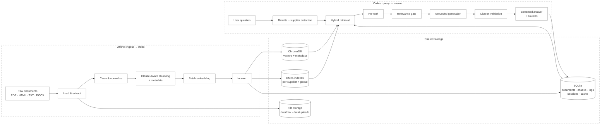
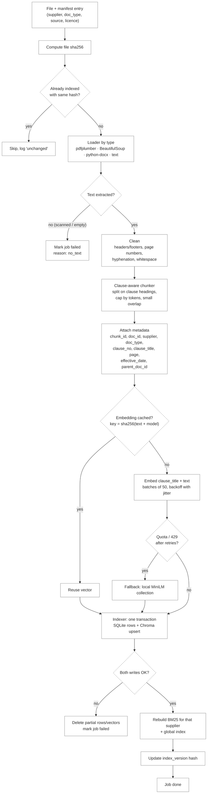
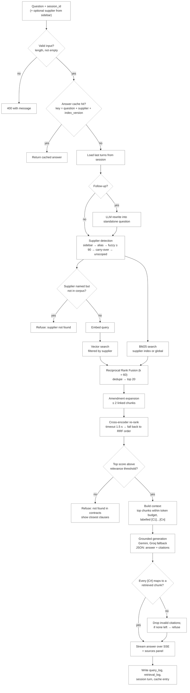
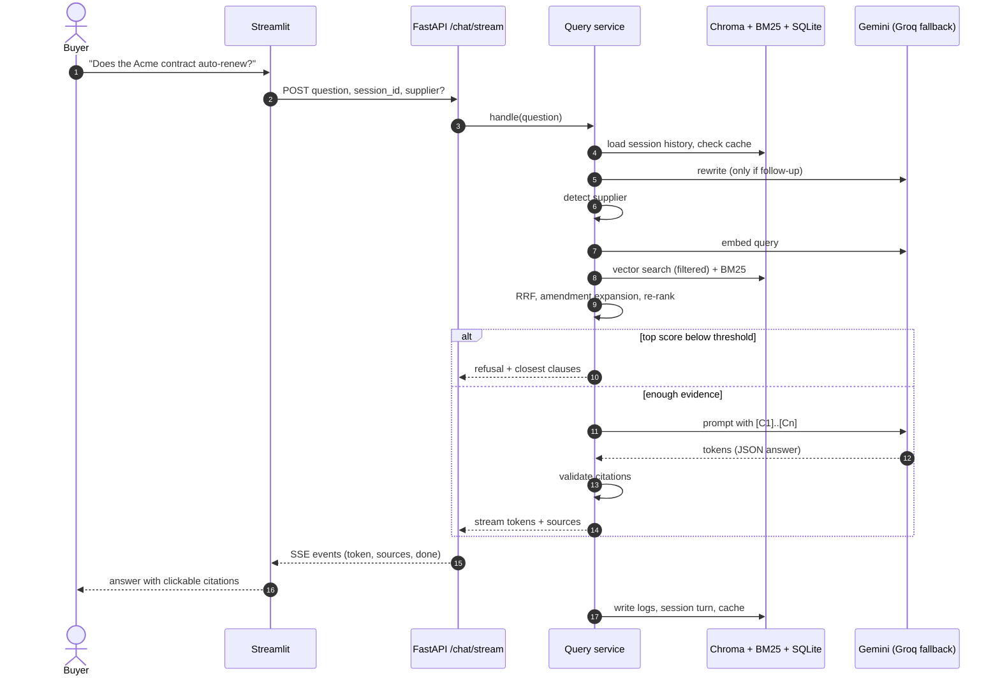

# Data Flow

This document traces how data moves through ClauseCheck. There are two flows and they meet at one shared storage layer:

- **Offline flow (ingest → index):** runs when we load the corpus or when a user uploads a document. It turns raw contracts into searchable clause chunks.
- **Online flow (query → answer):** runs on every question. It finds the right clauses and turns them into a cited answer, or refuses.

The offline flow writes to storage and the online flow only reads from it (apart from logs, cache and session history). Keeping that boundary strict is what lets us rebuild the index without touching the query path.

Related documents: `tdd.md` (components and APIs), `rag-architecture-design.md`, `chunking-strategy.md`, `retrieval-design.md`, `prompt-design.md`.

---

## 1. The big picture



---

## 2. Offline flow: ingest → index

### 2.1 When it runs

1. **Initial build.** We run `python -m ingest.run --source data/raw` over the full corpus (CUAD contracts, SEC EDGAR EX-10 exhibits, public DPAs/SLAs, and our synthetic supplier documents).
2. **User upload.** `POST /documents` saves the file and queues an ingest job. The job runs the same pipeline on one document.
3. **Re-index.** When we change the chunker or the embedding model, we rebuild into a new collection and switch over only after the eval run passes.

### 2.2 Flow diagram



### 2.3 Stage by stage

| # | Stage | Input | Output | Module |
|---|---|---|---|---|
| 1 | Register | file path + manifest row | `documents` row with status `pending` | `ingest/run.py` |
| 2 | Load | raw file | page-wise text and tables | `ingest/loaders.py` |
| 3 | Clean | page text | normalised text with page markers kept | `ingest/cleaner.py` |
| 4 | Chunk | clean text | list of clause chunks | `ingest/chunker.py` |
| 5 | Embed | chunk text | one vector per chunk | `ingest/embedder.py` |
| 6 | Index | chunks + vectors | SQLite rows, Chroma vectors, BM25 index | `ingest/indexer.py`, `store/*` |

**Load.** The loader is picked by file extension. PDF tables are pulled out separately and appended under their nearest heading so that pricing tables stay next to the clause that refers to them. If a PDF yields no text we stop there; we do not run OCR in this sprint.

**Clean.** We strip repeated page headers and footers, join words broken across lines, and collapse whitespace. We keep a page marker in the text so every chunk can still report the page it came from.

**Chunk.** We split on clause headings first (`7.2`, `Section 12`, `ARTICLE IV`, `Schedule B`). A clause longer than the token cap is split again with a small overlap; a very short clause is merged with its neighbour inside the same section. The reasoning is in `chunking-strategy.md`. Each chunk carries this metadata:

```json
{
  "chunk_id": "acme-msa-2023__7.2__0",
  "doc_id": "acme-msa-2023",
  "supplier": "Acme Industrial Supply",
  "doc_type": "MSA",
  "clause_no": "7.2",
  "clause_title": "Payment Terms",
  "page": 9,
  "effective_date": "2023-04-01",
  "parent_doc_id": null,
  "source": "synthetic",
  "token_count": 214
}
```

For an amendment, `parent_doc_id` points at the agreement it changes. The online flow uses this link to pull the amended clause next to the original.

**Embed.** We embed `clause_title + text`, not the bare text, because the title often holds the words people search with ("Termination for Convenience"). Calls go out in batches of 50 with exponential backoff and jitter. Every vector is cached by `sha256(text + model)`, so re-running ingest after a small fix costs almost nothing. If the free quota runs out, we write to a separate local MiniLM collection; the two are never mixed in one collection because the vectors are not comparable.

**Index.** SQLite and Chroma are written inside one logical transaction. If either write fails, we delete whatever was written for that document and mark the job failed, so we never end up with vectors that have no text row or the reverse. BM25 is not persisted; it is rebuilt from the SQLite `chunks` table at startup and after each successful job. Finally the `index_version` hash changes, which also invalidates the answer cache.

### 2.4 What ends up where

| Store | What it holds | Written by | Read by |
|---|---|---|---|
| File storage | original files (`data/raw`, `data/uploads`) | loader / upload endpoint | source viewer, re-index |
| SQLite `documents` | doc_id, supplier, doc_type, file hash, licence, status | register, indexer | `/documents`, supplier list |
| SQLite `chunks` | chunk text and all metadata | indexer | BM25 rebuild, citation display |
| ChromaDB | vector, chunk_id, filterable metadata | indexer | vector search |
| BM25 (memory) | tokenised chunks per supplier and global | rebuild at startup / after jobs | keyword search |
| SQLite `jobs` | ingest job status and error reason | ingest runner | upload status in UI |
| SQLite `embedding_cache` | hash → vector | embedder | embedder |

---

## 3. Online flow: query → answer

### 3.1 Flow diagram



### 3.2 Request sequence



### 3.3 Stage by stage

| # | Stage | Input | Output | Module |
|---|---|---|---|---|
| 1 | Validate + cache check | raw request | request object or cached answer | `api/routes/chat.py`, `rag/cache.py` |
| 2 | Query rewrite | question + last turns | standalone question | `rag/query_rewriter.py` |
| 3 | Supplier detection | standalone question, sidebar value | supplier or `None` | `rag/supplier_detector.py` |
| 4 | Hybrid retrieval | question, supplier | top 20 fused candidates | `rag/hybrid_retriever.py` |
| 5 | Amendment expansion | candidates | candidates + linked amendment/parent chunks | `rag/hybrid_retriever.py` |
| 6 | Re-rank | candidates | candidates with re-rank scores | `rag/reranker.py` |
| 7 | Relevance gate | scored candidates | pass, or refusal | `rag/relevance_gate.py` |
| 8 | Generation | context block + question | JSON answer with `[C#]` markers | `rag/generator.py` |
| 9 | Citation validation | JSON answer, context map | cleaned answer + source list | `rag/citation_validator.py` |
| 10 | Stream + log | final answer | SSE events, log rows | `api/routes/chat.py`, `rag/logger.py` |

**Rewrite.** We only call the LLM here when the question looks like a follow-up (pronouns, "and what about…", no supplier named while the previous turn had one). Otherwise the question passes through unchanged, which saves a call and a second of latency.

**Supplier detection.** The order matters: a supplier picked in the sidebar wins, then an exact alias match, then a fuzzy match at 90 or above, then the supplier from the previous turn, and only then do we search the whole corpus. If the user clearly names a supplier we do not have ("Supplier Q"), we refuse right away instead of retrieving clauses from some other supplier.

**Hybrid retrieval.** Vector search catches paraphrases ("how long do we have to pay" → "Net 45"). BM25 catches exact tokens that embeddings blur, such as `Net 45`, `7.2`, `A-114` and dollar amounts; its tokenizer keeps those as single protected tokens. Both lists are fused with Reciprocal Rank Fusion at k = 60, duplicates are removed, and the top 20 go on.

**Amendment expansion.** If a candidate chunk has an amendment pointing at it, or is itself an amendment, we add the linked chunk (at most two extra). This is how an answer can say "the original MSA says Net 30, but Amendment 2 dated 2024-01-15 changed it to Net 45".

**Re-rank.** A MiniLM cross-encoder scores each `(question, clause_title + text)` pair in one batch, truncated to 512 tokens. If it takes longer than 1.5 s we keep the RRF order and log the timeout rather than fail the request.

**Relevance gate.** If the best re-rank score is under `RELEVANCE_THRESHOLD`, we do not call the generator at all. The user gets a refusal plus the closest clauses we did find, so they can check for themselves. The threshold lives in config and we calibrate it on the eval set's answerable and unanswerable questions.

**Generation.** The context is built from the top chunks until the token budget is used, each labelled `[C1]`, `[C2]` and so on with supplier, document, clause number and page. The prompt (see `prompt-design.md`) tells the model to answer only from that context, cite every claim, and return JSON:

```json
{
  "answer": "Yes. The Acme MSA renews automatically for one-year terms unless either party gives 60 days' written notice [C1].",
  "citations": ["C1"],
  "answerable": true
}
```

Gemini is the primary model. On a 429 or timeout after retries, the same prompt goes to Groq.

**Citation validation.** Every `[C#]` in the answer must map to a chunk we actually sent. Invalid markers are removed. If removing them leaves an answer with no valid citations, we turn it into a refusal. If the model itself returned `"answerable": false`, we pass that through as a refusal.

**Stream and log.** The answer goes to the UI over Server-Sent Events as `token`, `sources` and `done` events. After the stream closes we write the session turn, the cache entry and two log rows.

### 3.4 Refusal paths

There are four places where a question can end without a generated answer. We track each one separately in `query_log.outcome` so the eval report can tell them apart.

| Outcome | Where | Message to user |
|---|---|---|
| `refused_unknown_supplier` | supplier detection | We don't have contracts for that supplier. |
| `refused_low_relevance` | relevance gate | Not found in the contracts; here are the closest clauses. |
| `refused_model` | generator returned `answerable: false` | The retrieved clauses don't answer this. |
| `refused_no_valid_citation` | citation validation | Same as above, logged separately so we can spot prompt issues. |

---

## 4. Logging and feedback data

The online flow writes three kinds of rows. They are what we use for debugging and for the evaluation report.

| Table | One row per | Main fields |
|---|---|---|
| `query_log` | question | session_id, raw and rewritten question, supplier, outcome, model used, latency per stage, tokens in/out, index_version |
| `retrieval_log` | candidate chunk per question | chunk_id, vector rank, BM25 rank, RRF score, re-rank score, sent to model (yes/no), cited (yes/no) |
| `feedback` | thumbs up/down from the UI | query_id, rating, optional comment |

When a question goes wrong, `retrieval_log` tells us which stage lost the right clause. If it never appears in the vector or BM25 ranks, the problem is chunking or retrieval. If it appears in the top 20 but drops after re-ranking, the problem is the re-ranker. If it was sent to the model but not cited, the problem is the prompt.

We never log API keys, and we do not send anything to the LLM providers except the question and the retrieved chunks.

---

## 5. Worked example

Question: *"And what about their notice period?"*, asked right after *"Does the Acme contract auto-renew?"*

1. **Cache:** miss.
2. **Rewrite:** follow-up detected → "What is the termination notice period in the Acme Industrial Supply contract?"
3. **Supplier:** no sidebar value, no alias in the original text, carry-over from previous turn → `Acme Industrial Supply`.
4. **Retrieval:** vector search (filtered to Acme) and Acme's BM25 index each return 20 chunks; RRF merges them.
5. **Expansion:** clause 14.1 of the MSA has an amendment linked to it → the amendment chunk is added.
6. **Re-rank:** MSA 14.1 "Term and Renewal" and Amendment 1 §3 come out on top.
7. **Gate:** top score is above the threshold → pass.
8. **Generation:** "The MSA requires 60 days' written notice before the renewal date [C1]. Amendment 1, effective 2024-03-01, shortened this to 30 days [C2]."
9. **Validation:** C1 and C2 both map to sent chunks → keep.
10. **Stream:** answer plus two source cards (supplier, document, clause, page). Logs written with outcome `answered`.

---

## 6. Where the two flows touch

| Shared item | Offline side | Online side |
|---|---|---|
| Embedding model name | chooses the Chroma collection | query must use the same model and collection |
| Chunk metadata schema | written by chunker | used for filters, expansion and source cards |
| BM25 tokenizer | builds the index | must tokenise queries the same way |
| `index_version` | changes after every successful job | part of the cache key, so stale answers expire |
| Supplier aliases | loaded from the manifest | used by supplier detection |

If any of these change on one side, the other side has to change in the same PR. That is the main thing to check in review for changes under `ingest/` or `store/`.
