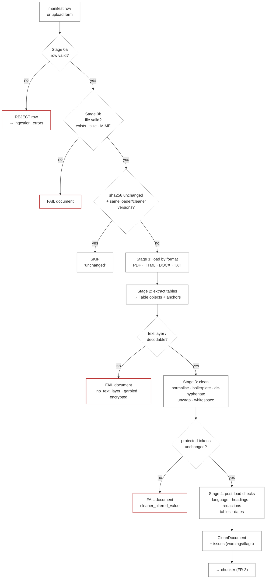
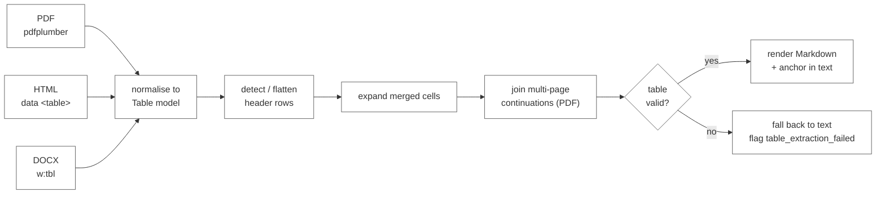
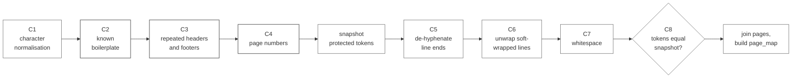

# ClauseCheck: Ingestion Pipeline

Sprint 2, Simulated Work (AI Application Development with RAG)
Repo: `FirstName_ClauseCheck_Kalvium-Community`
See also: [rag-architecture-design.md](rag-architecture-design.md) (sections 6.1–6.2), [tdd.md](tdd.md) (sections 5.1–5.2, 7.2), [data-sourcing.md](../data/data-sourcing.md) (sections 9–11), [functional-requirements.md](../requirements/functional-requirements.md) (FR-1, FR-2), [data-flow.md](data-flow.md) (section 2)

| | |
|---|---|
| **Document type** | Component design (Workstream A) |
| **Version** | 1.0 |
| **Date** | 2026-10-01 |
| **Status** | Draft for M1 review |
| **Covers** | Loaders per format, table extraction, cleaning, validation |
| **Does not cover** | Clause chunking (FR-3), embedding (NFR-4), indexing. These start where this document ends: at a validated `CleanDocument`. |

If this document disagrees with [rag-architecture-design.md](rag-architecture-design.md), the RAG design wins and this document is updated. Section 13 lists the places where earlier drafts disagreed and how this document resolves them.

---

## Contents

1. [Purpose and boundaries](#1-purpose-and-boundaries)
2. [Pipeline at a glance](#2-pipeline-at-a-glance)
3. [Data contracts](#3-data-contracts)
4. [Stage 0: manifest and file validation](#4-stage-0-manifest-and-file-validation)
5. [Stage 1: loaders per format](#5-stage-1-loaders-per-format)
6. [Stage 2: table extraction](#6-stage-2-table-extraction)
7. [Stage 3: cleaning](#7-stage-3-cleaning)
8. [Stage 4: post-load validation](#8-stage-4-post-load-validation)
9. [Issue codes and outcomes](#9-issue-codes-and-outcomes)
10. [Ingestion report](#10-ingestion-report)
11. [Configuration](#11-configuration)
12. [Testing](#12-testing)
13. [Resolved inconsistencies between earlier drafts](#13-resolved-inconsistencies-between-earlier-drafts)
14. [Known limitations](#14-known-limitations)

---

## 1. Purpose and boundaries

The ingestion pipeline turns a file listed in `data/manifest.csv` (or uploaded through `POST /documents`) into a **`CleanDocument`**: cleaned text with a character-offset → page map, a list of extracted tables in Markdown, document metadata and a list of issues. The chunker consumes nothing else.

Three rules shape every design choice below:

| Rule | Why | Enforced by |
|---|---|---|
| **Never change a value.** Numbers, currency symbols, dates, ranges (`500–999`), SKU codes and clause numbering leave cleaning byte-for-byte identical. | Buyers act on exact values; a cleaner that "tidies" `forty-five (45)` or turns `–` into `-` silently breaks exact-value answers. | Protected-token invariant (7.8), AC-1.5, AC-2.2 |
| **Fail loudly, per document.** A bad file fails on its own; it never stops the run, and it never lands half-indexed. | NFR-3 reproducibility; one broken EDGAR exhibit must not block 199 good contracts. | Issue model (section 9), indexer transaction ([tdd.md](tdd.md) 13) |
| **Same input, same output.** Loaders and cleaner are deterministic and versioned. | Re-running ingest on an unchanged manifest must create 0 chunks and 0 embedding calls (AC-1.9). | `sha256` skip, `LOADER_VERSION`, `CLEANER_VERSION` |

Module layout (from [tdd.md](tdd.md) section 17):

```text
clausecheck/ingest/
├── __main__.py        # CLI: python -m clausecheck.ingest
├── manifest.py        # Stage 0: manifest + file validation          (new file)
├── loaders/           # Stage 1 + 2: one module per format           (was loaders.py)
│   ├── __init__.py    #   registry: format → loader
│   ├── base.py        #   RawDocument, Page, Table, Loader protocol
│   ├── pdf.py
│   ├── html.py
│   ├── docx.py
│   ├── txt.py
│   └── tables.py      #   shared table model, Markdown renderer, table validation
├── cleaner.py         # Stage 3
├── validate.py        # Stage 4: post-load checks                    (new file)
├── report.py          # ingestion report                             (new file)
├── chunker.py         # FR-3, out of scope here
├── embedder.py
└── indexer.py
```

Splitting `loaders.py` into a package keeps each format's quirks testable in isolation. The public import path stays the same (`from clausecheck.ingest.loaders import load`).

---

## 2. Pipeline at a glance



| # | Stage | Input | Output | Module | Requirement |
|---|---|---|---|---|---|
| 0a | Manifest validation | CSV row / upload form | `ManifestRow` or `REJECT` | `manifest.py` | AC-1.3 |
| 0b | File validation | file path | `FileInfo` (size, MIME, sha256) or `FAIL` | `manifest.py` | AC-1.2, NFR-7 |
| 1 | Load | file + `ManifestRow` | `RawDocument` (pages, table regions) | `loaders/*` | FR-1, AC-1.1, 1.4, 1.6, 1.7, 1.8 |
| 2 | Table extraction | `RawDocument` | `Table` list + `[[TABLE:tN]]` anchors in page text | `loaders/*`, `loaders/tables.py` | FR-2, AC-2.1–2.3 |
| 3 | Clean | `RawDocument` | `CleanDocument` with page map | `cleaner.py` | AC-1.5 |
| 4 | Post-load validation | `CleanDocument` | issues attached | `validate.py` | AC-1.10, data-sourcing 11 |

Stages 1 and 2 run together inside each loader (tables are located while the page is open), but they are described separately because table extraction has its own model and its own validation.

---

## 3. Data contracts

All contracts are Pydantic models in `loaders/base.py`. They are the only thing passed between stages, which is what lets each stage be unit-tested with hand-built inputs.

```python
class ManifestRow(BaseModel):
    doc_id: str                     # e.g. ACME-MSA-2021
    supplier: str                   # normalised supplier_id, must exist in suppliers.csv
    doc_type: DocType               # msa | sow | supply | service | amendment | price_schedule
                                    # | dpa | sla | nda | certificate
    effective_date: date | None
    expiry_date: date | None        # certificates only
    parent_doc_id: str | None       # required when doc_type == amendment
    source: Literal["cuad", "edgar", "vendor_public", "synthetic", "upload"]
    source_url: str
    license: str
    format: Literal["pdf", "html", "txt", "docx"]
    is_synthetic: bool
    file_path: Path

class FileInfo(BaseModel):
    sha256: str
    size_bytes: int
    detected_mime: str
    retrieved_at: datetime | None   # vendor documents, from fetch_log.csv

class Page(BaseModel):
    number: int | None              # real page number; None for HTML/TXT (decision D3)
    text: str                       # raw text, table regions replaced by [[TABLE:tN]] anchors

class Table(BaseModel):
    table_id: str                   # t1, t2, ... in document order
    page_start: int | None
    page_end: int | None
    header: list[str]               # one flattened header row
    rows: list[list[str]]           # every row has len(header) cells
    caption: str | None             # nearest preceding heading / caption line
    source_format: str
    flags: set[str]                 # merged_cells, synthetic_header, multi_page, ...
    markdown: str                   # rendered once, by tables.render_markdown()

class RawDocument(BaseModel):
    manifest: ManifestRow
    file: FileInfo
    pages: list[Page]
    tables: list[Table]
    heading_hints: list[int]        # char offsets of DOCX "Heading N" paragraphs (optional)
    loader_version: str
    issues: list[Issue]

class CleanDocument(BaseModel):
    manifest: ManifestRow
    file: FileInfo
    text: str                       # all pages joined with "\n\n"
    page_map: list[tuple[int, int, int | None]]   # (start_offset, end_offset, page_number)
    tables: list[Table]
    heading_hints: list[int]
    redaction_count: int
    loader_version: str
    cleaner_version: str
    issues: list[Issue]

class Issue(BaseModel):
    code: str                       # see section 9
    severity: Literal["reject", "fail", "warn", "flag"]
    stage: str
    detail: str
    page: int | None = None
```

**Why a page map instead of inline page markers.** [data-flow.md](data-flow.md) mentions keeping page markers in the text. Markers would be embedded, BM25-indexed and shown to the LLM as if they were contract text. A side table of offsets gives the chunker the same information (`page_start`, `page_end` per chunk, AC-1.4) without polluting chunk text.

**Why table anchors.** A table is removed from the flowing text and replaced by a single line `[[TABLE:t3]]` at the position where it appeared. The chunker turns each anchor into a table chunk and uses the text immediately before the anchor to find the preceding heading (AC-2.3). The anchor itself never reaches a chunk.

---

## 4. Stage 0: manifest and file validation

### 4.1 Manifest row rules (AC-1.3)

Every rule produces a `REJECT` with its own code. A rejected row is written to the `ingestion_errors` table and the report; **other rows in the same run still load**.

| Code | Rule | Example of a failing row |
|---|---|---|
| `missing_license` | `license` empty | vendor row with no licence text |
| `missing_source_url` | `source_url` empty | hand-downloaded file with no URL |
| `unknown_supplier` | `supplier` not in `data/suppliers.csv` | `acme-industrail` (typo) |
| `invalid_enum` | `doc_type`, `source` or `format` not in the allowed list | `format = xlsx` |
| `amendment_without_parent` | `doc_type = amendment` and `parent_doc_id` empty | |
| `unknown_parent` | `parent_doc_id` not a `doc_id` in the manifest (or already indexed) | amendment pointing at a dropped original |
| `duplicate_doc_id` | `doc_id` appears more than once | both rows rejected, so the run is never order-dependent |
| `bad_date` | `effective_date` / `expiry_date` not ISO `YYYY-MM-DD` | `01/04/2023` |
| `certificate_without_expiry` | `doc_type = certificate` and no `expiry_date` | needed for code-computed validity (ADR-09) |
| `format_mismatch` | file extension does not match `format` | `format = pdf`, file `x.htm` |

`unknown_parent` is checked against the **whole manifest first**, then against already-indexed documents, so an amendment listed above its original in the CSV is still valid. Rows are then processed in dependency order (originals before their amendments) so that `parent_doc_id` always resolves to an indexed document by the time the amendment's chunks are written.

### 4.2 File checks

| Code | Check | Severity |
|---|---|---|
| `file_missing` | `file_path` does not exist | fail |
| `file_too_large` | size > `UPLOAD_MAX_MB` (20 MB) | fail |
| `empty_file` | size = 0 | fail |
| `mime_mismatch` | `python-magic` MIME is not compatible with `format` (table below) | fail |
| `docx_zip_bomb` | DOCX uncompressed size > `DOCX_MAX_UNCOMPRESSED_MB` (100 MB) or > 1,000 zip entries | fail |
| `vendor_hash_changed` | vendor document's sha256 differs from `fetch_log.csv` | warn; file is **not** replaced silently ([data-sourcing.md](../data/data-sourcing.md) 6.4) |

| `format` | Accepted MIME types |
|---|---|
| `pdf` | `application/pdf` |
| `html` | `text/html`, `application/xhtml+xml`, `text/xml` (some EDGAR exhibits) |
| `txt` | `text/plain` (EDGAR `.txt` with an SGML wrapper is detected as `text/plain` or `text/html`; both accepted, see 5.4) |
| `docx` | `application/vnd.openxmlformats-officedocument.wordprocessingml.document`, `application/zip` (older `libmagic`) |

### 4.3 Change detection (AC-1.9)

```text
skip_key = sha256(file bytes) + LOADER_VERSION + CLEANER_VERSION + CHUNKER_VERSION
```

If the `documents` table already holds the same `skip_key` for this `doc_id` and the document's last status is `completed`, the document is skipped with outcome `unchanged`: no loading, no chunks, no embedding calls. Bumping a loader or cleaner version therefore re-processes every document of that format on the next run, which is exactly what we want after a parsing fix. (The embedding cache still prevents re-embedding chunks whose text did not change.)

### 4.4 Upload path (FR-9)

Uploads go through the same Stage 0 with three differences:

1. The `ManifestRow` is built from the form fields (`supplier`, `doc_type`, `effective_date`, `parent_doc_id`), with `source = "upload"`, `license = "uploaded by user"` and `source_url = "upload://<job_id>"`.
2. The file is saved under a generated name (`data/uploads/<job_id>.<ext>`) before validation, so a filename can never be used for path traversal.
3. A `REJECT` or `FAIL` sets the job status to `failed` with the issue code as `error`, which the UI shows next to the upload.

---

## 5. Stage 1: loaders per format

### 5.1 Loader interface and registry

```python
class Loader(Protocol):
    format: str
    version: str                                  # bump on any behaviour change
    def load(self, path: Path, row: ManifestRow, info: FileInfo) -> RawDocument: ...

LOADERS: dict[str, Loader] = {
    "pdf":  PdfLoader(),    # loaders/pdf.py
    "html": HtmlLoader(),   # loaders/html.py
    "docx": DocxLoader(),   # loaders/docx.py
    "txt":  TxtLoader(),    # loaders/txt.py
}

def load(path, row, info) -> RawDocument:
    return LOADERS[row.format].load(path, row, info)
```

The loader is chosen by the manifest `format`, already cross-checked against the extension and MIME type in Stage 0, never by sniffing alone.

### 5.2 Summary by format

| | PDF | HTML / HTM | DOCX | TXT |
|---|---|---|---|---|
| **Library** | PyMuPDF (`fitz`) for text, pdfplumber for tables | BeautifulSoup with `lxml` | python-docx | stdlib + `chardet` |
| **Sources in corpus** | CUAD PDFs, some EDGAR, vendor PDFs, synthetic schedules and certificates | EDGAR exhibits, vendor DPA/SLA pages | synthetic documents, uploads | CUAD `.txt` subset (~20%), EDGAR `.txt` |
| **Page numbers** | real, from the file | none (D3) | explicit page breaks only, else none | none (D3) |
| **Tables** | pdfplumber `find_tables()` | `<table>` elements that pass the data-table test | `document.tables` | none |
| **Main hazards** | repeated headers/footers, no text layer, CID-garbled fonts, tables duplicated in text | layout tables, cookie banners, nav menus, `&nbsp;` everywhere | auto-numbered headings lost, merged cells | wrong encoding, SGML wrapper, form feeds |
| **Fails with** | `encrypted`, `no_text_layer`, `garbled_text` | `empty_after_strip` | `corrupt_docx` | `undecodable` |

### 5.3 PDF loader (`loaders/pdf.py`)

**Text.** For each page, PyMuPDF extracts text **blocks** with their bounding boxes (`page.get_text("blocks", sort=True)`). Using blocks rather than a single string lets us drop the blocks that fall inside a table region, so table values are not duplicated into the flowing text.

**Steps per page**

1. Open with PyMuPDF. If `doc.needs_pass` → fail `encrypted`.
2. Ask pdfplumber for table regions on the same page (section 6.2). Each accepted table gets an id `tN` and a bounding box.
3. Read text blocks. A block whose area overlaps a table box by ≥ `TABLE_BLOCK_OVERLAP` (50%) is dropped. The first dropped block of each table is replaced by the anchor line `[[TABLE:tN]]`, so the anchor sits where the table was in reading order.
4. Join the remaining blocks with `\n`. Record `Page(number = page.number + 1, text = ...)`.

```python
def _page_text(page, table_boxes: dict[str, Rect]) -> str:
    out, placed = [], set()
    for x0, y0, x1, y1, text, *_ in page.get_text("blocks", sort=True):
        block = fitz.Rect(x0, y0, x1, y1)
        hit = next((tid for tid, box in table_boxes.items()
                    if _overlap(block, box) >= settings.TABLE_BLOCK_OVERLAP), None)
        if hit is None:
            out.append(text.rstrip())
        elif hit not in placed:
            out.append(f"[[TABLE:{hit}]]")
            placed.add(hit)
    return "\n".join(out)
```

**Text-layer check (AC-1.8).** After all pages are read:

| Condition | Result |
|---|---|
| more than `SCANNED_PAGE_RATIO` (50%) of pages have fewer than `SCANNED_MIN_CHARS` (20) non-whitespace characters | fail `no_text_layer` (report text: `skipped: no text layer (scanned)`); **no OCR** |
| some, but ≤ 50%, of pages are below the threshold | warn `low_text_pages` with the page list (signature pages, blank pages and image-only exhibits are normal) |
| `(cid:NN)` sequences or U+FFFD make up more than `GARBLED_RATIO` (5%) of characters | fail `garbled_text` (font without a usable ToUnicode map; text would be meaningless to embed) |

**Why PyMuPDF for text and pdfplumber only for tables.** PyMuPDF is several times faster on the ~150 CUAD PDFs and preserves reading order well with `sort=True`. pdfplumber's table finder is better than PyMuPDF's on ruled price tables, which is the one thing we need it for. This split is what [rag-architecture-design.md](rag-architecture-design.md) 6.2 specifies.

### 5.4 HTML loader (`loaders/html.py`)

Covers EDGAR `.htm` exhibits and vendor DPA/SLA pages. HTML is **parsed, never rendered**, and no script is executed (AC-1.6, security section 14).

**Steps**

1. **Decode.** Bytes are decoded using, in order: BOM, `<meta charset>`, HTTP charset recorded in `fetch_log.csv`, then `chardet`. EDGAR exhibits are frequently `windows-1252`.
2. **Parse** with `BeautifulSoup(html, "lxml")`.
3. **Remove non-content elements entirely** (tag and contents):
   `script, style, noscript, template, nav, header, footer, aside, form, button, svg, iframe, object, embed`, plus any element with `role` in {`navigation`, `banner`, `contentinfo`} or whose `id`/`class` matches `cookie|consent|banner|newsletter|breadcrumb|skip-link` (case-insensitive).
4. **Pick the content root.** If the page has exactly one `<main>` or `<article>`, use it; otherwise use `<body>`. This is what removes most vendor-site chrome.
5. **Classify each `<table>`** as a data table or a layout table (section 6.4). Data tables are extracted and replaced in the tree with a `<p>[[TABLE:tN]]</p>`. Layout tables are unwrapped: each cell becomes a block of text.
6. **Serialise to text** by walking the tree: block-level elements (`p, div, li, h1–h6, tr, blockquote, pre, section`) start a new line; `<br>` becomes `\n`; `<li>` keeps a `- ` prefix only when the list is not already numbered in its text; inline elements are concatenated. `&nbsp;` is decoded to U+00A0 here and normalised in the cleaner.
7. **Pages.** One `Page(number=None, ...)` for the whole document (decision D3). EDGAR `<hr>` / `page-break-before` styles are treated as paragraph breaks, not pages.

If the resulting text has fewer than `MIN_DOC_CHARS` (500) characters → fail `empty_after_strip` (typically a JavaScript-rendered vendor page whose content is not in the HTML; the fix is to record a PDF version or an Internet Archive snapshot in the manifest).

**EDGAR wrapper.** Some EDGAR `.htm` and most `.txt` downloads are full submission files containing several `<DOCUMENT>` blocks. Both the HTML and TXT loaders first look for `<DOCUMENT>…<TYPE>EX-10…<TEXT>…</TEXT>` and keep only the exhibit's `<TEXT>` body. If several EX-10 documents are present, the one whose `<FILENAME>` matches the manifest's `source_url` is used; otherwise fail `ambiguous_edgar_submission`.

### 5.5 DOCX loader (`loaders/docx.py`)

Used for synthetic documents (generated by `scripts/generate_synthetic.py`) and user uploads.

**Steps**

1. Open with `python-docx`. A `BadZipFile` / `PackageNotFoundError` → fail `corrupt_docx`.
2. **Walk the body in document order.** `document.paragraphs` and `document.tables` are separate lists and lose their interleaving, so the loader iterates `document.element.body.iterchildren()` and dispatches on `w:p` (paragraph) and `w:tbl` (table). Each table is extracted (section 6.5) and replaced by its anchor at that position.
3. **Headings.** A paragraph whose style name starts with `Heading` or `Title` is recorded in `heading_hints` (its character offset). The chunker treats these as headings even when they have no number (common in uploads: "Payment Terms" set in Heading 2).
4. **Page breaks.** `w:br w:type="page"` and `w:pageBreakBefore` start a new `Page`. If the document contains none, it is a single `Page(number=None)`. `w:lastRenderedPageBreak` is ignored: it reflects whatever printer Word last used, not the document.
5. **Headers and footers** (`section.header`, `section.footer`) are not read. They are page furniture by definition in DOCX, so there is nothing to clean later.
6. **Text boxes, footnotes and comments** are not read in this sprint (warn `docx_unread_parts` if present).

**Auto-numbering hazard.** Word's automatic list numbering (`w:numPr`) is not part of the paragraph text, so python-docx returns "Payment Terms" where the reader sees "7.2 Payment Terms". The clause number would be lost from both the chunker's heading regex and the citations. Mitigations:

- `generate_synthetic.py` writes clause numbers as literal text, never as list numbering.
- For any paragraph with `w:numPr` and a heading style, the loader emits flag `auto_numbering_lost`, and the ingestion report lists the document so a team member can decide whether to convert it (re-save with numbering as text) before relying on its citations.

Reconstructing Word numbering from `numbering.xml` is possible but fiddly; it is listed as future work.

### 5.6 TXT loader (`loaders/txt.py`)

Used for the CUAD `full_contract_txt/` subset and EDGAR `.txt` exhibits.

1. **Decode (AC-1.7).** Try strict UTF-8 (with BOM handling). On `UnicodeDecodeError`, run `chardet` on the bytes; accept its guess if confidence ≥ `CHARDET_MIN_CONFIDENCE` (0.6), else try `windows-1252`, then `latin-1`. The decoded text must contain no U+FFFD replacement characters; if it does → fail `undecodable`. The chosen encoding is stored on the issue list as `info: decoded_as=<enc>` for traceability.
2. **Strip the EDGAR SGML wrapper** if present (5.4).
3. **Form feeds** (`\f`) become paragraph breaks. They are not trusted as page numbers (D3: TXT has no pages).
4. One `Page(number=None, text=...)`.

TXT has no table extraction. Pricing tables only appear in PDF, HTML and DOCX in our corpus; a fixed-width text table in an EDGAR `.txt` stays as text and BM25 still matches its values literally.

---

## 6. Stage 2: table extraction

### 6.1 Why tables get their own path

Pricing questions ("unit price of A-114 at 500 units?") are answered from tables. A table flattened into running text loses the link between a value and its column ("500–999 · $11.40" becomes a bag of numbers), and a table split mid-row by a token window separates a price from its tier. So tables are extracted into one common model, validated, rendered as Markdown with the header row, and handed to the chunker separately (FR-2).



### 6.2 PDF tables (pdfplumber)

```python
LINES = {"vertical_strategy": "lines", "horizontal_strategy": "lines",
         "snap_tolerance": 3, "join_tolerance": 3, "intersection_tolerance": 3}
TEXT  = {"vertical_strategy": "text",  "horizontal_strategy": "text",
         "min_words_vertical": 3, "min_words_horizontal": 1}

def find_tables(plumber_page, doc_type):
    found = plumber_page.find_tables(LINES)
    if not found and doc_type in {"price_schedule", "sla"}:
        found = plumber_page.find_tables(TEXT)      # only where tables are expected
    return [t for t in found if _accept(t)]
```

- **Ruled tables first.** The `lines` strategy uses drawn ruling lines and is reliable on synthetic schedules and most vendor SLA PDFs.
- **Whitespace tables only where expected.** The `text` strategy finds tables from column alignment, which also "finds" tables in ordinary two-column contract layouts and signature blocks. So it runs only for `price_schedule` and `sla` documents, and its output must pass the validation in 6.7 plus a numeric-column check (at least one column with ≥ 60% numeric cells).
- **Cell text.** pdfplumber returns `None` for empty cells; these become `""`. Newlines inside a cell are replaced by a single space (Markdown cells cannot hold line breaks).
- **Multi-page tables.** A table that starts within `TABLE_CONTINUATION_TOP_PT` (72 pt) of the top of page *n+1*, has the same column count as the last table on page *n*, and either repeats its header or has no header of its own, is merged into it. The merged table gets `page_start`, `page_end` and flag `multi_page`. If the continuation repeats the header, the repeated row is dropped.

### 6.3 Header detection (all formats)

1. **Explicit header.** HTML `<thead>`/`<th>` cells, or DOCX rows marked `w:tblHeader` (repeat-as-header-row), are the header.
2. **Inferred header.** Otherwise row 0 is the header if every non-empty cell is non-numeric text and at least one later row contains a numeric cell.
3. **Multi-row headers.** If rows 0 and 1 are both header-like and row 0 has merged cells, they are flattened column by column with ` / `: `Volume tier / Min`, `Volume tier / Max`, `Unit price (USD)`.
4. **No header found.** Columns are named `col_1 … col_n`, the table gets flag `synthetic_header`, and the report lists it. Retrieval still works on the values, but answers from such tables deserve a manual check during eval.

### 6.4 HTML data table vs layout table

EDGAR filings often wrap the **entire contract** in a `<table>` for layout, and signature blocks are frequently two-column tables. Treating those as data tables would turn clauses into one giant Markdown cell. A `<table>` is a **data table** only if all of these hold:

| Test | Threshold |
|---|---|
| It contains no nested `<table>` | — |
| Rows with ≥ 2 non-empty cells | ≥ 2 rows |
| Most common row width | ≥ 2 columns, shared by ≥ 70% of rows |
| Longest cell text | ≤ `TABLE_MAX_CELL_CHARS` (300) characters |
| It is not a signature block | does not match `By:\s*_+|Name:|Title:|IN WITNESS WHEREOF` in its text |

Anything else is a layout table and is unwrapped into text blocks (cell by cell, row by row). `rowspan`/`colspan` are honoured when building the grid (6.6).

### 6.5 DOCX tables

python-docx exposes merged cells by returning the same underlying `<w:tc>` object for every grid position it spans. The loader builds the grid from `table.rows[i].cells` and detects merges by object identity (`cell._tc`), which feeds the merged-cell rule in 6.6. Nested tables inside a cell are flattened to text inside that cell (rare in our corpus).

### 6.6 Merged cells

A merged cell's value is **repeated into every grid position it covers**, and the table gets flag `merged_cells`.

Example, a vendor SLA credit table:

| Monthly uptime | Service credit |
|---|---|
| < 99.9% but ≥ 99.0% | 10% |
| < 99.0% but ≥ 95.0% | 25% |
| < 95.0% | 100% |

If "Service credit" spans two header columns (`Service credit` over `Standard` / `Premium`), the flattened header becomes `Service credit / Standard`, `Service credit / Premium`. Repeating the spanning value keeps every row self-contained, which is what lets a row be read correctly even after the table is split by rows in the chunker. Values are never invented: repetition only copies a value that the source visibly applies to those cells.

### 6.7 Table validation

A table is accepted only if all checks pass. A table that fails is **not dropped**: its text is put back into the flowing page text at the anchor position (so nothing is lost), and the document gets flag `table_extraction_failed` with the table's page.

| Check | Rule | Why |
|---|---|---|
| Shape | ≥ 2 rows (including header) and ≥ 2 columns | 1-row or 1-column "tables" are usually headings or lists |
| Rectangular | after merge expansion, every row has exactly `len(header)` cells | AC-2.1 |
| No empty columns | every column has at least one non-empty cell | catches mis-split columns from the `text` strategy |
| Values present in source (PDF) | every non-empty cell's text (whitespace-normalised) occurs in the page's raw characters | catches cells split mid-number (`1,25` / `0.00`) |
| Not a duplicate | not identical to the previous table (same header and rows) | multi-page repeats, HTML responsive duplicates |

### 6.8 Markdown rendering

```python
def render_markdown(t: Table) -> str:
    esc = lambda s: s.replace("\\", "\\\\").replace("|", "\\|").strip()
    head = "| " + " | ".join(esc(h) for h in t.header) + " |"
    sep  = "|" + "|".join("---" for _ in t.header) + "|"
    body = ["| " + " | ".join(esc(c) for c in row) + " |" for row in t.rows]
    return "\n".join([head, sep, *body])
```

- Cell values are copied exactly (AC-2.2): currency symbols, thousands separators, en dashes in ranges and footnote markers stay as they are. Only `|` and `\` are escaped.
- The caption (nearest preceding heading or a line such as "Schedule B – Volume Pricing") is stored on the `Table`, not inside the Markdown. The chunker prepends it when it builds the table chunk (AC-2.3).
- Splitting large tables by rows and repeating the header is the chunker's job (AC-2.4). This stage always delivers whole tables.

---

## 7. Stage 3: cleaning

### 7.1 Order of operations

Cleaning runs per page, in a fixed order. The order matters: boilerplate must be removed before de-hyphenation (or a page number could be joined to a word), and the invariant check must run only over steps that are not supposed to remove content.



C2–C4 are **removal** steps (they may delete whole lines). C5–C7 are **preserving** steps (they may only change whitespace and line-end hyphens). The protected-token invariant (C8) compares the text after C4 with the text after C7.

### 7.2 C1: character normalisation

| Input | Output | Note |
|---|---|---|
| `\r\n`, `\r` | `\n` | |
| U+00A0 no-break space, U+2007, U+202F | space | EDGAR HTML is full of `&nbsp;` |
| U+200B, U+200C, U+200D, U+FEFF | removed | zero-width characters break BM25 tokens |
| U+00AD soft hyphen | removed | invisible in the source; always a line-break hint |
| ligatures U+FB00–U+FB06 (`fi`, `fl`, …) | `fi`, `fl`, … | common in PDF text layers |
| control characters (except `\n`, `\t`, `\f`) | removed | |
| `\t` | space | |
| curly quotes `‘ ’ “ ”` | straight `' "` | helps BM25 match `Buyer's` typed by users |

**Deliberately not done:**

- **No Unicode NFKC.** NFKC rewrites characters inside values (`½` → `1⁄2`, superscripts, full-width digits) and would violate AC-1.5.
- **No dash normalisation.** `–` (en dash) in `500–999` and `—` stay as they are (AC-2.2). The BM25 tokenizer, not the cleaner, decides how dashes match.
- **No case changes, no spelling fixes, no number-word conversion.** `forty-five (45)` stays exactly that.

### 7.3 C2: known boilerplate

Exact patterns for boilerplate we know is in the corpus. Each pattern removes the **whole line** and is applied only to lines in the first or last `EDGE_LINES` (4) lines of a page, so the same words inside a clause are never touched.

| Source | Pattern (case-insensitive) |
|---|---|
| CUAD / EDGAR-derived PDFs | `^Source:\s+.+,\s+(8-K|10-K|10-Q|S-1|10-K405|.+),\s+\d{1,2}/\d{1,2}/\d{2,4}$` |
| CUAD PDFs | `^Powered by Morningstar.*Document Research` and the copyright disclaimer line that follows it |
| EDGAR | `^Table of Contents$` when it is the only text on an edge line |
| Synthetic documents | the generator's own footer `^ClauseCheck synthetic document — not a real contract$` is **kept** (it is the visible synthetic label) |

The list lives in `clausecheck/ingest/boilerplate.yaml` so it can grow without code changes; every pattern has a test fixture line.

### 7.4 C3: repeated headers and footers

For multi-page PDFs (≥ 3 pages):

1. Take the first and last `EDGE_LINES` (4) non-empty lines of every page.
2. Normalise each for comparison only: lowercase, collapse spaces, replace every digit run with `#` (so "Page 3 of 12" and "Page 4 of 12" compare equal, as do "Acme MSA – 2021 – 3" variants).
3. A normalised line that occurs on ≥ `HEADER_FOOTER_MIN_PAGE_RATIO` (50%) of pages, at the same edge (top or bottom), is boilerplate. Remove those lines from every page where they occur at that edge.
4. **Never remove** a line that matches a clause heading pattern (the chunker's heading regex is imported, not copied) or that contains a redaction marker. This protects the rare document whose running header is the article title.

### 7.5 C4: page numbers

A line is a page number and is removed if it is an edge line **and** matches one of:

```text
^\s*\d{1,4}\s*$                       3
^\s*[-–—]\s*\d{1,4}\s*[-–—]\s*$      - 3 -
^\s*page\s+\d{1,4}(\s+of\s+\d{1,4})?\s*$     Page 3 / Page 3 of 12
^\s*[ivxlc]{1,6}\s*$                  iii   (front matter)
```

The bare-digit pattern is the dangerous one: a clause number such as `7` can sit alone on a line, with its title on the next. So a bare number is removed only if, across the document, the bare numbers found at that edge **increase with page index** (allowing gaps). An isolated `7` at the top of one page that breaks the sequence is kept.

### 7.6 C5: line-end hyphenation

PDF text layers break words at line ends: `obliga-\ntions`. The rule:

| Case | Example | Result |
|---|---|---|
| Right fragment starts lowercase **and** the joined word is a known English word (`wordfreq.zipf_frequency(joined, "en") ≥ 2.5`) **and** the hyphenated form is not | `obliga-\ntions` | `obligations` |
| Anything else ending in `-\n` | `forty-\nfive`, `non-\nexclusive`, `A-\n114`, `2023-\n04-01` | hyphen kept, newline removed: `forty-five`, `non-exclusive`, `A-114`, `2023-04-01` |
| Hyphen preceded by a digit or followed by a digit | `1,250-\n1,499` | hyphen kept, newline removed |
| En/em dash at line end | `500–\n999` | dash kept, newline removed |

The asymmetry is deliberate: wrongly keeping a hyphen (`obliga-tions`) costs a little BM25 recall on one word, while wrongly removing one (`fortyfive`, `A114`) destroys a value or a SKU. Hyphenation across a page boundary (last line of page *n*, first line of page *n+1*) is handled the same way when pages are joined, and the joined word is assigned to page *n*.

### 7.7 C6 and C7: line unwrapping and whitespace

**C6 unwrapping.** PDF and EDGAR TXT text is hard-wrapped at the column width, which splits sentences across lines. Two lines are joined with a single space when **all** of these hold:

- the first line does not end with `.`, `:`, `;`, `?`, `!` or a closing bracket of a list item,
- the second line starts with a lowercase letter, a digit that is not followed by `.`/`)` (so not a numbered item), or an opening parenthesis that is not a sub-clause marker such as `(a)`,
- the second line does **not** match any clause heading pattern and is not a table anchor or redaction-only line.

Lines that look like headings, list items or sub-clauses always stay on their own line, because the chunker splits on line starts.

**C7 whitespace.** Runs of spaces become one space; trailing spaces are removed; three or more consecutive newlines become two (one blank line = paragraph break). Leading indentation is removed, since it carries no meaning after extraction.

### 7.8 C8: protected-token invariant

The guarantee that cleaning never changes a value is **checked on every document**, not just in unit tests.

```python
PROTECTED = re.compile(r"""
    [$€£₹]\s?\d[\d,]*(?:\.\d+)?          # money: $1,250.00
  | \d+(?:\.\d+)?\s?%                     # percentages: 2%, 99.9 %
  | \b\d{4}-\d{2}-\d{2}\b                 # ISO dates
  | \b\d+(?:\.\d+){1,3}\b                 # clause numbers / decimals: 7.2, 4.1.3
  | \b[A-Z]{1,4}-\d{2,6}\b                # SKU-like codes: A-114
  | \b\d[\d,]*\s?[–—-]\s?\d[\d,]*\b       # ranges: 500–999
  | \[\s?\*{1,3}\s?\]|\*{3}               # redaction markers
  | \bnet\s?\d{1,3}\b                     # Net 45
  | \(\d+\)                               # (45) in "forty-five (45)"
""", re.X | re.I)

def protected_tokens(text: str) -> Counter:
    return Counter(m.group(0).replace(" ", "") for m in PROTECTED.finditer(text))

before = protected_tokens(text_after_C4)
after  = protected_tokens(text_after_C7)
if before != after:
    raise CleanerAlteredValue(missing=before - after, added=after - before)
```

Spaces are ignored in the comparison because C5–C7 may legitimately change the whitespace around a token (`Net\n45` → `Net 45`); anything else is a bug. A mismatch **fails the document** with `cleaner_altered_value` and the differing tokens in the detail, rather than indexing a contract with a corrupted number. This should never fire in production; if it does, it is a cleaner bug to fix and a new fixture to add.

### 7.9 Joining pages and the page map

Cleaned pages are joined with `\n\n`. While joining, the cleaner records `(start_offset, end_offset, page_number)` for each page in the final string, so the chunker can map any chunk span to `page_start`/`page_end` (AC-1.4). HTML, TXT and break-less DOCX documents have a single entry with `page_number = None`.

---

## 8. Stage 4: post-load validation

These checks run on the `CleanDocument`. They implement the quality gates in [data-sourcing.md](../data/data-sourcing.md) section 11 for documents arriving through the pipeline (including uploads, which never went through the sourcing review).

| Check | Rule | Severity | Code |
|---|---|---|---|
| Minimum content | cleaned text ≥ `MIN_DOC_CHARS` (500) | fail | `too_short` |
| Language | `lingua` detector on up to 5 samples of 1,000 chars; English confidence ≥ `LANG_MIN_CONFIDENCE` (0.9) on the majority | fail | `not_english` |
| Cleaning ratio | cleaned length / raw length ≥ `CLEAN_MIN_RATIO` (0.7) | warn | `heavy_cleaning` (usually a header/footer false positive; inspect) |
| Clause structure | ≥ 3 lines match the heading regex (or DOCX heading hints) | flag | `few_headings` → chunker uses page-based fallback (FR-3) |
| Redactions | count `[***]`, `[*]`, `***`, `[Confidential Treatment Requested]`, `[REDACTED]` | flag if > 0 | `has_redactions` (count stored; chunk-level `has_redaction` set by the chunker) |
| Tables expected | `doc_type` in {`price_schedule`, `sla`} and 0 tables extracted | warn | `no_tables_found` |
| Table fallback | any table failed validation (6.7) | flag | `table_extraction_failed` |
| Amendment date order | amendment `effective_date` ≥ parent's `effective_date` | warn | `amendment_predates_parent` |
| Amendment wording | `doc_type = amendment` and text contains none of `amend`, `amendment`, `hereby modified`, `deleted and replaced` | warn | `amendment_wording_missing` (possible mislabelled row) |
| Certificate dates | `doc_type = certificate` and `expiry_date` < `effective_date` | fail | `certificate_dates_invalid` |
| DOCX numbering | heading paragraphs with `w:numPr` | flag | `auto_numbering_lost` |
| Supplier mention | none of the supplier's aliases (fuzzy ≥ 90) appear in the first 3,000 characters | warn | `supplier_not_mentioned` (catches a file attached to the wrong supplier, especially on upload) |

**Severity semantics.** `fail` stops the document before chunking. `warn` lets it continue and lists it in the report for a human to look at. `flag` is expected, informational, and changes downstream behaviour (page-based chunking, redaction headers in the prompt).

---

## 9. Issue codes and outcomes

### 9.1 Document outcomes

| Outcome | Meaning | Written to |
|---|---|---|
| `loaded` | passed all stages; handed to the chunker (may carry warnings and flags) | `documents.status = pending_chunking` |
| `unchanged` | skipped by `skip_key` (4.3) | report only |
| `rejected` | manifest row invalid (Stage 0a) | `ingestion_errors`, report |
| `failed` | file or content check failed (Stages 0b–4) | `documents.status = failed`, `ingestion_errors`, report; upload job → `failed` |

### 9.2 All codes

| Code | Severity | Stage | Typical fix |
|---|---|---|---|
| `missing_license`, `missing_source_url`, `unknown_supplier`, `invalid_enum`, `amendment_without_parent`, `unknown_parent`, `duplicate_doc_id`, `bad_date`, `certificate_without_expiry`, `format_mismatch` | reject | 0a | fix the manifest row |
| `file_missing`, `empty_file`, `file_too_large`, `mime_mismatch`, `docx_zip_bomb` | fail | 0b | re-fetch or replace the file |
| `vendor_hash_changed` | warn | 0b | decide whether to accept the new vendor version |
| `encrypted`, `no_text_layer`, `garbled_text` | fail | 1 (PDF) | use the TXT/HTML version if one exists; otherwise drop |
| `low_text_pages` | warn | 1 (PDF) | usually fine (signature pages) |
| `empty_after_strip`, `ambiguous_edgar_submission` | fail | 1 (HTML/TXT) | use a PDF or archived snapshot; fix `source_url` |
| `corrupt_docx` | fail | 1 (DOCX) | re-save the file |
| `docx_unread_parts`, `auto_numbering_lost` | warn / flag | 1 (DOCX) | convert numbering to text if citations matter |
| `undecodable` | fail | 1 (TXT) | add the encoding override in the manifest |
| `table_extraction_failed`, `synthetic_header` | flag | 2 | inspect; tune pdfplumber settings for that document |
| `cleaner_altered_value` | fail | 3 | cleaner bug; add a fixture and fix |
| `too_short`, `not_english`, `certificate_dates_invalid` | fail | 4 | drop or fix the document |
| `heavy_cleaning`, `no_tables_found`, `amendment_predates_parent`, `amendment_wording_missing`, `supplier_not_mentioned` | warn | 4 | human review |
| `few_headings`, `has_redactions` | flag | 4 | none; handled downstream |

---

## 10. Ingestion report

Every run writes `reports/ingestion/<run_id>.json` and a readable `reports/ingestion/<run_id>.md` (AC-1.10). The Markdown version is what goes into the PR description.

```json
{
  "run_id": "2026-10-08T10-42-11Z",
  "versions": { "loader": {"pdf": "1.2", "html": "1.1", "docx": "1.0", "txt": "1.0"},
                "cleaner": "1.3", "chunker": "1.0" },
  "manifest_sha256": "9c2e…",
  "totals": { "rows": 214, "loaded": 188, "unchanged": 0, "rejected": 3, "failed": 23 },
  "by_format": {
    "pdf":  { "loaded": 131, "failed": 9, "pages": 2874, "tables": 61 },
    "html": { "loaded": 34,  "failed": 2, "tables": 18 },
    "docx": { "loaded": 18,  "failed": 0, "tables": 22 },
    "txt":  { "loaded": 5,   "failed": 12 }
  },
  "by_source": { "cuad": 142, "edgar": 31, "vendor_public": 22, "synthetic": 19 },
  "issues": [
    { "doc_id": "BRIGHT-SUPPLY-2014", "code": "has_redactions", "severity": "flag", "detail": "count=7" },
    { "doc_id": "NORTHW-AMD2-2016",   "code": "no_text_layer",  "severity": "fail",
      "detail": "skipped: no text layer (scanned); 14/14 pages < 20 chars" }
  ],
  "timings_s": { "load": 74.2, "tables": 31.8, "clean": 6.1, "validate": 3.9 }
}
```

*(Counts above are illustrative.)*

The Markdown report shows, in order: totals; a per-format and per-source table; every `fail` and `reject` with its reason; every `warn`; and counts of each `flag`. Chunk-level statistics (chunk-size histogram, chunks per document) are appended by the chunker to the same report.

---

## 11. Configuration

New settings introduced by this document, loaded with `pydantic-settings` alongside those in [rag-architecture-design.md](rag-architecture-design.md) section 11. All are written into the report so a run can be reproduced.

| Setting | Default | Used in |
|---|---|---|
| `LOADER_VERSION_*`, `CLEANER_VERSION` | code constants | 4.3 skip key, report |
| `UPLOAD_MAX_MB` | 20 | 4.2 (existing) |
| `DOCX_MAX_UNCOMPRESSED_MB` | 100 | 4.2 |
| `SCANNED_MIN_CHARS` | 20 | 5.3 |
| `SCANNED_PAGE_RATIO` | 0.5 | 5.3 |
| `GARBLED_RATIO` | 0.05 | 5.3 |
| `MIN_DOC_CHARS` | 500 | 5.4, 8 |
| `CHARDET_MIN_CONFIDENCE` | 0.6 | 5.6 |
| `TABLE_BLOCK_OVERLAP` | 0.5 | 5.3 |
| `TABLE_CONTINUATION_TOP_PT` | 72 | 6.2 |
| `TABLE_MAX_CELL_CHARS` | 300 | 6.4 |
| `EDGE_LINES` | 4 | 7.3–7.5 |
| `HEADER_FOOTER_MIN_PAGE_RATIO` | 0.5 | 7.4 |
| `DEHYPHEN_MIN_ZIPF` | 2.5 | 7.6 |
| `LANG_MIN_CONFIDENCE` | 0.9 | 8 |
| `CLEAN_MIN_RATIO` | 0.7 | 8 |

**CLI** (extends [tdd.md](tdd.md) 5.1):

```bash
python -m clausecheck.ingest --manifest data/manifest.csv --rebuild      # full run
python -m clausecheck.ingest --manifest data/manifest.csv --validate-only # Stage 0 only, no files opened
python -m clausecheck.ingest --manifest data/manifest.csv --dry-run      # Stages 0–4 + chunking, no embedding
python -m clausecheck.ingest --doc-id ACME-MSA-2021 --dump-clean out/    # write CleanDocument text + tables for inspection
python -m clausecheck.ingest --only-supplier acme-industrial
```

`--validate-only` is meant for CI on every PR that touches `data/manifest.csv`. `--dump-clean` is the main debugging tool: it writes `ACME-MSA-2021.clean.txt`, `ACME-MSA-2021.tables.md` and `ACME-MSA-2021.issues.json` so a reviewer can read exactly what the chunker will see.

**New dependencies:** `python-magic`, `wordfreq`, `lingua-language-detector`, `lxml` (PyMuPDF, pdfplumber, BeautifulSoup, python-docx and chardet are already in the TDD).

---

## 12. Testing

### 12.1 Fixtures (`tests/fixtures/ingest/`)

| Fixture | Purpose |
|---|---|
| `contract.pdf`, `contract.html`, `contract.htm`, `contract.txt`, `contract.docx` | one per format, each containing the sentence *"Payment shall be made within forty-five (45) days of receipt of a valid invoice."* |
| `values.pdf` | header/footer on every page, hyphenated line breaks, and `$1,250.00`, `forty-five (45)`, `Net 45`, `Section 7.2`, `A-114`, `500–999`, `[***]` |
| `scanned.pdf` | image-only PDF |
| `cid_garbled.pdf` | font without ToUnicode map |
| `cp1252.txt` | Windows-1252 text with `’` and `é` in a known sentence |
| `edgar_submission.txt` | SGML wrapper with two `<DOCUMENT>` blocks |
| `vendor_sla.html` | nav, cookie banner, footer, script, and a credit table with `<thead>` and a `colspan` |
| `edgar_layout.htm` | whole contract inside a layout `<table>` plus a signature table |
| `price_schedule.pdf` | ruled table spanning two pages with a repeated header |
| `price_schedule.docx` | table with merged header cells and `w:tblHeader` |
| `big_table.pdf` | 200-row table (for AC-2.4, used by chunker tests) |
| `autonumbered.docx` | headings using Word list numbering |
| `bad_manifest.csv` | one row per rejection rule in 4.1 |

### 12.2 Test matrix

| Test | Covers | Type |
|---|---|---|
| each format fixture loads; known sentence present unchanged | AC-1.1 | UT |
| `documents` row has all provenance fields and sha256; vendor rows have `retrieved_at` | AC-1.2 | IT |
| each `bad_manifest.csv` row rejected with its code; valid rows still load | AC-1.3 | UT |
| PDF page map gives correct `page_start`/`page_end`; HTML/TXT pages are `None` | AC-1.4 | UT |
| `values.pdf`: every protected token present after cleaning; headers/footers/page numbers gone; `obliga-tions` joined, `forty-five` kept | AC-1.5 | UT |
| `vendor_sla.html`: no script/style/nav/footer/cookie text in output | AC-1.6 | UT |
| `cp1252.txt` decodes with no U+FFFD | AC-1.7 | UT |
| `scanned.pdf` → `no_text_layer`, 0 chunks, report text matches | AC-1.8 | UT |
| second run on unchanged manifest: 0 new chunks, 0 embedding calls | AC-1.9 | IT (embedder mocked, call count asserted) |
| report has per-format counts and a reason for each skip/failure | AC-1.10 | IT |
| PDF / HTML / DOCX table fixtures: same row and column counts as source | AC-2.1 | UT |
| every cell string-equal to the source, incl. `$`, `,`, `500–999` | AC-2.2 | UT |
| table has caption and header; anchor placed at the table's position | AC-2.3 (ingestion half) | UT |
| two-page table merged, repeated header dropped, `multi_page` flag | 6.2 | UT |
| `edgar_layout.htm`: no data tables extracted; signature block stays text | 6.4 | UT |
| invariant: a deliberately broken cleaner step makes `cleaner_altered_value` fire | 7.8 | UT |
| property test: random strings built from protected tokens and filler survive C5–C7 | 7.8 | UT (`hypothesis`) |
| 30 real CUAD/EDGAR page edges: no clause heading removed by C3/C4 | 7.4–7.5 | UT |

CI runs the unit tests on every PR, and `--validate-only` on every PR that changes the manifest.

---

## 13. Resolved inconsistencies between earlier drafts

| Topic | Earlier text | This document | Basis |
|---|---|---|---|
| PDF text library | [data-flow.md](data-flow.md): pdfplumber for text | PyMuPDF for text, pdfplumber for tables only | [rag-architecture-design.md](rag-architecture-design.md) 6.2, [tdd.md](tdd.md) 5.2 |
| HTML page numbers | [tdd.md](tdd.md) 5.2: approximate pages every ~3,000 chars | no page numbers for HTML or TXT | decision D3, AC-1.4 |
| Page markers in text | [data-flow.md](data-flow.md) 2.3: keep a page marker in the text | side-table `page_map`, no markers in text | keeps markers out of embeddings and prompts (section 3) |
| `chunk_id` separator | [data-flow.md](data-flow.md): `acme-msa-2023__7.2__0` | `ACME-MSA-2021::7.2::0` (chunker's concern, noted for consistency) | [tdd.md](tdd.md) 5.3, [rag-architecture-design.md](rag-architecture-design.md) 5.1 |
| Ingest entry point | [data-flow.md](data-flow.md): `python -m ingest.run` | `python -m clausecheck.ingest` | [tdd.md](tdd.md) 5.1, [data-sourcing.md](../data/data-sourcing.md) 10 |
| Skip key | sha256 only | sha256 + loader/cleaner/chunker versions | a parsing fix must re-process affected files (4.3) |

[data-flow.md](data-flow.md) should be updated to match the first five rows in the same PR that adds this document.

---

## 14. Known limitations

- **No OCR.** Scanned PDFs fail with `no_text_layer`. This matches the sprint scope; synthetic certificates are generated as text PDFs.
- **Word auto-numbering is not reconstructed.** Affected uploads are flagged, not fixed (5.5).
- **Whitespace-aligned PDF tables** are only searched for in price schedules and SLAs. A pricing table in an ordinary contract with no ruling lines will stay as text: still keyword-searchable, but without a header row attached to each value.
- **Header/footer detection needs ≥ 3 pages.** One- and two-page documents rely on the known-boilerplate list only.
- **JavaScript-rendered vendor pages** cannot be loaded from raw HTML. The fix is sourcing (a PDF version or an archived snapshot), not parsing.
- **Text boxes, footnotes and comments in DOCX** are not read in this sprint.
- **Language detection** is English-only by design; a bilingual contract with a long non-English section may be rejected and would need a manual override.
