# ClauseCheck: Technical Design Document

Sprint 2, Simulated Work (AI Application Development with RAG)
Repo: `FirstName_ClauseCheck_Kalvium-Community`
See also: [01-project-overview.md](../01-project-overview.md), [02-project-description.md](../02-project-description.md)
Status: draft, waiting on design review. We start building once this is approved.

This document describes how we plan to build ClauseCheck: the architecture, what each component does, how data is stored, the API, the UI, and how we deploy it. Section 18 maps each requirement from the project description (FR-1 to FR-11, NFR-1 to NFR-5) to the code that implements it. Diagrams are written in Mermaid so they render on GitHub.

## Contents

1. [Goals and constraints](#1-goals-and-constraints)
2. [System context](#2-system-context)
3. [Overall architecture](#3-overall-architecture)
4. [Component relationships](#4-component-relationships)
5. [Ingestion and indexing](#5-ingestion-and-indexing)
6. [Answering a question](#6-answering-a-question)
7. [Data design](#7-data-design)
8. [API design](#8-api-design)
9. [Frontend design](#9-frontend-design)
10. [Deployment](#10-deployment)
11. [Prompts](#11-prompts)
12. [Caching and logging](#12-caching-and-logging)
13. [Error handling](#13-error-handling)
14. [Configuration and security](#14-configuration-and-security)
15. [Latency budget](#15-latency-budget)
16. [Testing and evaluation](#16-testing-and-evaluation)
17. [Repository layout](#17-repository-layout)
18. [Requirements traceability](#18-requirements-traceability)
19. [Build plan](#19-build-plan)
20. [Open questions and future work](#20-open-questions-and-future-work)

---

## 1. Goals and constraints

### 1.1 What the design has to get right

Most answers a buyer needs are exact values: "Net 45", a 2% discount, a clause number, a SKU price. A semantic search alone tends to miss these, so we pair it with keyword search (BM25) and keep pricing tables in one piece instead of splitting them.

Every answer has to be checkable. Citations are not written freely by the model. The model refers to numbered passages, and our code maps those numbers back to real chunk IDs and drops anything that doesn't match.

The assistant should never make up a term. We check retrieval quality before calling the LLM at all, and if nothing relevant comes back we return a fixed refusal message.

Time to first token should stay under 3 seconds (median). We stream the answer, cache repeated questions, use a small re-ranker that runs on CPU, and skip the query-rewrite step on the first message of a conversation.

Anyone on the team should be able to rebuild the whole index from `data/manifest.csv` with one command.

### 1.2 Constraints

- We're on free tiers: Gemini through AI Studio, with Groq as a backup. Rate limits are a real problem during bulk embedding, so we batch, back off and cache.
- Free hosting means CPU only, limited RAM, and a disk that may be wiped on restart.
- Five weeks, student team. We picked tools we can set up quickly (ChromaDB, SQLite, Streamlit) over managed services.
- Only public and synthetic documents. Nothing confidential goes to an external API.

### 1.3 Main decisions

| Area | Choice | Also considered | Reason |
|---|---|---|---|
| Vector store | ChromaDB, embedded and persisted to disk | Qdrant | No separate server to run; supports metadata filters; fine for 10-20k chunks |
| Keyword search | `rank_bm25`, one index per supplier | One global index, filter afterwards | Supplier filter applies before scoring, and small indexes rebuild quickly |
| Merging results | Reciprocal Rank Fusion, k = 60 | Weighted sum of scores | Vector and BM25 scores aren't on the same scale; RRF only uses ranks |
| Re-ranker | `cross-encoder/ms-marco-MiniLM-L-6-v2` on CPU | Asking the LLM to re-rank | About 22M parameters, fast on CPU, no API calls |
| Streaming | Server-Sent Events | WebSockets | We only stream one way, and SSE is simpler with FastAPI |
| Relational store | SQLite | Postgres | One file covers logs, cache, sessions and chunk text |
| Citations | `[C1]` markers mapped to chunk IDs | Free-text citations | Easy to validate in code |

---

## 2. System context

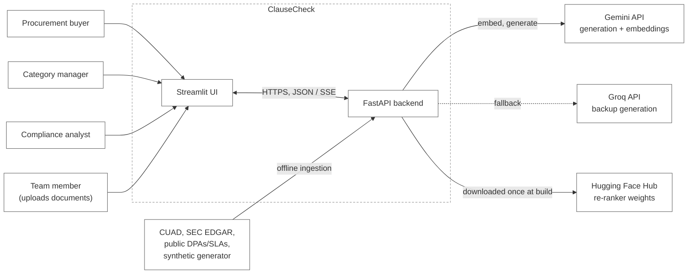

---

## 3. Overall architecture

There are two pipelines that share the same storage.

The offline pipeline runs when documents are added. It parses each file, splits it into clause-level chunks, embeds them, and writes them to ChromaDB, SQLite and the BM25 indexes.

The online pipeline runs for each question. It rewrites follow-ups into stand-alone questions, works out which supplier is meant, retrieves and re-ranks clauses, checks that the best match is good enough, and then streams a cited answer.

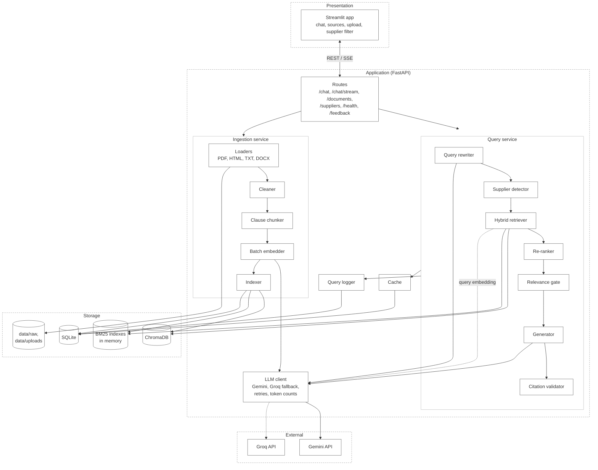

### 3.1 Who does what

The Streamlit app only handles display: rendering the chat, streaming tokens, showing sources and collecting uploads. It never calls the LLM or the vector store directly and never sees an API key.

All the real work (retrieval, generation, validation, logging, ingestion) happens in FastAPI. The only state kept in memory is the BM25 indexes, which can be rebuilt from SQLite at startup.

Storage holds embeddings, chunk text, metadata, logs and the cache. No secrets are stored there.

The external APIs only ever receive the question and the retrieved chunks.

---

## 4. Component relationships

### 4.1 Module dependencies

An arrow means "calls" or "imports". Modules lower in the diagram never import ones above them.

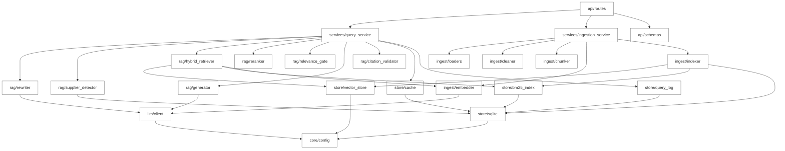

### 4.2 Components

| Module | Takes | Returns | Main library |
|---|---|---|---|
| `ingest/loaders` | file path + manifest row | `RawDocument` (pages, tables, metadata) | PyMuPDF, pdfplumber, BeautifulSoup, python-docx |
| `ingest/cleaner` | `RawDocument` | cleaned text per page | `re` |
| `ingest/chunker` | cleaned pages + tables | list of `Chunk` with metadata | tiktoken |
| `ingest/embedder` | chunks | vectors | Gemini embeddings, sentence-transformers |
| `ingest/indexer` | chunks + vectors | rows in Chroma, SQLite, BM25 | chromadb, sqlite3 |
| `rag/rewriter` | question + last few turns | stand-alone question | Gemini |
| `rag/supplier_detector` | question, previous supplier | `supplier_id` or `None` | rapidfuzz |
| `rag/hybrid_retriever` | query, supplier, k | merged candidates | chromadb, rank_bm25 |
| `rag/reranker` | query + candidates | candidates with scores | CrossEncoder |
| `rag/relevance_gate` | top scores | pass or refuse | |
| `rag/generator` | query + chunks | streamed answer with `[C#]` markers | Gemini |
| `rag/citation_validator` | answer + marker map | citations, cleaned answer | `re` |
| `llm/client` | prompts or texts | completions or embeddings | google-genai, groq, tenacity |

---

## 5. Ingestion and indexing

### 5.1 Flow

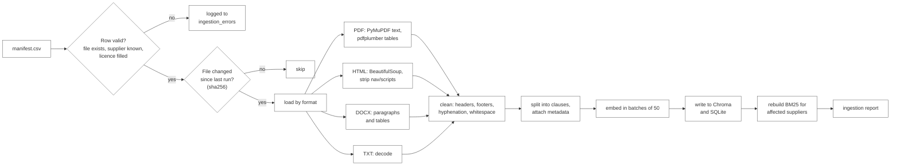

Rebuilding everything is a single command (NFR-3):

```bash
python -m clausecheck.ingest --manifest data/manifest.csv --rebuild
```

Other flags: `--only-supplier <id>` to re-index one supplier, `--dry-run` to parse and chunk without embedding, and `--embedder local` to use sentence-transformers instead of Gemini.

### 5.2 Loaders (FR-1, FR-2)

| Format | Text | Tables | Page numbers |
|---|---|---|---|
| PDF | `page.get_text("text")` from PyMuPDF | `extract_tables()` from pdfplumber, converted to Markdown | from the file |
| HTML | `get_text("\n")` after removing script, style, nav and footer | `<table>` converted to Markdown | approximate, one "page" per ~3,000 characters |
| DOCX | `document.paragraphs`, keeping heading styles | `document.tables` converted to Markdown | from page breaks if present, otherwise none |
| TXT | decoded, with `chardet` as fallback | none | none |

We don't OCR scanned PDFs. If a PDF has no text layer, it shows up in the ingestion report. Our synthetic certificates are generated as text PDFs, so this shouldn't affect them.

### 5.3 Clause chunking (FR-3, FR-4)

Contracts are organised by clause, so we split on clause headings rather than at a fixed size. The steps:

1. Join the cleaned pages, keeping track of which character offset belongs to which page.
2. Split wherever a line looks like a heading. The patterns we match:
   ```text
   ^\s*(ARTICLE|Article)\s+[IVXLC\d]+              article
   ^\s*(Section|SECTION)\s+\d+(\.\d+)*             section
   ^\s*\d+(\.\d+){0,3}\.?\s+[A-Z][^\n]{2,80}$      numbered clause, e.g. "7.2 Late Delivery"
   ^\s*\([a-z]\)\s+                                sub-clause, stays inside its parent
   ```
3. If a clause is 512 tokens or less, it becomes one chunk. Longer clauses are split at sentence boundaries into windows of about 400 tokens with 60 tokens of overlap, and each window starts with the clause heading. Clauses under 60 tokens are merged into the next one.
4. Each table becomes its own chunk (heading, header row, rows). Large tables are split by rows, and every part repeats the header row.
5. Each chunk gets its metadata and an ID of the form `{doc_id}::{clause_no or p<page>}::{part}`, for example `ACME-MSA-2021::7.2::0`.

Metadata stored with each chunk:

| Field | Example | Used for |
|---|---|---|
| `chunk_id` | `ACME-MSA-2021::7.2::0` | citations |
| `doc_id` | `ACME-MSA-2021` | linking to the source |
| `supplier_id` | `acme-industrial` | filtering retrieval |
| `doc_type` | `msa`, `sow`, `amendment`, `price_schedule`, `dpa`, `sla`, `nda`, `certificate` | prompt context, UI label |
| `clause_no`, `clause_title` | `7.2`, `Late Delivery` | citations, keyword boost |
| `page_start`, `page_end` | `14`, `14` | citations |
| `effective_date` | `2023-04-01` | working out which term is current |
| `expiry_date` | `2026-03-31` or null | certificate questions |
| `parent_doc_id` | `ACME-MSA-2021` or null | linking an amendment to its original |
| `is_table`, `is_synthetic` | `true`, `false` | prompt formatting, UI label |
| `token_count` | `384` | fitting chunks into the context budget |

### 5.4 Embedding in batches (NFR-4)

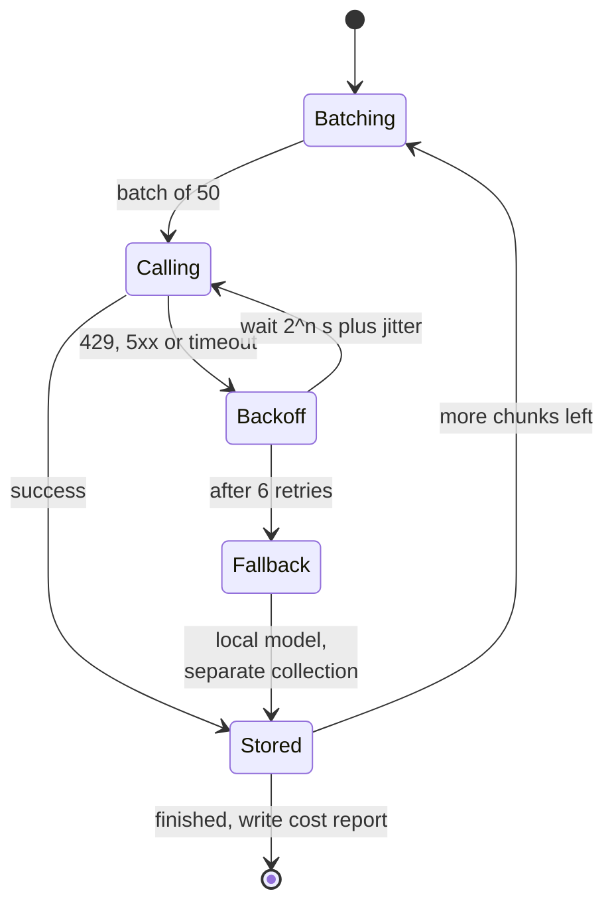

Embeddings are cached by `sha256(chunk_text + model_name)`, so re-running ingestion doesn't re-embed chunks that haven't changed. We use the "document" task type when indexing and "query" at question time. Gemini and local embeddings are never stored in the same collection; the collection name includes the model (`chunks__gemini-emb`, `chunks__minilm`).

### 5.5 Amendments

An amendment chunk has `parent_doc_id` pointing to the original agreement. When a retrieved chunk comes from a document that has amendments, the retriever also pulls in the best-matching amendment chunks (section 6.3). That way the model sees the later term and can say it replaced the original.

---

## 6. Answering a question

### 6.1 Streaming request, start to finish

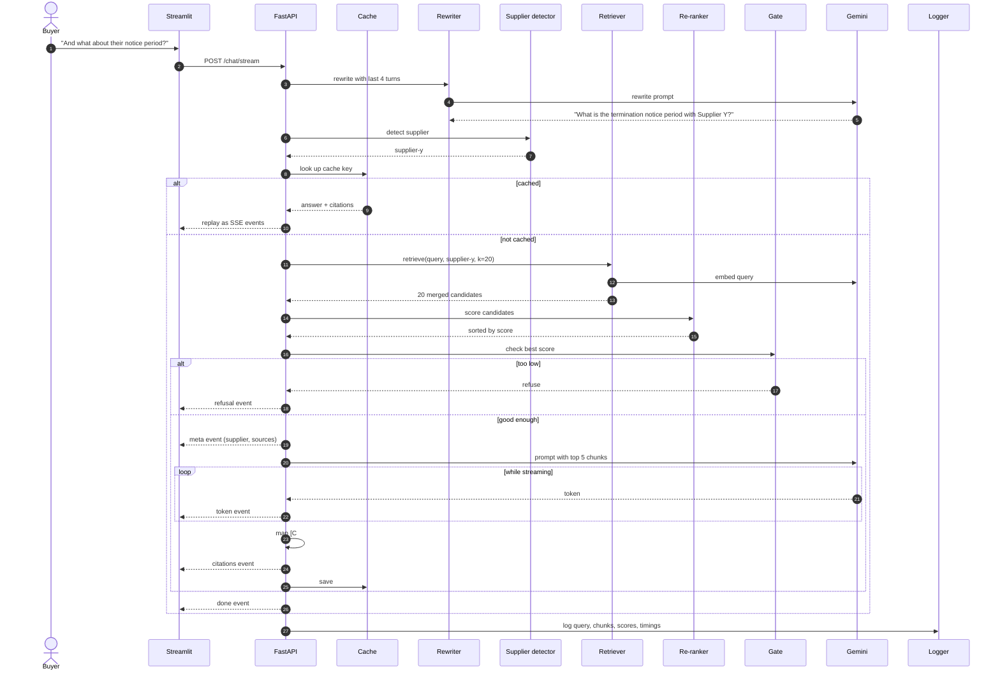

### 6.2 Follow-ups and supplier detection (FR-8)

If the conversation has earlier turns, the rewriter turns the new message into a stand-alone question using the last 4 turns (earlier answers cut to 300 tokens). It runs at temperature 0 with a 60-token limit. On the first message there's nothing to rewrite, so we skip it and save about half a second.

The supplier detector tries these in order and stops at the first match:

1. The supplier picked in the sidebar filter, if any.
2. A match against supplier names and aliases, exact or fuzzy (`rapidfuzz.token_set_ratio >= 90`). "Acme", "ACME Corp" and "Acme Industrial Ltd" all resolve to `acme-industrial`.
3. The supplier from the previous turn, if the question uses "their", "they", "that contract" and so on, or doesn't name anyone.
4. Otherwise, search all suppliers. If the question names a company that isn't in our supplier table, we refuse with "Supplier Q is not in the contract repository."

### 6.3 Hybrid retrieval (FR-5)

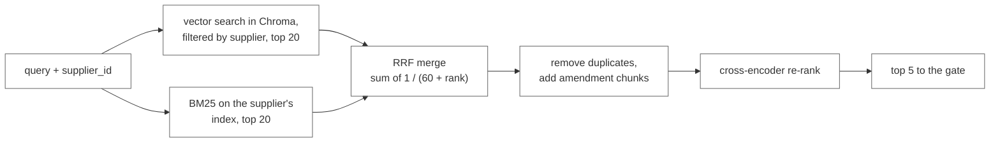

The BM25 tokenizer lowercases and splits on whitespace and punctuation, but keeps things like `Net 45`, `7.2`, `A-114` and `$1,250.00` as single tokens (their parts are indexed too). For any candidate whose document has amendments, we add the best BM25 match from each amendment, at most 2 extra chunks. The re-ranker sees `clause_title + "\n" + chunk_text`, cut to 512 tokens.

### 6.4 Relevance gate (FR-7)

```text
top1 = re-ranker score of the best chunk
if top1 < threshold                  -> refuse (nothing relevant)
if a named supplier wasn't found     -> refuse (unknown supplier)
otherwise                            -> send chunks scoring >= threshold - 2, up to 5
```

We'll choose the threshold using the eval set: try a range of values and keep the one that answers the most answerable questions while still refusing at least 90% of the unanswerable ones. We start at 0.0, since MiniLM scores are roughly centred there. The value lives in config (`RELEVANCE_THRESHOLD`) and is written to every log row, so eval runs can be compared.

The refusal text is fixed, not generated: "I couldn't find this in the contracts for {supplier}. Try rephrasing, or check that the document has been uploaded."

### 6.5 Building the prompt (FR-6)

Chunks go into the prompt in score order until we hit 3,000 tokens. We never cut a chunk in half; if it doesn't fit, it's left out. Each chunk is labelled and carries a short header:

```text
[C2] Supplier: Acme Industrial | Doc: ACME-AMD-2023 (amendment, effective 2023-04-01,
     amends ACME-MSA-2021) | Clause 4.1 "Payment Terms" | Page 2
Payment shall be made within forty-five (45) days of receipt of a valid invoice...
```

The model is told to put a `[C#]` after every sentence that states a term (prompt in section 11). Temperature is 0.1 and the output limit is 400 tokens.

### 6.6 Checking citations

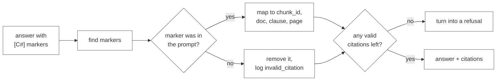

We also check numbers. Every number or date in the answer should appear in at least one cited chunk, after normalising ("forty-five (45)" counts as "45"). If one doesn't, we log `unsupported_number` and show a warning next to the answer in the UI. We don't silently delete it.

---

## 7. Data design

### 7.1 Where things are stored

| Location | Contents | Can we rebuild it? |
|---|---|---|
| `data/raw/` | original contracts | no, this is the source (committed or fetched by script) |
| `data/manifest.csv` | one row per document | no, committed |
| `data/uploads/` | files uploaded through the app | no; uploads are also added to the manifest |
| `index/chroma/` | embeddings and metadata | yes, from the manifest |
| BM25 (memory) | per-supplier keyword indexes | yes, from the `chunks` table at startup |
| `index/clausecheck.db` | documents, chunks, sessions, logs, cache, jobs | partly; logs can't be rebuilt |

### 7.2 Manifest

Columns: `doc_id, supplier, doc_type, effective_date, parent_doc_id, source, source_url, license, format, is_synthetic`

Ingestion checks that `doc_id` is unique, that `supplier` exists in `data/suppliers.csv` (which holds the normalised ID, display name and aliases), that amendments have a `parent_doc_id` pointing to a real document, and that `license` isn't empty.

### 7.3 Chroma collection

```text
collection: chunks__<embedding_model>
  id         chunk_id
  embedding  float vector
  document   chunk text, with heading prefix
  metadata   supplier_id, doc_id, doc_type, clause_no, clause_title,
             page_start, page_end, effective_date, expiry_date,
             parent_doc_id, is_table, is_synthetic, token_count
  distance   cosine
```

### 7.4 SQLite schema

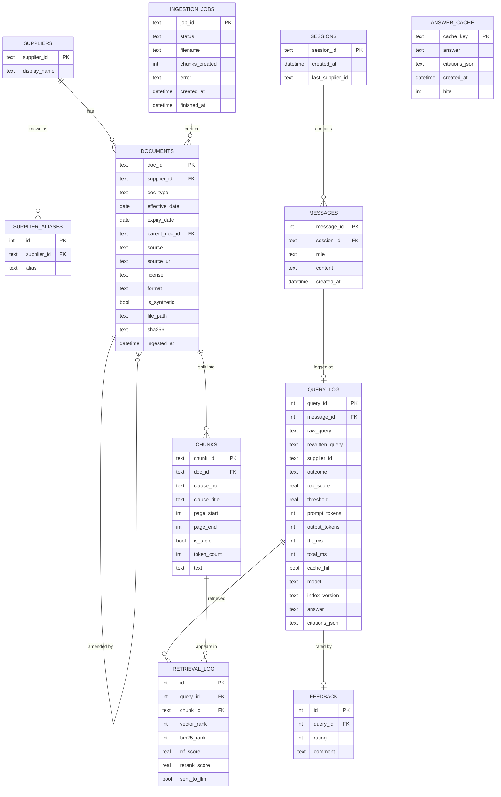

`outcome` is one of `answered`, `refused_low_score`, `refused_unknown_supplier`, `refused_no_citation` or `error`.

`index_version` is a hash of the embedding model, the chunker version and the manifest. It's part of the cache key, so re-indexing automatically invalidates old cached answers.

---

## 8. API design

The base path is `/api/v1`. Request and response models are Pydantic classes in `api/schemas.py`, and FastAPI serves interactive docs at `/docs`.

### 8.1 Endpoints

| Method | Path | What it does | Req |
|---|---|---|---|
| GET | `/health` | status and index stats | |
| GET | `/suppliers` | supplier list for the sidebar filter | FR-5 |
| POST | `/sessions` | start a conversation | FR-8 |
| POST | `/chat` | full answer in one response (used by the eval script) | FR-5, 6, 7 |
| POST | `/chat/stream` | streamed answer over SSE | FR-10 |
| POST | `/documents` | upload and index a document in the background | FR-9 |
| GET | `/documents/jobs/{job_id}` | status of an upload | FR-9 |
| GET | `/documents` | list indexed documents | |
| GET | `/chunks/{chunk_id}` | full text of a cited clause | FR-6 |
| POST | `/feedback` | thumbs up or down on an answer | FR-11 |

### 8.2 Request and response examples

`POST /chat` request:

```json
{
  "session_id": "b1f0...",
  "message": "What are the payment terms with Acme? Is there an early-payment discount?",
  "supplier_id": null,
  "top_k": 5
}
```

Response:

```json
{
  "query_id": 1842,
  "outcome": "answered",
  "rewritten_query": "What are the payment terms with Acme Industrial, and is there an early-payment discount?",
  "supplier": { "id": "acme-industrial", "name": "Acme Industrial" },
  "answer": "Invoices are payable within 45 days of receipt [C1]. A 2% discount applies if paid within 10 days [C2].",
  "citations": [
    { "marker": "C1", "chunk_id": "ACME-AMD-2023::4.1::0", "doc_id": "ACME-AMD-2023",
      "doc_type": "amendment", "clause_no": "4.1", "clause_title": "Payment Terms",
      "page": 2, "effective_date": "2023-04-01", "amends": "ACME-MSA-2021",
      "snippet": "Payment shall be made within forty-five (45) days...", "score": 6.12 },
    { "marker": "C2", "chunk_id": "ACME-MSA-2021::4.3::0", "doc_id": "ACME-MSA-2021",
      "doc_type": "msa", "clause_no": "4.3", "clause_title": "Early Payment Discount",
      "page": 9, "effective_date": "2021-01-15", "amends": null,
      "snippet": "Buyer may deduct two percent (2%)...", "score": 5.40 }
  ],
  "warnings": [],
  "usage": { "prompt_tokens": 2310, "output_tokens": 64, "cache_hit": false },
  "latency_ms": { "ttft": null, "total": 2140 }
}
```

A refusal has the same shape, with `outcome` set to one of the `refused_*` values, the fixed refusal text in `answer`, and an empty `citations` list.

`POST /chat/stream` returns `text/event-stream` with these events:

| Event | Data | Sent when |
|---|---|---|
| `meta` | query_id, rewritten query, supplier, source list | after retrieval, before the first token |
| `token` | `{"t": "..."}` | for each piece of text |
| `citations` | citations and warnings | after the answer is validated |
| `refusal` | outcome and message | instead of tokens, when the gate refuses |
| `error` | code and message | on failure |
| `done` | latency, token usage, cache_hit | always, last |

`POST /documents` takes `multipart/form-data`:

| Field | Required | Notes |
|---|---|---|
| `file` | yes | .pdf, .html, .htm, .txt or .docx, up to 20 MB |
| `supplier` | yes | an existing ID, or a new name (creates the supplier) |
| `doc_type` | yes | one of the types in 5.3 |
| `effective_date` | no | ISO date |
| `parent_doc_id` | for amendments | must already exist |

It responds with `202 Accepted` and `{"job_id": "job_7f3a", "status": "queued"}`, then processes the file in a FastAPI background task:

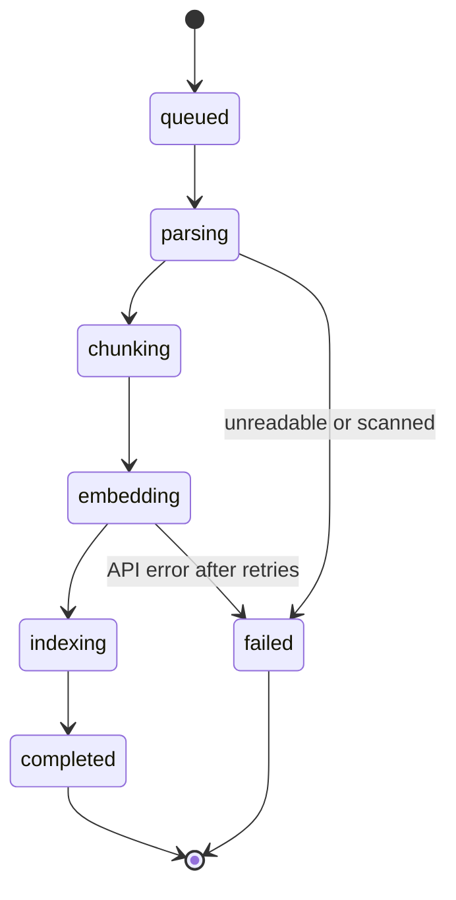

When a job completes, we rebuild that supplier's BM25 index and bump the index version so its cached answers are invalidated.

### 8.3 Errors

| HTTP | code | Example |
|---|---|---|
| 400 | `invalid_request` | empty message, unknown `doc_type` |
| 404 | `not_found` | unknown session, chunk or job ID |
| 413 | `file_too_large` | upload over 20 MB |
| 415 | `unsupported_format` | an .xlsx upload |
| 429 | `rate_limited` | more than 30 requests a minute from one client |
| 503 | `llm_unavailable` | both Gemini and Groq failing |

Error body: `{"error": {"code": "...", "message": "...", "request_id": "..."}}`

---

## 9. Frontend design

### 9.1 Layout

```text
+------------------------------------------------------------------------------+
|  ClauseCheck                                          Index: 184 docs, OK    |
+-----------------------+------------------------------------------------------+
| Supplier              |  You: What are the payment terms with Acme?          |
| [ All suppliers  v ]  |                                                      |
|                       |  ClauseCheck: Invoices are payable within 45 days    |
| [ New conversation ]  |  of receipt [C1]. A 2% discount applies if paid      |
|                       |  within 10 days [C2].                                |
| Upload a document     |                                                      |
| [ Choose file ]       |  Sources                                             |
| Supplier  [______]    |  > C1  Acme Industrial, ACME-AMD-2023                |
| Type      [MSA  v]    |        Amendment, effective 2023-04-01, s.4.1, p.2   |
| Effective [______]    |        Amends ACME-MSA-2021                          |
| Amends    [______]    |  > C2  Acme Industrial, ACME-MSA-2021                |
| [ Upload ]            |        MSA, s.4.3 Early Payment Discount, p.9        |
| Embedding... 60%      |                                                      |
|                       |  [up] [down]                  1.4 s to first token   |
| Not legal advice.     |                                                      |
| Synthetic documents   |  You: And what about their notice period?            |
| are labelled.         |  ClauseCheck: (streaming)                            |
|                       +------------------------------------------------------+
|                       |  [ Ask about a supplier's terms...          ] [Send] |
+-----------------------+------------------------------------------------------+
```

Refusals are shown in a grey `st.info` box, so they can't be mistaken for an actual term.

### 9.2 Components

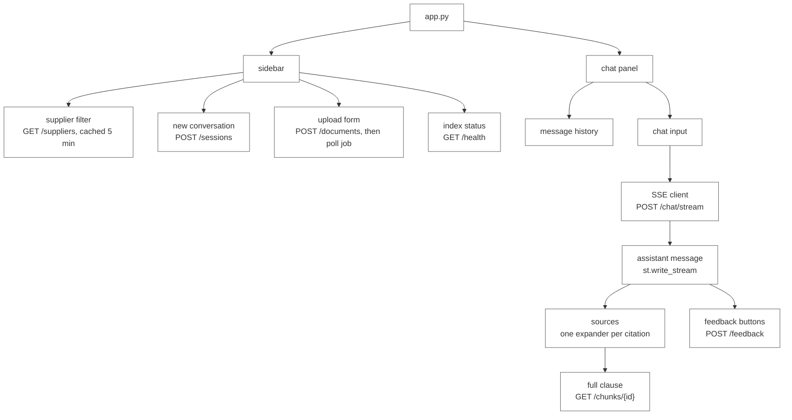

### 9.3 Session state

| Key | Holds |
|---|---|
| `session_id` | backend conversation ID |
| `messages` | list of `{role, content, citations, outcome, query_id}` for re-rendering |
| `supplier_filter` | sidebar selection, or None |
| `upload_job_id` | current upload, polled every 2 s until it finishes or fails |
| `api_base_url` | read from `st.secrets["API_BASE_URL"]` |

The SSE client opens the stream with `httpx.stream(...)` and yields `token` events into `st.write_stream`. When the `citations` event arrives, it renders the sources underneath.

---

## 10. Deployment

### 10.1 Hosting

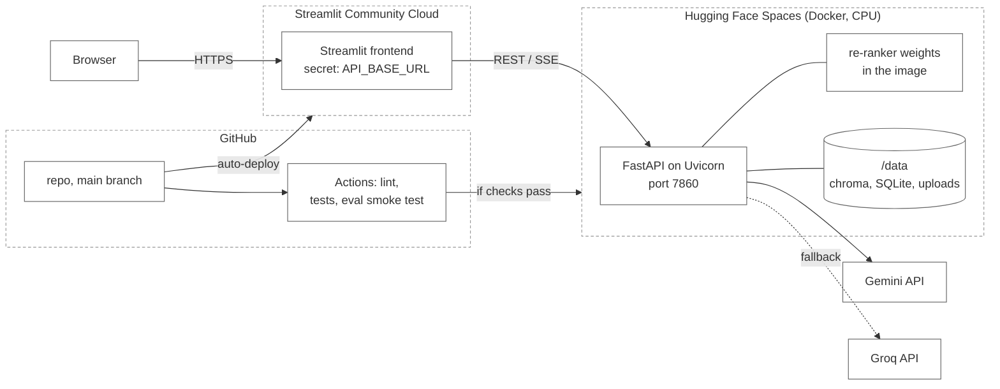

The frontend runs on Streamlit Community Cloud, which is free, deploys straight from GitHub and has a secrets manager. The backend runs on Hugging Face Spaces using the Docker SDK; the free CPU tier has enough memory for the re-ranker and Chroma, and Docker lets us control the environment. If Spaces is down or too slow, Render's free web service is our backup, keeping in mind its disk is wiped on restart. API keys live only in the Space and Streamlit secret settings (NFR-2).

### 10.2 Keeping the index across restarts

Free hosts can wipe local disk on restart, so we don't rely on it:

1. CI builds the index (`index/chroma/` and `clausecheck.db`) from the committed manifest and publishes it as a zip on the GitHub release.
2. When the container starts, `scripts/bootstrap.py` downloads and unpacks the zip if `/data/chroma` is missing, then builds the BM25 indexes from SQLite. For about 15k chunks this takes 2-5 seconds.
3. Documents uploaded through the app go into the live index, but may be lost on restart on the free tier. The UI says so. Turning on persistent storage for the Space fixes this.

### 10.3 Dockerfile

```dockerfile
FROM python:3.11-slim
WORKDIR /app
COPY requirements.txt .
RUN pip install --no-cache-dir -r requirements.txt
# download the re-ranker at build time so cold starts don't have to
RUN python -c "from sentence_transformers import CrossEncoder; CrossEncoder('cross-encoder/ms-marco-MiniLM-L-6-v2')"
COPY clausecheck/ clausecheck/
COPY scripts/ scripts/
ENV DATA_DIR=/data
EXPOSE 7860
CMD ["sh", "-c", "python scripts/bootstrap.py && uvicorn clausecheck.api.main:app --host 0.0.0.0 --port 7860"]
```

### 10.4 CI/CD

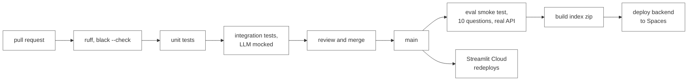

---

## 11. Prompts

### 11.1 Answer prompt (system)

```text
You are ClauseCheck, an assistant that answers questions about supplier contracts.

Rules:
1. Use ONLY the numbered context passages [C1]..[Cn]. Do not use outside knowledge.
2. After every sentence that states a term, cite the passage(s) it came from, e.g. [C2].
3. Quote numbers, dates, percentages and durations exactly as written in the passage.
4. If an amendment (doc_type = amendment) changes a term from the original agreement,
   state the amended term as current, and mention that it replaced the original.
5. If passages conflict and you cannot tell which is in force, say so and cite both.
6. If the passages do not answer the question, reply exactly: NOT_FOUND
7. Be concise: 1-4 sentences. No legal advice or recommendations.
```

The user message contains the rewritten question followed by the context block from 6.5. If the model replies `NOT_FOUND`, the backend swaps in the standard refusal. This is a second check in case something gets past the gate.

### 11.2 Rewrite prompt

```text
Rewrite the user's latest message as a single stand-alone question about supplier
contracts. Replace pronouns ("they", "their", "that contract") with the supplier or
document named earlier. Do not answer it. Output only the question.

Conversation:
{last_4_turns}
Latest message: {message}
```

### 11.3 Versions

Prompts are stored in `clausecheck/prompts/` as text files starting with a version line (`# v3`). The version is logged with every query, so we can tell which prompt produced which eval result.

---

## 12. Caching and logging

### 12.1 Caches (NFR-5)

| Cache | Key | Cleared when |
|---|---|---|
| Answers | hash of the normalised rewritten query, supplier, index version and prompt version | index or prompt changes; entries expire after 7 days |
| Query embeddings | hash of query and model | model changes |
| Chunk embeddings | hash of chunk text and model | model changes |
| Supplier list | in memory | an upload finishes |

We cache answers and refusals but never errors. Cached answers are sent through the same SSE events as fresh ones, so the UI handles both the same way.

### 12.2 Logs (FR-11)

Each request writes one JSON log line to stdout (the host collects these) with a request ID, the time spent in each stage (`rewrite_ms`, `embed_ms`, `retrieve_ms`, `rerank_ms`, `ttft_ms`, `total_ms`), token counts and the outcome.

The same information is saved to `query_log` and `retrieval_log`. When a question goes wrong, we can look up exactly which chunks came back and how they scored.

Every LLM call records its token counts. `scripts/usage_report.py` adds them up per day so we can see how close we are to the free-tier limits.

### 12.3 Health check

`GET /health` returns something like:

```json
{ "status": "ok", "documents": 184, "chunks": 14210, "suppliers": 42,
  "index_version": "a91c...", "embedding_model": "gemini-embedding",
  "llm_primary": "up", "llm_fallback": "up" }
```

---

## 13. Error handling

| What fails | What we do |
|---|---|
| Gemini returns 429 or 5xx | retry with `tenacity`, backing off from 1 s to 32 s with jitter, up to 5 tries |
| Gemini still failing after retries | answer with Groq for this request and log `fallback_used` |
| Embedding API down at query time | fall back to BM25 only and show "semantic search unavailable" |
| Both LLMs down | send an `error` event (503); the UI shows a retry button |
| Upload can't be parsed | mark the job `failed` with the reason; nothing is half-indexed |
| Model cites a passage that wasn't given | drop that marker; refuse if no citations are left |
| User closes the page mid-answer | stop generating to save tokens and log `client_cancelled` |
| Re-ranker takes longer than 1.5 s | use the RRF order for this request and log a warning |

An upload is written inside one SQLite transaction, and the Chroma upsert is keyed by `chunk_id`. If anything fails, we delete that document's chunks from both stores so the index never holds half a document.

---

## 14. Configuration and security

### 14.1 `.env.example` (NFR-2)

```bash
# LLM
GEMINI_API_KEY=
GEMINI_GEN_MODEL=gemini-flash-latest
GEMINI_EMBED_MODEL=gemini-embedding-latest
GROQ_API_KEY=
GROQ_MODEL=llama-3.3-70b-versatile

# Retrieval
EMBEDDING_BACKEND=gemini            # gemini or local
LOCAL_EMBED_MODEL=sentence-transformers/all-MiniLM-L6-v2
RERANKER_MODEL=cross-encoder/ms-marco-MiniLM-L-6-v2
RETRIEVE_K=20
CONTEXT_K=5
CONTEXT_TOKEN_BUDGET=3000
RELEVANCE_THRESHOLD=0.0

# Storage
DATA_DIR=./index
UPLOAD_MAX_MB=20

# API
CORS_ORIGINS=http://localhost:8501,https://<app>.streamlit.app
RATE_LIMIT_PER_MIN=30
```

Model names go in config rather than code because free-tier model names change often. We'll check the current names in Google AI Studio during week 1. Settings are loaded with `pydantic-settings`, and the app won't start if a required value is missing; it prints which one.

### 14.2 Security

- `.env` is in `.gitignore`, and a pre-commit hook runs `detect-secrets`.
- CORS only allows the frontend's origin.
- Uploads are checked by extension and by MIME type (`python-magic`), limited in size, and saved under generated names so a filename can't be used for path traversal.
- HTML files are only parsed with BeautifulSoup. Nothing in them is executed or rendered.
- Prompt injection: chunk text sits inside clearly marked context blocks, and the system prompt says to ignore instructions found in passages. Citation checking and the fixed refusal text also limit what injected text could do.
- A per-IP rate limit protects our API quota.
- The UI says that ClauseCheck gives information from contracts and is not legal advice.

---

## 15. Latency budget

The target is a median time to first token under 3 seconds (NFR-1).

| Stage | Expected time | Notes |
|---|---|---|
| Rewrite | 0-600 ms | skipped on the first message |
| Supplier detection | under 10 ms | in-memory lookup |
| Cache lookup | under 5 ms | SQLite primary key |
| Query embedding | 150-300 ms | cached for repeated queries |
| Vector search | under 50 ms | ~15k chunks, HNSW |
| BM25 | under 30 ms | per-supplier indexes are small |
| Re-ranking 20 pairs on CPU | 300-700 ms | one batch |
| First token from the LLM | 500-1,000 ms | streamed |
| Total | about 1.2-2.7 s | |

If we measure more than 3 seconds, we'll try these in order: lower `RETRIEVE_K` to 12, skip the rewrite when the message already names a known supplier, and send the `meta` event (sources) as early as possible so the user sees progress.

---

## 16. Testing and evaluation

### 16.1 Tests

| Level | What we test | Tools |
|---|---|---|
| Unit | heading regex against 30 real headings, table-to-Markdown, RRF, citation parsing, BM25 tokenizer keeping "Net 45" together | pytest |
| Integration | ingest 5 sample contracts, ask a question, expect the right chunk in the top 5; upload job reaches `completed` | pytest, `respx` to mock HTTP |
| API | `/chat` response shape, SSE event order, error codes | FastAPI `TestClient` |
| Evaluation | the full question set | `eval/run_eval.py` |
| Manual | follow-ups, how refusals look, uploading | checklist in `docs/qa.md` |

### 16.2 Evaluation

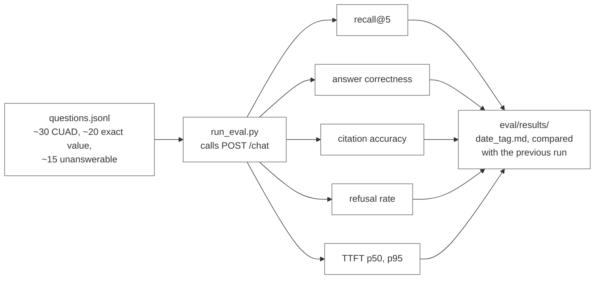

Example question:

```json
{"id": "q017", "group": "exact_value", "question": "What is the unit price for SKU A-114 at 500 units with Supplier X?",
 "supplier_id": "supplier-x", "gold_chunk_ids": ["SUPX-PS-2024::table1::0"],
 "gold_answer": "$11.40", "answer_type": "number", "answerable": true}
```

For exact-value questions, the answer counts as correct if the normalised expected value appears in it.

For the CUAD questions, answers are prose, so an LLM judge grades them as correct, partly correct or wrong against the expected clause. We use a Groq model for judging so it isn't the same model family that wrote the answer, and we check 10% of its grades by hand.

Whenever we change retrieval, we compare vector only, BM25 only, hybrid, and hybrid with re-ranking, each with and without the supplier filter.

Targets:

| Metric | Target |
|---|---|
| Recall@5 | 0.85 or higher |
| Answer correctness | 85% or higher |
| Citation accuracy | 90% or higher |
| Correct refusals | 90% or higher |
| Median TTFT | under 3 s |

---

## 17. Repository layout

```text
FirstName_ClauseCheck_Kalvium-Community/
├── README.md
├── NOTICE                         # CUAD attribution
├── pyproject.toml
├── requirements.txt
├── .env.example
├── .pre-commit-config.yaml
├── .secrets.baseline
├── Dockerfile
├── .github/workflows/ci.yml
├── data/
│   ├── manifest.csv
│   ├── fetch_log.csv
│   ├── suppliers.csv              # supplier_id, display_name, aliases
│   ├── raw/
│   └── uploads/
├── index/                         # generated, git-ignored
├── clausecheck/
│   ├── core/          config.py, logging.py, ids.py
│   ├── ingest/        models.py, loaders.py, cleaner.py, chunker.py, embedder.py,
│   │                  indexer.py, __main__.py
│   ├── rag/           types.py, rewriter.py, supplier_detector.py, vector_retriever.py,
│   │                  hybrid_retriever.py, reranker.py, relevance_gate.py,
│   │                  context_builder.py, generator.py, citation_validator.py
│   ├── store/         vector_store.py, bm25_index.py, sqlite.py, cache.py, query_log.py
│   ├── llm/           client.py, gemini.py, groq.py, tokens.py
│   ├── services/      query_service.py, ingestion_service.py, sessions.py
│   ├── prompts/       loader.py, answer.txt, rewrite.txt, judge.txt
│   └── api/           main.py, schemas.py, deps.py, routes/
├── frontend/
│   ├── app.py
│   └── components/    sidebar.py, chat.py, sources.py, insights.py, sse_client.py
├── scripts/
│   ├── generate_synthetic.py      # price schedules and certificates
│   ├── fetch_sources.py           # CUAD / EDGAR download
│   ├── validate_cuad.py           # corpus validation
│   ├── bootstrap.py               # restores the index on container start
│   └── usage_report.py
├── notebooks/                     # exploration, outputs stripped by nbstripout
├── eval/
│   ├── questions.jsonl
│   ├── run_eval.py
│   └── results/
├── tests/
│   ├── unit/
│   ├── integration/
│   ├── api/
│   └── fixtures/                  # 5 small sample contracts
└── docs/
    ├── 01-project-overview.md
    ├── 02-project-description.md
    ├── team-charter.md
    ├── qa.md
    ├── requirements/              # PRD.md, functional-requirements.md, non-functional-requirements.md
    ├── planning/                  # development-plan.md, roadmap.md
    ├── architecture/              # tdd.md, rag-architecture-design.md, api-design.md,
    │                              # data-flow.md, ingestion-pipeline.md
    ├── data/                      # data-sourcing.md, data-validation-report.md
    ├── ux/                        # mock-ux.md, user-flows.md, ui-states.md
    ├── evaluation/                # eval reports
    └── pr-prompts/
```

---

## 18. Requirements traceability

| Req | Where it's implemented | How we check it |
|---|---|---|
| FR-1 multi-format ingestion | `ingest/loaders.py` | unit test per format, ingestion report |
| FR-2 tables | pdfplumber, table chunks (5.3) | exact-value eval questions |
| FR-3 clause chunking | `ingest/chunker.py` | heading regex tests, chunk size histogram |
| FR-4 metadata | Chroma metadata, `chunks` table | integration test checks the fields |
| FR-5 hybrid filtered retrieval | `rag/hybrid_retriever.py`, `rag/reranker.py` | recall@5 and ablations |
| FR-6 citations | `rag/citation_validator.py` | citation accuracy |
| FR-7 refusals | `rag/relevance_gate.py`, `NOT_FOUND` handling | refusal rate |
| FR-8 follow-ups | `rag/rewriter.py`, supplier carry-over | follow-up question pairs, manual QA |
| FR-9 upload | `POST /documents`, `ingestion_service` | API test, job states |
| FR-10 streaming UI | `/chat/stream`, `frontend/` | manual QA, TTFT |
| FR-11 logging | `query_log`, `retrieval_log`, JSON logs | test that each request writes a log row |
| NFR-1 TTFT under 3 s | streaming, section 15 | eval latency numbers |
| NFR-2 no secrets in repo | `.env`, `pydantic-settings`, detect-secrets | secret scan in CI |
| NFR-3 reproducible | `python -m clausecheck.ingest` | rebuild from a clean clone in CI |
| NFR-4 rate limits | `tenacity`, batching, fallback | unit test with a mocked 429 |
| NFR-5 caching | `store/cache.py` | asking the same question twice gives `cache_hit: true` |

---

## 19. Build plan

This follows the sprint timeline. Building starts after the PRD and this document are approved.

```mermaid
gantt
    dateFormat  X
    axisFormat  W%s
    title Build plan by week
    section Week 1
    Repo, charter, config, CI skeleton          :a1, 1, 1
    Corpus, manifest, synthetic script          :a2, 1, 1
    section Week 2
    Loaders, cleaner, tables                    :b1, 2, 1
    Clause chunker and metadata                 :b2, 2, 1
    section Week 3
    Batch embedder and Chroma                   :c1, 3, 1
    BM25, RRF, supplier filter, re-rank         :c2, 3, 1
    Recall@5 and ablations                      :c3, 3, 1
    section Week 4
    Prompt, citations, gate                     :d1, 4, 1
    Rewriter and sessions                       :d2, 4, 1
    Answer eval and threshold tuning            :d3, 4, 1
    section Week 5
    FastAPI routes, SSE, upload                 :e1, 5, 1
    Streamlit UI, cache, logging                :e2, 5, 1
    Deploy, docs, final eval report             :e3, 5, 1
```

A component is done when its PR is reviewed and merged, its unit tests pass, and the related eval number is written in the PR description.

---

## 20. Open questions and future work

Questions for the review:

1. We picked ChromaDB because it's simple. If filtered search takes more than 100 ms on the full corpus, we'll look at Qdrant again.
2. For "is this certificate still valid?", should the code compare `expiry_date` with today's date instead of leaving it to the model? We think yes: we'd add `valid_as_of_today` to the chunk header so the model never has to do date arithmetic.
3. HTML and TXT files don't have real pages. We suggest showing only the clause number for these and hiding the page.

Not in this sprint:

- Questions across the whole portfolio, like "which suppliers auto-renew next quarter?". These need key terms extracted into a `contract_terms` table at ingestion and queried with SQL.
- OCR for scanned certificates.
- Access control and an audit trail for confidential contracts, plus a paid or self-hosted model.
- Connecting to an ERP or invoicing system to check invoice prices against price schedules automatically.
