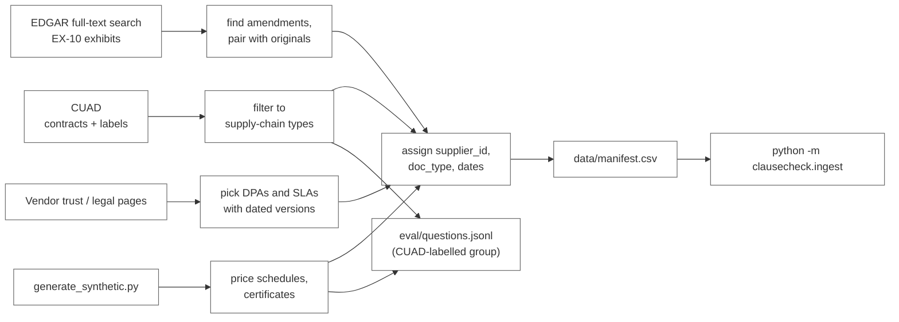

# ClauseCheck: Data Sourcing

Sprint 2, Simulated Work (AI Application Development with RAG)
Repo: `FirstName_ClauseCheck_Kalvium-Community`
See also: `01-project-overview.md`, `02-project-description.md`, `tdd.md`
Status: draft, submitted with the PRD for week 1 review.

This document explains where ClauseCheck's corpus comes from, why each source was chosen, how documents are selected and collected, and how each one ends up as a row in `data/manifest.csv`. It covers the three real-world sources: **CUAD**, **SEC EDGAR EX-10 exhibits**, and **public vendor DPAs / SLAs**. Synthetic price schedules and certificates are covered only briefly (section 7). Their generator is documented in `scripts/generate_synthetic.py`.

## Contents

1. [What the corpus has to do](#1-what-the-corpus-has-to-do)
2. [Selection criteria for every source](#2-selection-criteria-for-every-source)
3. [Sources at a glance](#3-sources-at-a-glance)
4. [CUAD](#4-cuad)
5. [SEC EDGAR EX-10 exhibits](#5-sec-edgar-ex-10-exhibits)
6. [Public vendor DPAs and SLAs](#6-public-vendor-dpas-and-slas)
7. [Where synthetic documents fit](#7-where-synthetic-documents-fit)
8. [Turning sources into one supplier repository](#8-turning-sources-into-one-supplier-repository)
9. [Manifest conventions](#9-manifest-conventions)
10. [Collection pipeline and reproducibility](#10-collection-pipeline-and-reproducibility)
11. [Quality checks and exclusion rules](#11-quality-checks-and-exclusion-rules)
12. [Licensing and attribution](#12-licensing-and-attribution)
13. [Known limitations](#13-known-limitations)

---

## 1. What the corpus has to do

ClauseCheck answers one core question: *what is the negotiated term with a given supplier, and where exactly does the contract say so?* The corpus has to make that question testable. That means it needs:

| Need | Why it matters for ClauseCheck |
|---|---|
| Real contract language | Clause-aware chunking (TDD 5.3) only means something if it runs on real headings, numbering schemes and legal prose |
| Procurement-shaped contracts | Supply, manufacturing, service, hosting and similar agreements, where one side sells to the other |
| Ground truth | Recall@5 and citation accuracy need to know which clause is the right one |
| Amendments paired with originals | Tests that the assistant returns the term currently in force, not the first one it finds |
| Compliance documents | DPAs, SLAs and certificates for the compliance / vendor-risk user |
| Exact numbers and dates | Prices, discounts, service credits, expiry dates: the values buyers actually act on |
| Several formats | PDF, HTML, TXT and DOCX, to exercise every loader (FR-1) |
| Clean licensing | Everything must be legally usable in a public repo and a public demo |

No single public dataset covers all of these, so we combine sources, each chosen to fill a specific gap.

## 2. Selection criteria for every source

A source was accepted only if it met all of the following:

1. **Legally usable.** Openly licensed, or a public record / publicly published document we can reference with attribution. Nothing obtained behind a login or under an NDA.
2. **Non-confidential.** Documents are sent to free-tier external APIs (Gemini, Groq), so nothing confidential can enter the corpus.
3. **Relevant to procurement.** The document either sets commercial terms between a buyer and a supplier, or is a compliance document a buyer would check about a supplier.
4. **Traceable.** Every document can be traced back to a stable URL or a dataset file name, recorded in the manifest.
5. **Collectable by script.** Anyone on the team can re-fetch it with `scripts/fetch_sources.py` (NFR-3). Hand-downloaded files are allowed only if the URL is recorded and the step is documented.
6. **Fills a gap.** Each source must add something the others don't (ground truth, amendments, compliance terms, exact values).

## 3. Sources at a glance

| Source | What we take | Gap it fills | Formats | Target count | Licence |
|---|---|---|---|---|---|
| **CUAD** (Atticus Project) | Commercial contracts of supply-chain types + expert clause labels | Real contract prose and clause-level ground truth | PDF, TXT | 120–200 contracts | CC BY 4.0 |
| **SEC EDGAR EX-10** | Amendments and the original agreements they modify | Amendment handling, extra contract variety | HTML, TXT (some PDF) | 20–40 amendments + their originals | Public filings |
| **Public vendor DPAs / SLAs** | Data processing addenda, service level agreements | Compliance questions, real service-credit and notice terms | HTML, PDF | 30–50 documents (with synthetic certificates) | Publicly published; © each vendor; URL recorded |
| **Synthetic** (see section 7) | Price schedules, compliance and insurance certificates | Exact prices, volume tiers, expiry dates | PDF, DOCX | 30–50 schedules, certificates | Generated by us |



---

## 4. CUAD

### 4.1 What it is

The **Contract Understanding Atticus Dataset (CUAD) v1** is a corpus of **510 commercial contracts** annotated by legal experts from the Atticus Project, with **more than 13,000 labels across 41 clause categories** (for example Renewal Term, Cap on Liability, Termination for Convenience, Warranty Duration). It was published by Hendrycks, Burns, Chen and Ball (NeurIPS 2021 Datasets and Benchmarks track) and is released under **CC BY 4.0**.

The contracts themselves were originally filed with the SEC on EDGAR, so every one is a real, signed commercial agreement.

The release contains:

| File / folder | Contents | How we use it |
|---|---|---|
| `full_contract_pdf/` | Each contract as a PDF, grouped by contract type | Main input to the PDF loader |
| `full_contract_txt/` | The same contracts as plain text | Input to the TXT loader for a subset (format mix); fallback if a PDF parses badly |
| `master_clauses.csv` | One row per contract, with the labelled text span (and a Yes/No or value answer where relevant) for each of the 41 categories | Ground truth for the eval set |
| `CUAD_v1.json` | The same labels in SQuAD question-answering format, with character offsets | Locating the gold span inside our chunks (gold `chunk_id`) |

Source: <https://www.atticusprojectai.org/cuad>, code and data at <https://github.com/TheAtticusProject/cuad>, archive on Zenodo.

### 4.2 Why we chose it

- **It is the only openly licensed contract corpus we found with expert clause-level labels.** Without it we would have to hand-label every gold clause for recall@5 and citation accuracy.
- **Its contract types match procurement.** CUAD is grouped into 25 contract types. Several are exactly the kind of agreement a procurement team holds: Supply, Manufacturing, Outsourcing, Service, Maintenance, Distributor, Hosting.
- **Its label categories match the terms buyers ask about.** The table in 4.4 shows the overlap.
- **It is real legal text.** Real numbering schemes (Article IV, Section 7.2, (a)(ii)), cross-references, defined terms and odd formatting are what our chunker has to survive.
- **CC BY 4.0** lets us use, transform and redistribute it with attribution.

Alternatives we looked at and why we didn't use them as the core corpus:

| Alternative | Reason not chosen |
|---|---|
| Scraping EDGAR ourselves for everything | No labels; we'd have to build all ground truth by hand |
| Contract datasets focused on NLI or classification (e.g. ContractNLI, LEDGAR) | Useful research sets, but they are NDA-only or provision-level snippets, not full procurement contracts with clause locations |
| Template / sample contracts from law firm websites | Unsigned templates, often with blanks in place of the actual terms, and unclear licensing |

### 4.3 What we take from CUAD

1. **Filter by contract type.** Keep contracts whose CUAD type is one of: Supply, Manufacturing, Outsourcing, Service, Maintenance, Distributor, Hosting. Other types (Franchise, Joint Venture, Endorsement, Sponsorship, and so on) are excluded because they aren't buyer–supplier relationships.
2. **Filter by usefulness.** Within those types, prefer contracts that have non-empty labels in at least 3 of the "procurement categories" in 4.4, so each contract can support several eval questions.
3. **Sample to the target size.** Take 120–200 contracts. `fetch_sources.py` uses a fixed random seed so the selection is the same for everyone.
4. **Format mix.** Ingest most contracts from PDF, and a fixed subset (about 20%) from TXT, so both loaders are tested on real contracts.
5. **Keep the original file name.** CUAD file names encode the filer, filing date, exhibit number and contract type (for example `COMPANYNAME_09_09_1999-EX-10-SUPPLY AGREEMENT.PDF`). We keep this in `data/sources/cuad_index.csv` next to our `doc_id`, so any document can be traced back to CUAD and to its EDGAR filing.

### 4.4 Mapping CUAD labels to ClauseCheck question types

| ClauseCheck category (from project description) | CUAD categories used as ground truth |
|---|---|
| Renewal | Renewal Term, Notice Period To Terminate Renewal, Expiration Date |
| Liability | Cap On Liability, Uncapped Liability |
| Termination | Termination For Convenience |
| Warranty | Warranty Duration |
| Penalties | Liquidated Damages |
| Pricing | Price Restrictions, Most Favored Nation, Minimum Commitment, Volume Restriction |
| Compliance / risk | Insurance, Audit Rights |
| Metadata checks | Parties, Effective Date, Agreement Date, Governing Law |

**Gap to note: CUAD has no "payment terms" category.** Payment-term questions ("Net 45", early-payment discount) therefore come from EDGAR contracts (hand-labelled) and from synthetic price schedules, not from CUAD labels.

### 4.5 Turning CUAD labels into eval questions

For the ~30 real-contract questions in `eval/questions.jsonl`:

1. Pick a contract and a category from 4.4 where `master_clauses.csv` has a non-empty label.
2. Write the question in buyer language, naming the supplier ("Does the Brightline supply agreement auto-renew?"), not in CUAD's annotation language.
3. Use the label's character offsets from `CUAD_v1.json` to find which of our chunks contains the span. That chunk's ID becomes `gold_chunk_ids`.
4. The labelled span becomes the reference for the LLM judge (TDD 16.2).

Contracts where a category is **empty** are candidates for "no such clause" questions (for example asking about termination for convenience in a contract that has none). These are used carefully: an empty label means the annotators found no such clause, which is a weaker signal than "the supplier isn't in the corpus", so each one is checked by hand before it goes into the unanswerable group.

### 4.6 Caveats

- CUAD contracts come from hundreds of different companies over roughly two decades, not one buyer (see section 8).
- In some contracts the "supplier" is not obvious (for example a distributor agreement, where the distributor buys goods). Section 8 describes how we decide which party is the supplier.
- Some contracts have values removed under SEC confidential treatment (see 5.6). CUAD labels the clause even when the number inside it is redacted.

---

## 5. SEC EDGAR EX-10 exhibits

### 5.1 What it is

EDGAR is the SEC's public filing system. When a US-listed company signs a contract that is material to its business, it files the contract as an exhibit to its 10-K, 10-Q or 8-K. Under Item 601(b)(10) of Regulation S-K, these **material contracts** are filed as exhibit type **EX-10** (EX-10.1, EX-10.2, and so on). That includes **amendments** to earlier contracts, which are usually filed as separate exhibits titled "Amendment No. 1 to ... Agreement" or "First Amendment to ...".

### 5.2 Why we chose it

- **Amendments.** The project description lists fragmentation (terms split across MSAs, SOWs and amendments) as a core difficulty, and the TDD's `parent_doc_id` / `effective_date` design exists to handle it. CUAD contains originals but does not pair them with their amendments. EDGAR is the only free source of real amendments we can link to their original agreements.
- **Same world as CUAD.** CUAD itself was built from EDGAR exhibits, so EDGAR contracts look and read like the rest of the corpus.
- **HTML format.** Most modern EDGAR exhibits are HTML, which gives the HTML loader real input.
- **Payment and pricing clauses.** Hand-picking EDGAR supply agreements lets us fill the payment-term gap CUAD leaves (4.4).
- **Public, stable URLs.** Every filing has a permanent archive URL we can store in the manifest.

### 5.3 How we find documents

We use **EDGAR full-text search** (<https://www.sec.gov/edgar/search/>, which covers filings from 2001 onward) with queries such as:

| Goal | Example query | Filters |
|---|---|---|
| Amendments to supply-type contracts | `"amendment to supply agreement"`, `"amendment no. 1" "supply agreement"` | Form 8-K, 10-K, 10-Q |
| Manufacturing / services amendments | `"amendment to manufacturing agreement"`, `"amendment to master services agreement"` | Form 8-K, 10-K, 10-Q |
| Payment terms | `"net 45" "supply agreement"`, `"early payment discount"` | Form 8-K, 10-K, 10-Q |
| Originals of amendments found above | exact agreement title and parties from the amendment's recitals | same filer (CIK) |

Results are filtered to exhibits whose type starts with `EX-10`.

### 5.4 Pairing an amendment with its original

An amendment is only useful if we also have the agreement it changes. For each candidate amendment:

1. Read its recitals ("This Amendment No. 2 amends the Supply Agreement dated March 1, 2019 between ...").
2. Look for the original:
   - first in our CUAD selection (the filer and date in the CUAD file name make this easy), then
   - in the same company's earlier EDGAR filings, usually an earlier 10-K or 8-K exhibit.
3. **Keep the pair only if both documents are found.** An amendment whose original we can't locate is dropped, because the eval question would have nothing to compare against.
4. Record the pair in the manifest: the amendment's `parent_doc_id` is the original's `doc_id`, and `effective_date` comes from the amendment text (not the filing date).
5. For each pair, write at least one eval question whose correct answer is the **amended** term, and record the original clause as a "trap" chunk the answer must not rely on alone.

Target: **20–40 amendments**, each paired with its original. Where an original is already in the CUAD selection, it is not duplicated.

### 5.5 How we download

EDGAR has published fair-access rules (<https://www.sec.gov/os/accessing-edgar-data>). `fetch_sources.py` follows them:

- Sends a declared `User-Agent` with the project name and a contact email (read from `.env`, `EDGAR_USER_AGENT`), as the SEC requires.
- Stays well below the SEC's limit of 10 requests per second (we use at most 2 per second).
- Downloads each exhibit once and skips it if the file already exists with the same hash.
- Saves the original file unchanged under `data/raw/edgar/`, keeping its native format (`.htm`, `.txt` or `.pdf`).

### 5.6 Redactions

Companies can ask the SEC to keep commercially sensitive parts of an exhibit confidential. Those parts are replaced in the filed version by markers such as `[***]` or `[Confidential Treatment Requested]`. **Prices and volume figures are the values most often redacted.**

What this means for us:

- The chunker flags chunks containing redaction markers (`has_redaction` in the ingestion report).
- Eval questions never target a redacted value.
- The expected behaviour when a buyer asks about a redacted value is to say that the value is redacted in the filed copy, citing the clause, rather than guessing. We include two or three such questions in the eval set.
- This is a main reason exact-price questions come from synthetic price schedules instead (section 7).

### 5.7 Selection rules

Keep an EDGAR exhibit only if:

- it is an EX-10 exhibit that is an agreement or amendment between two companies (not an employment agreement, stock plan, credit agreement or lease),
- it is buyer–supplier in nature (supply, manufacturing, services, maintenance, hosting, logistics, distribution),
- it is in English and has a readable text layer,
- it is not already in the CUAD selection (checked by filer, date and title).

---

## 6. Public vendor DPAs and SLAs

### 6.1 What they are

Many companies that sell software and cloud services publish their standard contract documents on their legal or trust pages, openly and without a login:

- **Data Processing Addenda (DPAs):** what the vendor may do with customer personal data, sub-processor rules, breach notification timing, audit rights, international transfer mechanisms, deletion on termination.
- **Service Level Agreements (SLAs):** uptime commitments, how downtime is measured, **service credit percentages**, how and when to claim credits, exclusions.

### 6.2 Why we chose them

- **Compliance user.** The compliance / vendor-risk analyst in the project description asks things like "Do we have a signed DPA with them?" and "What's their breach notification window?". CUAD and EDGAR contain almost no DPAs.
- **Real penalty and notice terms.** SLA service-credit tables ("10% credit below 99.9%, 25% below 99.0%") are real penalty clauses with exact numbers, the kind of value our citation and number checks (TDD 6.6) are built for.
- **Tables in the wild.** Service-credit tables test table extraction (FR-2) on real, not synthetic, layouts.
- **Modern documents.** They balance the corpus, which would otherwise be mostly older EDGAR-era contracts.
- **Versioned.** Vendors update these documents and usually show a "last updated" or version date, which exercises `effective_date`.

Why not other compliance sources:

| Alternative | Reason not chosen |
|---|---|
| Real ISO 27001 / SOC 2 certificates | Rarely published in full; reports are shared under NDA. We generate synthetic certificates instead (section 7) |
| Real insurance certificates | Contain policy numbers and personal data; not published |
| Government model clauses (for example standard contractual clauses) on their own | Useful, but identical across vendors, so they can't test supplier filtering. They appear inside vendor DPAs anyway |

### 6.3 Candidates and selection rules

Candidates are well-known SaaS and cloud vendors that publish standalone DPA and SLA documents, for example the major cloud providers, collaboration and messaging tools, payment processors and communications APIs. The final list, with exact URLs, lives in the manifest rather than here, because vendors move these pages.

A document is kept only if it:

1. is publicly reachable without signing in or accepting terms,
2. is a standalone DPA or SLA (not a marketing page summarising one),
3. shows a version or "last updated" date, used as `effective_date`,
4. is in English,
5. is from a vendor for whom we can collect **both** a DPA and an SLA where possible, so one supplier can be asked about both.

Aim for a mix: roughly half HTML pages and half PDFs, so both loaders get real compliance documents.

### 6.4 How we collect them

- `fetch_sources.py` downloads each URL listed under `source = vendor_public` in the manifest and saves the file unchanged under `data/raw/vendor/`.
- For every download it writes a line to `data/sources/fetch_log.csv`: `doc_id, url, retrieved_at, http_status, sha256`.
- Because vendors revise these pages, the version we indexed is identified by `retrieved_at` and `sha256`. We also record an Internet Archive snapshot URL for each document, so the exact version can be recovered if the live page changes or disappears.
- If a re-fetch returns a different hash, the script reports it and does **not** silently replace the file; a team member decides whether to update the document (and its eval questions).

### 6.5 Licensing position

These documents are published openly but remain the vendors' copyrighted material. So:

- **Raw copies are not committed.** `data/raw/vendor/` is in `.gitignore`; only the manifest (with URLs) and the fetch log are committed. Anyone rebuilding the index fetches the documents themselves.
- They are used only for this non-commercial educational project, with the vendor and URL shown in every citation.
- The manifest's `license` column reads `publicly published, (c) <vendor>; not redistributed`.

### 6.6 Supplier mapping

In our simulated repository, each vendor is treated as one of the enterprise's IT / cloud suppliers. The vendor's real company name is its `display_name` in `data/suppliers.csv`. Because DPAs and SLAs are standard terms (not negotiated), the UI label for these documents says "standard terms", so nobody reads them as a bespoke negotiated agreement.

---

## 7. Where synthetic documents fit

Synthetic documents are not the subject of this document, but they exist because of specific gaps in the real sources:

| Gap in real sources | Synthetic document that fills it |
|---|---|
| EDGAR prices are often redacted (5.6); CUAD has no payment-term labels (4.4) | Price schedules with SKUs, unit prices, volume tiers and payment terms |
| Certificates are not published (6.2) | ISO 27001-style and insurance certificates with issue and expiry dates |

Every synthetic document is tagged `is_synthetic = true`, has `source = synthetic`, and is labelled as synthetic in the UI. Its ground truth is written at generation time. Synthetic documents are assigned to suppliers that already have real contracts, so a buyer can ask about both the MSA and the price schedule of the same supplier.

---

## 8. Turning sources into one supplier repository

The project assumes these documents belong to **one enterprise's supplier contract repository** (project overview, Key Assumptions). In reality they come from many unrelated companies. We make that assumption workable with a few rules:

1. **One supplier per document.** For each contract we decide which party is the seller or service provider. That party becomes the `supplier`. The other party is treated as "us", the enterprise.
   - Supply, manufacturing, service, maintenance, hosting, outsourcing: the party providing goods or services.
   - Distributor agreements: the manufacturer whose products are distributed is treated as the supplier.
   - If the roles are genuinely unclear, the contract is dropped.
2. **Normalised supplier IDs.** Each supplier gets one `supplier_id` in `data/suppliers.csv` plus an alias list ("Acme", "ACME Corp.", "Acme Industrial Ltd"). Legal names are taken from the Parties clause; CUAD's "Parties" label helps here.
3. **Grouping.** Documents from the same real company (original, amendments, CUAD and EDGAR copies, synthetic schedules) share one `supplier_id`, which is what makes supplier filtering and amendment pairing meaningful.
4. **Target shape.** 30–50 suppliers, most with 2–6 documents each, so the supplier filter actually narrows retrieval.
5. **Real names kept.** We keep the real company names from public filings rather than inventing new ones, so every citation can be checked against the original source.

---

## 9. Manifest conventions

Columns (from the project description): `doc_id, supplier, doc_type, effective_date, parent_doc_id, source, source_url, license, format, is_synthetic`

| Column | CUAD | EDGAR | Vendor DPA / SLA |
|---|---|---|---|
| `doc_id` | `{SUPPLIER}-{TYPE}-{YEAR}`, e.g. `BRIGHT-SUPPLY-2014` | same pattern; amendments `{SUPPLIER}-AMD{n}-{YEAR}` | `{VENDOR}-DPA-{YEAR}`, `{VENDOR}-SLA-{YEAR}` |
| `supplier` | normalised `supplier_id` | normalised `supplier_id` | normalised `supplier_id` |
| `doc_type` | `supply`, `msa`, `service`, `sow`, ... (mapped from CUAD type) | as CUAD, or `amendment` | `dpa` or `sla` |
| `effective_date` | from the contract text (CUAD "Effective Date" label) | from the contract / amendment text, not the filing date | the document's version / last-updated date |
| `parent_doc_id` | empty | the original's `doc_id`, for amendments | empty |
| `source` | `cuad` | `edgar` | `vendor_public` |
| `source_url` | CUAD dataset URL; the original CUAD file name is in `data/sources/cuad_index.csv` | EDGAR archive URL of the exhibit | the vendor page URL |
| `license` | `CC BY 4.0` | `public SEC filing` | `publicly published, (c) <vendor>; not redistributed` |
| `format` | `pdf` or `txt` | `html`, `txt` or `pdf` | `html` or `pdf` |
| `is_synthetic` | `false` | `false` | `false` |

Ingestion rejects any row with an empty `license` or `source_url`, an unknown supplier, or an amendment whose `parent_doc_id` doesn't exist (TDD 7.2).

---

## 10. Collection pipeline and reproducibility

```bash
# 1. Fetch real sources (CUAD zip, EDGAR exhibits, vendor documents)
python scripts/fetch_sources.py --all

# 2. Generate synthetic documents (fixed seed)
python scripts/generate_synthetic.py --seed 42

# 3. Build the index from the manifest
python -m clausecheck.ingest --manifest data/manifest.csv --rebuild
```

`fetch_sources.py` options:

| Flag | Effect |
|---|---|
| `--cuad` | Download the CUAD v1 release, unpack it, copy the selected contracts into `data/raw/cuad/` |
| `--edgar` | Download every manifest row with `source = edgar` |
| `--vendor` | Download every manifest row with `source = vendor_public` and update `fetch_log.csv` |
| `--check` | Re-fetch nothing; report missing files and hash changes |

What is committed and what isn't:

| Path | Committed? | Why |
|---|---|---|
| `data/manifest.csv`, `data/suppliers.csv` | yes | the definition of the corpus |
| `data/sources/cuad_index.csv`, `fetch_log.csv` | yes | traceability |
| `data/raw/cuad/` | yes (selected contracts only) | CC BY 4.0 allows redistribution with attribution |
| `data/raw/edgar/` | yes | public filings, small |
| `data/raw/vendor/` | **no** | vendor copyright; fetched by script |
| `data/raw/synthetic/` | no | regenerated from the seed |

The CUAD selection seed and the synthetic seed are both recorded in the README, so the corpus is the same on every machine.

---

## 11. Quality checks and exclusion rules

After fetching, and before a document is added to the manifest, it must pass:

| Check | Rule | If it fails |
|---|---|---|
| Text layer | PDF has extractable text on most pages | drop (we don't OCR, TDD 5.2) |
| Language | English | drop |
| Clause structure | the heading regex (TDD 5.3) finds at least 3 clause headings | keep, but flag; chunker falls back to page-based chunks |
| Duplicates | same filer, date and title as a document already selected | keep only one copy |
| Redactions | count redaction markers | keep; exclude redacted values from eval questions |
| Supplier role | seller / provider party identifiable | drop if unclear |
| Amendment pairing | original found | drop the amendment if not |
| Licence and URL | both recorded | row rejected by ingestion |

The ingestion report (TDD 5.1) lists per-source counts, parsing failures, chunk counts and flagged documents. It is saved with each rebuild and summarised in the daily journal.

---

## 12. Licensing and attribution

**CUAD** is licensed under CC BY 4.0. The README and a `NOTICE` file include:

> The Atticus Project, *Contract Understanding Atticus Dataset (CUAD) v1*, licensed under CC BY 4.0. Hendrycks, D., Burns, C., Chen, A., & Ball, S. (2021). *CUAD: An Expert-Annotated NLP Dataset for Legal Contract Review.* NeurIPS Datasets and Benchmarks. Documents have been re-chunked and re-labelled for this project.

**SEC EDGAR** exhibits are public filings made available by the SEC. We use them for a non-commercial educational project, cite the EDGAR URL for every document, and do not present them as our own.

**Vendor DPAs / SLAs** remain the copyright of each vendor. We reference them by URL, don't redistribute copies, show the vendor and URL in every citation, and use them only for this educational demo. If a vendor asks, the document is removed from the manifest.

All of the above is public or synthetic data. Nothing confidential enters the corpus, which is what makes free-tier external LLM APIs acceptable here (project overview, Key Assumptions).

---

## 13. Known limitations

- **Not one real enterprise.** Suppliers, dates and industries are far more varied than any one company's repository. Retrieval may look easier than in practice because suppliers are so different from each other.
- **Old contracts.** Many CUAD and EDGAR agreements are 10–20 years old. Terms like "current" or "still valid" are judged against the document dates, not against today.
- **Public contracts are unusual contracts.** Companies only file contracts that are material to them, so these tend to be larger and more formal than an average supplier agreement.
- **Redactions remove many numbers.** Real exact-value coverage is thinner than we'd like, which is why exact-value eval questions rely on synthetic data.
- **DPAs and SLAs are standard terms.** They are not negotiated, so they test compliance lookups, not negotiated-term verification.
- **Vendor pages change.** Hashes and archive snapshots let us detect and recover versions, but a vendor document can still disappear.
- **CUAD labels were made for legal review, not procurement.** Some labels (for example the whole clause for Cap on Liability) are longer than a buyer's answer needs, so the LLM judge compares meaning, not exact text.
