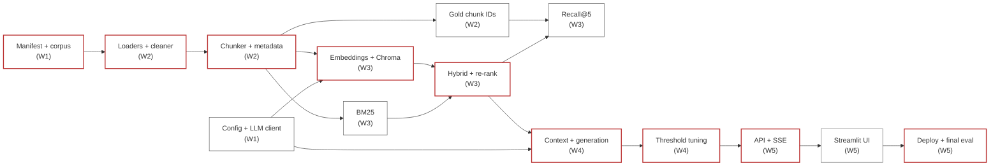

# ClauseCheck: Development Plan

Sprint 2, Simulated Work (AI Application Development with RAG)
Repo: `FirstName_ClauseCheck_Kalvium-Community`
See also: `01-project-overview.md`, `02-project-description.md`, `data-sourcing.md`, `tdd.md`, `rag-architecture-design.md`
Status: draft, submitted alongside the RAG architecture design.

This document turns the five-week timeline (project description, section 10; TDD, section 19) into a week-by-week, day-by-day build plan. For each week it lists the goal, what must be true before the week starts, the tasks, the deliverables, the eval numbers to record, and the exit gate that must pass before the next week begins.

Where the TDD and the RAG architecture design differ, this plan follows the RAG architecture design (it is the source of truth for RAG decisions; see its section 17 for the list of changes).

## Contents

1. [How to use this plan](#1-how-to-use-this-plan)
2. [Timeline at a glance](#2-timeline-at-a-glance)
3. [Workstreams and ownership](#3-workstreams-and-ownership)
4. [Working rhythm](#4-working-rhythm)
5. [Week 1: Foundations and planning](#5-week-1-foundations-and-planning)
6. [Week 2: Design approval and ingestion](#6-week-2-design-approval-and-ingestion)
7. [Week 3: Embeddings and retrieval](#7-week-3-embeddings-and-retrieval)
8. [Week 4: Grounded generation](#8-week-4-grounded-generation)
9. [Week 5: App and delivery](#9-week-5-app-and-delivery)
10. [Milestones and review gates](#10-milestones-and-review-gates)
11. [Evaluation checkpoints](#11-evaluation-checkpoints)
12. [Requirements coverage by week](#12-requirements-coverage-by-week)
13. [Critical path and dependencies](#13-critical-path-and-dependencies)
14. [Schedule risks and cut list](#14-schedule-risks-and-cut-list)
15. [Final submission checklist](#15-final-submission-checklist)

---

## 1. How to use this plan

- Each week has an **exit gate**. The next week's work starts only when the gate passes, or when the team records in the journal why it is proceeding anyway and what is carried over.
- Day numbers (D1 to D5) are a guide, not a contract. Tasks within a week can move between days; tasks should not move between weeks without updating this document.
- Every task maps to a GitHub issue on the Kanban board. Issue titles start with the week and workstream, e.g. `W3-B: RRF fusion`.
- Building (Phase 4 onward) starts only after the PRD and the RAG architecture design are approved. Week 1 and the first part of week 2 are planning and data work only.

---

## 2. Timeline at a glance

| Week | Phase | Goal | Key outputs | Exit gate |
|---|---|---|---|---|
| 1 | Foundations & planning | Team, repo and corpus ready; plan approved | Team charter, repo + CI skeleton, manifest, synthetic generator, PRD, mock UX | PRD and mock UX submitted; manifest validates |
| 2 | Design & ingestion | Every document in the manifest becomes clean, clause-level chunks with metadata | RAG design approved; loaders, cleaner, chunker, ingestion report | Full `--dry-run` ingestion succeeds; chunk checks pass |
| 3 | Embeddings & retrieval | Right clause in the top 5 for answerable questions | Embedded index, BM25, RRF, supplier filter, amendment expansion, re-ranker | Recall@5 ≥ 0.85 on the tuning split |
| 4 | Grounded generation | Correct, cited answers; refusals instead of guesses | Prompt, context builder, gate, citation/number checks, rewriter, answer eval | Correctness, citation and refusal targets met on the tuning split |
| 5 | App & delivery | Deployed, documented, reproducible app | FastAPI, SSE, upload, Streamlit UI, cache, logging, deployment, final eval | All acceptance gates met on the held-out split; app live |

```mermaid
gantt
    dateFormat  X
    axisFormat  W%s
    title ClauseCheck development plan
    section Week 1
    Charter, repo, config, CI skeleton        :a1, 1, 1
    LLM basics, model names confirmed         :a2, 1, 1
    Corpus sourcing, manifest, synthetic      :a3, 1, 1
    PRD and mock UX                           :milestone, m1, 1, 0
    section Week 2
    RAG design approved                       :milestone, m2, 2, 0
    Loaders, cleaner, tables                  :b1, 2, 1
    Clause chunker, metadata, redactions      :b2, 2, 1
    Ingestion validation, eval set draft      :b3, 2, 1
    section Week 3
    Batch embedder, Chroma                    :c1, 3, 1
    BM25, RRF, supplier filter, amendments    :c2, 3, 1
    Re-ranker, recall@5, ablations            :c3, 3, 1
    section Week 4
    Context, prompt, generator, citations     :d1, 4, 1
    Gate, threshold tuning, rewriter          :d2, 4, 1
    Answer eval with LLM judge                :d3, 4, 1
    section Week 5
    FastAPI, SSE, upload                      :e1, 5, 1
    Streamlit UI, cache, logging              :e2, 5, 1
    Deploy, docs, held-out eval               :e3, 5, 1
    Final submission                          :milestone, m3, 5, 0
```

---

## 3. Workstreams and ownership

The work is split into four workstreams. Each has one owner (named in the team charter) and one reviewer from another workstream, so every PR is reviewed by someone who didn't write it.

| ID | Workstream | Main modules | Busiest weeks |
|---|---|---|---|
| **A** | Data & ingestion | `scripts/fetch_sources.py`, `scripts/generate_synthetic.py`, `ingest/*`, `data/manifest.csv`, `data/suppliers.csv` | 1, 2 |
| **B** | Retrieval | `ingest/embedder`, `store/vector_store`, `store/bm25_index`, `rag/hybrid_retriever`, `rag/reranker`, `rag/supplier_detector` | 3 |
| **C** | Generation & evaluation | `rag/generator`, `rag/relevance_gate`, `rag/citation_validator`, `rag/rewriter`, `prompts/*`, `eval/*` | 2 (eval set), 4 |
| **D** | App & platform | `core/*`, `llm/client`, `api/*`, `services/*`, `frontend/*`, Dockerfile, CI, deployment | 1 (skeleton), 5 |

| Workstream | Owner | Reviewer |
|---|---|---|
| A: Data & ingestion | | |
| B: Retrieval | | |
| C: Generation & evaluation | | |
| D: App & platform | | |

Workstreams overlap deliberately: D builds the config, LLM client and CI in week 1 so A, B and C can use them; C writes the eval set in week 2 so B has something to measure against in week 3.

---

## 4. Working rhythm

### 4.1 Daily

| When | What |
|---|---|
| Start of day | 15-minute stand-up: yesterday, today, blockers. Kanban board updated. |
| During the day | Work on a branch named `w{week}-{workstream}-{short-name}`, e.g. `w3-b-rrf-fusion`. |
| End of day | At least one PR per person (daily PR requirement), and a journal entry in `docs/journal/YYYY-MM-DD.md`. |

Each journal entry records: what was done, PRs opened or merged, any eval numbers produced (with index version, prompt version and parameters), blockers, and the plan for the next day.

### 4.2 Weekly

| When | What |
|---|---|
| D1 | Week kick-off: confirm the previous exit gate, assign this week's issues |
| D3 | Mid-week check: are we on track for the exit gate? Move work or trigger the cut list (section 14) if not |
| D5 | Full eval run (from week 3 onward), weekly review with the mentor, exit-gate decision recorded in the journal |

### 4.3 Definition of done (every task)

A task is done when:

1. its PR is reviewed and merged into `main`;
2. its unit tests pass in CI (lint, unit, integration with the LLM mocked);
3. the related eval number, if any, is written in that day's journal;
4. any config it adds is in `.env.example`, and any decision it makes is reflected in the design documents.

### 4.4 Rules that apply all sprint

- No secrets in the repo; `detect-secrets` runs as a pre-commit hook from week 1.
- Every retrieval or prompt change is re-run against the eval set before merge (from week 3).
- Parameters live in `.env`, never hard-coded.
- Prompts are versioned text files (`# v1`, `# v2`, ...); the version is logged with every query.

---

## 5. Week 1: Foundations and planning

**Goal:** the team, repository, tooling and corpus are in place, and the plan (PRD, mock UX) is submitted for approval.

**Entry criteria:** sprint brief received; team formed.

### 5.1 Day-by-day

| Day | A: Data & ingestion | B: Retrieval | C: Generation & eval | D: App & platform |
|---|---|---|---|---|
| D1 | Read CUAD paper and release layout; list target contract types | LLM basics: embeddings, cosine similarity, BM25 | LLM basics: prompting, grounding, temperature | Team charter; create repo, branch protection, Kanban board, issue templates |
| D2 | `fetch_sources.py --cuad`: download, filter to supply-chain types, seeded sample of 120–200 contracts, `cuad_index.csv` | Confirm Gemini embedding model name and limits in AI Studio; note batch size limit | Confirm Gemini generation and Groq model names; note free-tier quotas | Repo layout (TDD 17), `requirements.txt`, `core/config.py` with `pydantic-settings`, `.env.example` |
| D3 | EDGAR full-text searches for amendments; pair each with its original; `fetch_sources.py --edgar` with declared User-Agent and ≤ 2 req/s | Help A: supplier role decisions, `suppliers.csv` with aliases | Draft PRD from the project description | `llm/client.py` skeleton: Gemini + Groq, `tenacity` retries, token counting; pre-commit with `ruff`, `black`, `detect-secrets` |
| D4 | Vendor DPAs and SLAs: pick vendors, record URLs and archive snapshots, `fetch_sources.py --vendor`, `fetch_log.csv` | Write `generate_synthetic.py` (price schedules, certificates) with seed 42; ground truth written at generation time | Mock UX: chat, sources panel, refusal box, upload form, supplier filter | CI skeleton (`.github/workflows/ci.yml`): lint + unit tests on PRs |
| D5 | Complete `manifest.csv`; run manifest validation (unique `doc_id`, known supplier, licence and URL present, amendment parents exist) | Review corpus counts against targets | Submit PRD and mock UX | `README` first version with setup steps and seeds; `NOTICE` with CUAD attribution |

### 5.2 Deliverables

- Team charter, repo, Kanban board, CI running on PRs
- `data/manifest.csv`, `data/suppliers.csv`, `data/sources/cuad_index.csv`, `data/sources/fetch_log.csv`
- `scripts/fetch_sources.py`, `scripts/generate_synthetic.py` (seeded)
- `core/config.py`, `llm/client.py` skeleton, `.env.example`
- PRD and mock UX submitted
- Data sourcing document (`data-sourcing.md`) submitted

### 5.3 Corpus targets to check on D5

| Item | Target |
|---|---|
| Contracts (CUAD + EDGAR originals) | 120–200 |
| Amendments, each paired with its original | 20–40 |
| Price schedules (synthetic) | 30–50 |
| Compliance documents (DPAs, SLAs, certificates) | 30–50 |
| Suppliers | 30–50, most with 2–6 documents |
| Formats | PDF, HTML, TXT, DOCX all present |

### 5.4 Exit gate

- [ ] PRD and mock UX submitted
- [ ] Manifest passes validation with no errors
- [ ] Corpus counts within the targets above (or the shortfall recorded with a plan)
- [ ] CI runs on every PR; no secrets in the repo
- [ ] Model names confirmed and written to `.env.example`

---

## 6. Week 2: Design approval and ingestion

**Goal:** the RAG architecture design is approved, and every document in the manifest is parsed, cleaned and split into clause-level chunks with complete metadata.

**Entry criteria:** week 1 gate passed; RAG architecture design submitted.

### 6.1 Day-by-day

| Day | A: Data & ingestion | B: Retrieval | C: Generation & eval | D: App & platform |
|---|---|---|---|---|
| D1 | **RAG design review.** Address comments; record decisions D1–D6. Building starts after approval. | (review) | (review) | (review) |
| D2 | `ingest/loaders.py`: PDF (PyMuPDF text, pdfplumber tables → Markdown), TXT (chardet fallback) | Collect 30 real clause headings from the corpus as test fixtures for the heading regex | Start `eval/questions.jsonl`: CUAD questions from `master_clauses.csv` using the label mapping in `data-sourcing.md` 4.4 | `store/sqlite.py`: schema from TDD 7.4 (documents, chunks, suppliers, aliases, ingestion_jobs, logs, cache) |
| D3 | Loaders: HTML (BeautifulSoup, strip script/style/nav/footer), DOCX (paragraphs, heading styles, tables); `ingest/cleaner.py` (headers, footers, hyphenation, whitespace; never touches numbers) | `ingest/chunker.py`: heading regex, character-offset → page map | Exact-value questions from synthetic ground truth, including tier boundaries | `tests/fixtures/`: 5 small sample contracts; unit-test scaffolding |
| D4 | Table chunks: header row repeated on every part; `has_redaction` flag for `[***]` markers | Chunk sizing: merge < 60 tokens, single chunk ≤ 512, 400/60 windows with heading prefix; page-based fallback when < 3 headings; `chunk_id` format | Amendment questions with trap chunks; redacted-value questions; unanswerable questions (unknown suppliers, hand-checked absent clauses) | `python -m clausecheck.ingest` CLI: `--manifest`, `--rebuild`, `--only-supplier`, `--dry-run`; sha256 change detection |
| D5 | Run full `--dry-run`; produce ingestion report (per-source counts, failures, flagged docs, redaction counts) | Chunk-size histogram; fix regex misses found in the report | Map CUAD character offsets to `gold_chunk_ids`; split eval set into tuning (~60%) and held-out (~40%) | Integration test: ingest the 5 fixtures, check every metadata field is filled |

### 6.2 Deliverables

- RAG architecture design approved (sign-off table filled in)
- `ingest/loaders.py`, `ingest/cleaner.py`, `ingest/chunker.py` with unit tests per format
- Ingestion CLI with dry-run and change detection
- SQLite schema in place
- First ingestion report and chunk-size histogram
- `eval/questions.jsonl` draft with gold chunk IDs, split into tuning and held-out

### 6.3 Checks to record in the journal

| Check | Target |
|---|---|
| Documents parsed without error | ≥ 98% of manifest rows |
| Documents with ≥ 3 detected headings | as high as possible; every fallback document listed |
| Clauses that fit in one chunk | majority (from the histogram) |
| Tables extracted with header rows intact | all synthetic price schedules |
| Heading regex unit tests | 30/30 real headings detected correctly |
| Eval questions with a gold chunk ID | all answerable questions |

### 6.4 Exit gate

- [ ] RAG architecture design approved
- [ ] Full `--dry-run` ingestion completes; failures are listed and explained
- [ ] Every chunk has `supplier_id`, `doc_id`, `doc_type`, `clause_no` or page, `effective_date`, `token_count`
- [ ] Amendments have a valid `parent_doc_id`; redaction flags set
- [ ] Eval set drafted (~30 CUAD, ~20 exact-value, ~15 unanswerable, ≥ 10 amendment, 2–3 redacted, ≥ 5 follow-up pairs) and split

---

## 7. Week 3: Embeddings and retrieval

**Goal:** for answerable questions, the right clause is in the top 5 after re-ranking.

**Entry criteria:** week 2 gate passed; chunks and gold chunk IDs exist.

### 7.1 Day-by-day

| Day | A: Data & ingestion | B: Retrieval | C: Generation & eval | D: App & platform |
|---|---|---|---|---|
| D1 | `ingest/embedder.py`: batches of 50, backoff with jitter, embedding cache by `sha256(text + model)`, embeds `clause_title + text` | `store/vector_store.py`: Chroma collection per embedding model, cosine, metadata filters | `eval/run_eval.py` retrieval mode: recall@5, recall@20, MRR@5 against gold chunks | Unit test: mocked 429 triggers backoff then success (NFR-4) |
| D2 | Full embedding run; fall back to local MiniLM collection if quota runs out; cost report | `store/bm25_index.py`: protected-token tokenizer (`net 45`, `7.2`, `a-114`, `$1,250.00`), **per-supplier and global** indexes, rebuilt from SQLite at startup | Baseline runs: vector only, BM25 only (filter on/off) | `ingest/indexer.py`: one transaction for SQLite + Chroma; delete-on-failure; `index_version` hash |
| D3 | Help B with amendment expansion test cases | `rag/hybrid_retriever.py`: supplier-filtered vector + BM25, RRF (k = 60), dedupe, top 20 | Run hybrid; add chunking ablation (fixed 500-token vs clause-aware) | Measure filtered vector search latency on the full corpus (decision D1: switch to Qdrant only if p95 > 100 ms) |
| D4 | | Amendment expansion (≤ 2 extra chunks; reverse: amendment → parent clause); `rag/supplier_detector.py` (sidebar → alias → fuzzy ≥ 90 → carry-over → unscoped) | Run hybrid + expansion; check amendment questions retrieve the amended chunk | `rag/reranker.py` packaging: weights downloaded once, 1.5 s timeout with RRF fallback |
| D5 | Fix any chunking issues the misses reveal | `rag/reranker.py`: cross-encoder MiniLM, one batch, `clause_title + text` truncated to 512 | **Full ablation matrix** (RAG design 12.3); record recall@5 per configuration | `retrieval_log` writes (vector rank, BM25 rank, RRF, re-rank score) |

### 7.2 Deliverables

- Embedded index (Gemini, plus local fallback collection if needed) and cost report
- BM25 per-supplier and global indexes with protected-token tokenizer
- Hybrid retriever with RRF, supplier filter, amendment expansion and re-ranker
- `run_eval.py` retrieval metrics and ablation results in `eval/results/<date>_retrieval.md`
- Decision D1 confirmed with a measured latency number

### 7.3 Eval numbers to record

| Configuration | Recall@5 | Recall@20 | MRR@5 |
|---|---|---|---|
| Vector only, filter off / on | | | |
| BM25 only, filter off / on | | | |
| Hybrid (RRF), filter off / on | | | |
| Hybrid + re-rank, filter off / on | | | |
| Hybrid + re-rank + amendment expansion (default) | | | |
| Fixed 500-token chunks (default retrieval) | | | |

If recall@20 is high but recall@5 is low, the problem is re-ranking; if recall@20 is low, it is retrieval or chunking. Use this to decide what to fix first.

### 7.4 Exit gate

- [ ] Recall@5 ≥ 0.85 on the tuning split with the default configuration
- [ ] Amendment questions retrieve the amended chunk in the top 5
- [ ] Ablation table complete and saved
- [ ] Unit tests: RRF, BM25 tokenizer keeps "Net 45" together, supplier detection, mocked 429
- [ ] Index rebuilds from a clean clone with one command (NFR-3)

---

## 8. Week 4: Grounded generation

**Goal:** answers are correct, cite the right clause, state amended terms as current, and the system refuses instead of guessing.

**Entry criteria:** week 3 gate passed; retrieval returns re-ranked candidates with scores.

### 8.1 Day-by-day

| Day | A: Data & ingestion | B: Retrieval | C: Generation & eval | D: App & platform |
|---|---|---|---|---|
| D1 | Context builder: `[C#]` markers, code-built headers (amendment, standard terms, redaction, synthetic, table) within 3,000 tokens, never truncating a chunk | Certificate validity in the header computed from `expiry_date` and `AS_OF_DATE` (decision D2) | `prompts/answer.txt` v1 with all 10 rules (RAG design 7.8); `rag/generator.py` streaming, temperature 0.1, 400 tokens | `services/query_service.py`: wires stages 1–9 together |
| D2 | `rag/citation_validator.py`: extract markers, drop invalid, map to chunk/doc/clause/page; refuse if none left | Number and date normaliser ("forty-five (45)" → 45, "2%" → 2 percent, dates → ISO); `unsupported_number` warning | `NOT_FOUND` handling; first end-to-end answers on 10 questions | `/chat` (non-streaming) route for the eval script |
| D3 | Refusal taxonomy: fixed texts for all outcomes; HTML/TXT citations show clause only (decision D3) | `rag/relevance_gate.py`; unknown-supplier, multi-supplier and aggregation detection | `run_eval.py` answer mode; LLM judge on Groq (`prompts/judge.txt`); exact-value scoring with trap-chunk check | Sessions and messages tables; `/sessions` route |
| D4 | | `rag/rewriter.py`: last 4 turns, temperature 0, 60 tokens; skip on first message and when a supplier is named without pronouns | **Threshold tuning** (RAG design 12.4): gate off, record top-1 scores, sweep −6 to +4, pick lowest false refusals with correct refusals ≥ 90% | Query log rows with outcome, threshold, prompt and index versions, stage timings |
| D5 | Fix prompt issues found in eval (new prompt version, re-run) | Follow-up pair eval; supplier carry-over checks | **Full answer eval on tuning split**; hand-check 10% of judge grades (agreement ≥ 85%) | Measure TTFT on the non-streaming path as a first estimate |

### 8.2 Deliverables

- Context builder, generator, citation validator, number check, relevance gate, rewriter
- Answer prompt v1+ and rewrite prompt, versioned
- Tuned `RELEVANCE_THRESHOLD` with refusal / false-refusal curves in the eval report
- `eval/results/<date>_answers.md` with all metrics

### 8.3 Eval numbers to record

| Metric | Target | Tuning split result |
|---|---|---|
| Recall@5 | ≥ 0.85 | |
| Answer correctness | ≥ 85% | |
| Citation accuracy | ≥ 90% | |
| Correct refusal rate | ≥ 90% | |
| False refusal rate | ≤ 10% | |
| Unsupported-number rate | tracked | |
| `refused_no_citation` frequency | tracked | |
| Judge–human agreement | ≥ 85% | |

### 8.4 Exit gate

- [ ] All answer metrics meet their targets on the tuning split (held-out is saved for week 5)
- [ ] Amendment questions state the amended term and never the trap value alone
- [ ] Redacted-value questions answered as "redacted in the filed copy" with a citation
- [ ] Unknown-supplier and aggregation questions make no LLM call
- [ ] Threshold, prompt version and index version recorded in the journal

---

## 9. Week 5: App and delivery

**Goal:** a deployed, documented, reproducible application that meets every acceptance gate on the held-out split.

**Entry criteria:** week 4 gate passed; the query service works end to end.

### 9.1 Day-by-day

| Day | A: Data & ingestion | B: Retrieval | C: Generation & eval | D: App & platform |
|---|---|---|---|---|
| D1 | `/documents` upload: validation (extension + MIME, 20 MB, generated filenames), background job states, `/documents/jobs/{id}` | `/chat/stream` SSE: `meta`, `token`, `citations`, `refusal`, `error`, `done`; stop on client disconnect | `/chunks/{id}`, `/suppliers`, `/health`, `/feedback`; error codes and bodies (TDD 8.3) | Streamlit skeleton: sidebar, chat panel, `sse_client.py` with `httpx.stream` + `st.write_stream` |
| D2 | Upload rebuilds affected BM25 (supplier + global) and bumps `index_version` | `store/cache.py`: answer cache keyed by query, supplier, index and prompt versions; 7-day TTL; cached answers replayed as SSE | API tests: response shape, SSE event order, error codes | UI: sources expanders, full-clause view, refusal `st.info` box, unsupported-number warning, synthetic/standard-terms labels, "not legal advice" note |
| D3 | `scripts/bootstrap.py`: restore index zip if `/data/chroma` missing, rebuild BM25 | JSON stdout logs with request ID and stage timings; rate limit 30/min per IP; CORS | Measure TTFT p50/p95 on the streaming path; apply latency fixes in order if p50 > 3 s (RAG design 13.1) | Dockerfile (re-ranker baked in); deploy backend to Hugging Face Spaces; frontend to Streamlit Community Cloud |
| D4 | CI: build index zip on `main`, attach to release; 10-question eval smoke test with real API | `docs/qa.md` manual checklist: follow-ups, refusals, upload, streaming, cancellation | **Final eval on held-out split**; eval report with ablations, threshold curves, latency | Deploy fixes; confirm keys only in Space and Streamlit secrets; Render as backup if Spaces is unreliable |
| D5 | README: setup, seeds, one-command rebuild, deployment, limitations | Record concept walkthrough videos | Final journal and eval summary | **Final submission** (checklist in section 15) |

### 9.2 Deliverables

- FastAPI backend with all endpoints in TDD 8.1, streaming over SSE
- Upload endpoint with background indexing
- Streamlit chat UI with streamed answers, visible sources and refusals
- Answer cache and query/retrieval logging
- Public deployment (frontend and backend URLs)
- Final eval report on the held-out split
- README, `docs/qa.md`, walkthrough videos

### 9.3 Exit gate (acceptance, held-out split)

- [ ] Recall@5 ≥ 0.85
- [ ] Answer correctness ≥ 85%
- [ ] Citation accuracy ≥ 90%
- [ ] Correct refusal rate ≥ 90%
- [ ] False refusal rate ≤ 10%
- [ ] TTFT p50 < 3 s (measured on the deployed app)
- [ ] Repeating a question returns `cache_hit: true`
- [ ] App reachable at a public URL; index restored automatically after a restart

---

## 10. Milestones and review gates

| Milestone | Week / day | Evidence | Reviewer |
|---|---|---|---|
| M1: PRD and mock UX submitted | W1 D5 | PRD, mock UX, data sourcing document | Mentor |
| M2: RAG architecture design approved | W2 D1 | Signed approval table in `rag-architecture-design.md` | Mentor |
| M3: Corpus ingested | W2 D5 | Ingestion report, chunk histogram | Team |
| M4: Retrieval target met | W3 D5 | Recall@5 ≥ 0.85, ablation table | Mentor (weekly review) |
| M5: Grounded answers target met | W4 D5 | Answer eval report on tuning split | Mentor (weekly review) |
| M6: App deployed | W5 D3 | Public URLs, `/health` returns ok | Team |
| M7: Final submission | W5 D5 | Section 15 checklist complete | Mentor |

---

## 11. Evaluation checkpoints

| When | Split | Metrics | Purpose |
|---|---|---|---|
| W3 D2 | Tuning | Recall@5/20, MRR (vector only, BM25 only) | Baselines |
| W3 D5 | Tuning | Full retrieval ablation matrix | Show what each component adds; exit gate |
| W4 D2 | 10 questions | Manual review of answers | Catch prompt problems early |
| W4 D4 | Tuning | Top-1 scores with gate off; refusal curves | Choose `RELEVANCE_THRESHOLD` |
| W4 D5 | Tuning | All answer metrics | Exit gate |
| Every merge to `main` (from W4) | 10-question smoke subset | Recall@5, correctness, refusals | Catch regressions |
| W5 D3 | Tuning | TTFT p50/p95 on streaming path | Latency fixes |
| W5 D4 | **Held-out** | All metrics, TTFT on deployed app | Reported results; acceptance |

Every result file in `eval/results/` records the index version, prompt version, threshold and parameters, so runs can be compared. The held-out split is not run before W5 D4.

---

## 12. Requirements coverage by week

| Req | W1 | W2 | W3 | W4 | W5 |
|---|---|---|---|---|---|
| FR-1 multi-format ingestion | corpus in all formats | **loaders** | | | upload formats |
| FR-2 tables | synthetic tables | **table chunks** | BM25 SKU tokens | table in prompt | |
| FR-3 clause chunking | | **chunker** | chunking ablation | | |
| FR-4 metadata | manifest columns | **chunk metadata** | metadata filters | headers | |
| FR-5 hybrid filtered retrieval | | | **retriever, re-ranker** | | `/suppliers` |
| FR-6 citations | | | | **validator** | sources UI |
| FR-7 refusals | | unanswerable questions | | **gate, taxonomy** | refusal UI |
| FR-8 follow-ups | | follow-up pairs | supplier carry-over | **rewriter** | sessions UI |
| FR-9 upload | | | | | **`/documents`, jobs** |
| FR-10 streaming UI | mock UX | | | | **SSE, Streamlit** |
| FR-11 logging | | | retrieval log | query log | **JSON logs, feedback** |
| NFR-1 TTFT < 3 s | | | latency of search | first estimate | **measured, tuned** |
| NFR-2 no secrets | **`.env`, detect-secrets** | | | | deployment secrets |
| NFR-3 reproducible | **seeds, fetch script** | ingest CLI | **clean-clone rebuild** | | CI index build |
| NFR-4 rate limits | **LLM client retries** | | **batched embedding** | Groq fallback | rate limit per IP |
| NFR-5 caching | | | embedding cache | | **answer cache** |

Bold marks the week in which the requirement is mainly delivered.

---

## 13. Critical path and dependencies

The red path has no slack. A delay on it moves the final submission unless work is cut (section 14). Things that can run in parallel without blocking it: the eval set (W2), the UI skeleton (can start in W4 against a mocked API), documentation, and the Dockerfile.

**Key dependencies to watch**

| Dependency | Needed by | Risk if late |
|---|---|---|
| RAG design approval | W2 D2 (start of building) | Whole build slips; ask for review early |
| Chunk IDs stable | Gold chunk mapping (W2 D5) | Changing the chunker later breaks gold IDs; re-run the mapping script whenever the chunker version changes |
| Embedding quota | W3 D2 | Use local MiniLM collection and continue |
| Tuned threshold | Final eval (W5 D4) | Re-tune on tuning split only; never on held-out |

---

## 14. Schedule risks and cut list

### 14.1 Risks

| Risk | Week | Early signal | Response |
|---|---|---|---|
| Corpus below target | 1 | D3 counts low | Reduce EDGAR target to 20 pairs; add synthetic schedules for existing suppliers |
| Design approval delayed | 2 | No review by D1 | Start loaders (low-risk, approved in TDD) while waiting; hold chunking decisions |
| Heading regex fails on many contracts | 2 | Many fallback documents in report | Add patterns from the failures; accept page-based fallback for the rest |
| Free-tier embedding quota exhausted | 3 | 429s after retries | Local MiniLM collection; finish Gemini run overnight |
| Recall@5 below 0.85 | 3 | D3 hybrid numbers | Check recall@20 vs recall@5 to locate the problem; tune `RETRIEVE_K`, chunk size, tokenizer |
| Threshold can't meet both refusal targets | 4 | Curves don't cross the targets | Improve unknown-supplier detection; refine prompt `NOT_FOUND` rule; report the trade-off honestly |
| Deployment issues on free hosting | 5 | D3 deploy fails | Render as backup; deploy a working version on D3, not D5 |
| TTFT over 3 s | 5 | D3 measurement | Apply the three latency fixes in order (RAG design 13.1) |

### 14.2 Cut list

If the team falls behind, cut in this order. Items higher in the list are cut first. Nothing below the line is cut.

| Order | Item | Effect of cutting |
|---|---|---|
| 1 | `/feedback` endpoint and thumbs buttons | No user ratings; logging still complete |
| 2 | Reverse amendment expansion (amendment → parent) | Slightly weaker amendment answers; forward expansion stays |
| 3 | DOCX upload through the app (keep in batch ingestion) | Upload supports PDF, HTML, TXT only |
| 4 | Render backup deployment | Single host only |
| 5 | Chunking ablation (fixed vs clause-aware) | One fewer comparison in the report |
| — | **Not cut:** hybrid retrieval, supplier filter, relevance gate, marker citations, citation validation, held-out eval, streaming, deployment | These are the core of the project and its acceptance gates |

The sprint also keeps half a day of buffer on W5 D5 afternoon; it is not planned with new work.

---

## 15. Final submission checklist

**Application**
- [ ] Public frontend URL and backend URL working
- [ ] Questions answered with streamed text and visible sources
- [ ] Refusals shown in the grey refusal box
- [ ] Upload indexes a new document and it becomes answerable
- [ ] `/health` reports document, chunk and supplier counts

**Repository**
- [ ] README with setup, seeds, one-command rebuild and deployment steps
- [ ] `.env.example` complete; no secrets in history (`detect-secrets` clean)
- [ ] Team charter, `NOTICE` with CUAD attribution
- [ ] `data/manifest.csv` with source and licence for every document
- [ ] Ingestion and indexing reproducible from a clean clone (verified in CI)

**Documents**
- [ ] `01-project-overview.md`, `02-project-description.md`
- [ ] PRD and mock UX
- [ ] `data-sourcing.md`
- [ ] `rag-architecture-design.md` (approved) and `tdd.md` updated with the changes in its section 17
- [ ] `development-plan.md` (this document), updated with actual dates and any re-planning
- [ ] `docs/qa.md` with the manual checklist completed

**Evaluation**
- [ ] `eval/questions.jsonl` with tuning and held-out splits
- [ ] Final report on the held-out split meeting all acceptance gates (or shortfalls explained)
- [ ] Ablation table, threshold curves, latency numbers, judge agreement

**Process**
- [ ] Daily PRs and journal entries for every day of the sprint
- [ ] Concept walkthrough videos recorded
