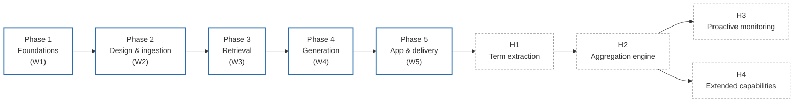
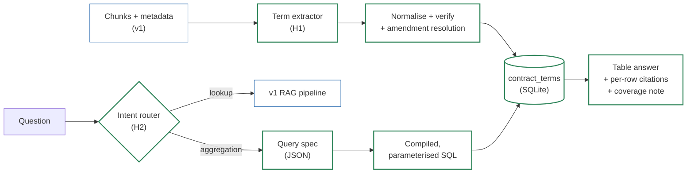

# ClauseCheck: Roadmap

Sprint 2, Simulated Work (AI Application Development with RAG)
Repo: `FirstName_ClauseCheck_Kalvium-Community`
See also: `01-project-overview.md`, `02-project-description.md`, `data-sourcing.md`, `tdd.md`, `rag-architecture-design.md`, `development-plan.md`
Status: draft. Update with actual dates at each phase gate.

This roadmap is the one-page view of where ClauseCheck is going. **Part A** covers the five sprint phases: what each phase delivers, the gate that closes it, and the milestone it produces. The day-by-day tasks live in `development-plan.md`. **Part B** covers what comes after the sprint. Its main item is **portfolio-wide aggregation**, which the sprint scope deliberately excludes (project description, section 13; RAG design, section 7.2, `out_of_scope_aggregation`).

## Contents

**Part A: Sprint phases**
1. [Roadmap at a glance](#1-roadmap-at-a-glance)
2. [Phase 1: Foundations and planning (W1)](#2-phase-1-foundations-and-planning-w1)
3. [Phase 2: Design and ingestion (W2)](#3-phase-2-design-and-ingestion-w2)
4. [Phase 3: Embeddings and retrieval (W3)](#4-phase-3-embeddings-and-retrieval-w3)
5. [Phase 4: Grounded generation (W4)](#5-phase-4-grounded-generation-w4)
6. [Phase 5: App and delivery (W5)](#6-phase-5-app-and-delivery-w5)
7. [Sprint milestones and acceptance targets](#7-sprint-milestones-and-acceptance-targets)

**Part B: Future work**

8. [Why aggregation needs a different architecture](#8-why-aggregation-needs-a-different-architecture)
9. [Future roadmap at a glance](#9-future-roadmap-at-a-glance)
10. [Horizon 1: Structured term extraction](#10-horizon-1-structured-term-extraction)
11. [Horizon 2: Aggregation query engine](#11-horizon-2-aggregation-query-engine)
12. [Horizon 3: Proactive monitoring](#12-horizon-3-proactive-monitoring)
13. [Horizon 4: Extended capabilities](#13-horizon-4-extended-capabilities)
14. [Future-work evaluation plan](#14-future-work-evaluation-plan)
15. [Future-work risks](#15-future-work-risks)
16. [Open questions](#16-open-questions)

---

# Part A: Sprint phases

## 1. Roadmap at a glance

| Phase | Week | Theme | Outcome | Gate to close the phase |
|---|---|---|---|---|
| 1 | W1 | Foundations & planning | Team, repo, corpus and plan in place | PRD and mock UX submitted; manifest validates |
| 2 | W2 | Design & ingestion | Every document becomes clean, clause-level chunks with metadata | RAG design approved; full `--dry-run` ingestion passes |
| 3 | W3 | Embeddings & retrieval | Right clause in the top 5 | Recall@5 ≥ 0.85 (tuning split) |
| 4 | W4 | Grounded generation | Correct, cited answers; refusals instead of guesses | All answer targets met (tuning split) |
| 5 | W5 | App & delivery | Deployed, documented, reproducible app | All acceptance gates met (held-out split); app live |
| — | Post-sprint | Future work (Part B) | Portfolio-wide questions answered from a structured term store | Horizon gates in section 9 |



**Ground rules for the whole sprint**

- A phase closes only when its gate passes, or when the journal records why the team is proceeding anyway and what carries over.
- Building starts only after the RAG architecture design is approved (W2 D1).
- Every retrieval or prompt change is re-run against the eval set before merge (from W3).
- The held-out split is not run before W5 D4.

---

## 2. Phase 1: Foundations and planning (W1)

**Theme:** get the team, tooling and data ready, and get the plan approved.

| Area | Deliverables |
|---|---|
| Team & process | Team charter; repo with branch protection; Kanban board; issue templates; daily PR + journal rhythm |
| Platform | Repo layout, `core/config.py` (`pydantic-settings`), `.env.example`, `llm/client.py` skeleton (Gemini + Groq, retries), pre-commit (`ruff`, `black`, `detect-secrets`), CI on PRs |
| Data | `fetch_sources.py` (CUAD, EDGAR, vendor DPAs/SLAs), `generate_synthetic.py` (seed 42), `manifest.csv`, `suppliers.csv`, `fetch_log.csv` |
| Planning | PRD, mock UX, `data-sourcing.md` |

**Corpus targets:** 120–200 contracts, 20–40 amendment pairs, 30–50 price schedules, 30–50 compliance documents, 30–50 suppliers, all four formats present.

**Gate:** PRD and mock UX submitted · manifest validates · corpus counts on target (or shortfall recorded) · CI on every PR · model names confirmed.

**Milestone:** M1, PRD and mock UX submitted (W1 D5).

---

## 3. Phase 2: Design and ingestion (W2)

**Theme:** design approved, then every document turned into well-formed chunks.

| Area | Deliverables |
|---|---|
| Design | RAG architecture design approved (decisions D1–D6 recorded) |
| Ingestion | Loaders for PDF, HTML, TXT, DOCX; cleaner; table chunks with repeated header rows; redaction flags |
| Chunking | Clause-aware chunker (heading regex, 512-token cap, 400/60 windows, page fallback), stable `chunk_id` |
| Storage | SQLite schema (documents, chunks, suppliers, aliases, jobs, logs, cache) |
| CLI | `python -m clausecheck.ingest` with `--dry-run`, `--rebuild`, `--only-supplier`, sha256 change detection |
| Evaluation | `eval/questions.jsonl` draft with gold chunk IDs, split into tuning (~60%) and held-out (~40%) |

**Gate:** design approved · full `--dry-run` completes with failures explained · every chunk has full metadata · amendments linked by `parent_doc_id` · eval set drafted and split.

**Milestones:** M2, RAG design approved (W2 D1) · M3, corpus ingested (W2 D5).

---

## 4. Phase 3: Embeddings and retrieval (W3)

**Theme:** find the right clause, measurably.

| Area | Deliverables |
|---|---|
| Embedding | Batched Gemini embedding with backoff and cache; local MiniLM fallback collection; cost report |
| Indexes | Chroma (cosine, metadata filters); BM25 per-supplier and global, with protected-token tokenizer |
| Retrieval | Supplier resolution; hybrid retrieval with RRF (k = 60); amendment expansion (both directions); cross-encoder re-ranker with timeout fallback |
| Evaluation | `run_eval.py` retrieval mode; full ablation matrix (vector / BM25 / hybrid / re-rank / expansion; filter on/off; fixed vs clause chunks) |

**Gate:** recall@5 ≥ 0.85 on the tuning split · amendment questions retrieve the amended chunk in the top 5 · ablation table saved · index rebuilds from a clean clone with one command.

**Milestone:** M4, retrieval target met (W3 D5).

---

## 5. Phase 4: Grounded generation (W4)

**Theme:** answer only from the contracts, cite every claim, and refuse when unsure.

| Area | Deliverables |
|---|---|
| Context | Context builder with `[C#]` markers and code-built headers (amendment, redaction, synthetic, table, certificate validity from `AS_OF_DATE`) |
| Generation | Versioned answer prompt; streaming generator (temperature 0.1) |
| Verification | Citation validator; number and date normaliser; `unsupported_number` warning |
| Refusals | Relevance gate; fixed refusal taxonomy, including **`out_of_scope_aggregation`** (the hook Part B builds on) |
| Conversation | Follow-up rewriter; supplier carry-over; sessions |
| Evaluation | Answer-mode eval with LLM judge; threshold sweep and refusal curves; judge-human agreement check |

**Gate:** correctness ≥ 85% · citation accuracy ≥ 90% · correct refusals ≥ 90% · false refusals ≤ 10% (all on the tuning split) · amended terms stated as current · unknown-supplier and aggregation questions make no LLM call.

**Milestone:** M5, grounded answers target met (W4 D5).

---

## 6. Phase 5: App and delivery (W5)

**Theme:** ship it, and prove it on data the team never tuned on.

| Area | Deliverables |
|---|---|
| API | FastAPI endpoints; `/chat/stream` over SSE; `/documents` upload with background jobs; `/health`, `/suppliers`, `/chunks/{id}` |
| UI | Streamlit chat with streamed answers, sources panel, refusal box, warnings, "not legal advice" note |
| Platform | Answer cache (7-day TTL, version-keyed); JSON logs with stage timings; rate limiting; Dockerfile |
| Deployment | Backend on Hugging Face Spaces, frontend on Streamlit Community Cloud (Render as backup); index restored on restart |
| Delivery | Final held-out eval report; README; `docs/qa.md`; walkthrough videos |

**Gate (acceptance, held-out split):** recall@5 ≥ 0.85 · correctness ≥ 85% · citation accuracy ≥ 90% · correct refusals ≥ 90% · false refusals ≤ 10% · TTFT p50 < 3 s on the deployed app · cache hits on repeat · public URL live.

**Milestones:** M6, app deployed (W5 D3) · M7, final submission (W5 D5).

---

## 7. Sprint milestones and acceptance targets

| Milestone | When | Evidence |
|---|---|---|
| M1: PRD and mock UX submitted | W1 D5 | PRD, mock UX, data sourcing document |
| M2: RAG design approved | W2 D1 | Signed approval table |
| M3: Corpus ingested | W2 D5 | Ingestion report, chunk histogram |
| M4: Retrieval target met | W3 D5 | Recall@5, ablation table |
| M5: Grounded answers target met | W4 D5 | Answer eval report (tuning split) |
| M6: App deployed | W5 D3 | Public URLs, `/health` ok |
| M7: Final submission | W5 D5 | Submission checklist complete |

| Metric | Target | First measured | Reported on |
|---|---|---|---|
| Recall@5 | ≥ 0.85 | W3 D2 | Held-out, W5 D4 |
| Answer correctness | ≥ 85% | W4 D3 | Held-out, W5 D4 |
| Citation accuracy | ≥ 90% | W4 D3 | Held-out, W5 D4 |
| Correct refusal rate | ≥ 90% | W4 D4 | Held-out, W5 D4 |
| False refusal rate | ≤ 10% | W4 D4 | Held-out, W5 D4 |
| TTFT p50 | < 3 s | W4 D5 (estimate) | Deployed app, W5 D4 |

**Cut order if behind schedule:** feedback endpoint → reverse amendment expansion → DOCX upload in the app → Render backup → chunking ablation. Hybrid retrieval, supplier filter, relevance gate, citations, held-out eval, streaming and deployment are never cut.

---

# Part B: Future work

## 8. Why aggregation needs a different architecture

ClauseCheck v1 answers **lookup questions**: one supplier, one term, one cited clause. Procurement managers also ask **portfolio questions**:

| Type | Example |
|---|---|
| Filter | "Which suppliers auto-renew next quarter?" |
| Threshold | "Which contracts have a liability cap below $1M?" |
| Count | "How many suppliers allow termination for convenience?" |
| Rank / sort | "List suppliers by notice period, longest first." |
| Expiry | "Which ISO 27001 certificates expire in the next 90 days?" |
| Gap | "Which suppliers have no signed DPA on file?" |

v1 cannot answer these reliably, and the reason is structural rather than a matter of tuning:

1. **Top-k sees a sample, not the set.** Retrieval sends at most 5 chunks to the model. A question about 50 suppliers needs evidence from all 50. Any answer built from 5 chunks is silently incomplete.
2. **Completeness can't be checked.** For a lookup, a missing clause produces a refusal. For a list, a missing supplier produces a shorter list that *looks* correct, and the user cannot tell the difference.
3. **LLMs are weak at counting, comparing and date arithmetic.** v1 already moves certificate validity into code (ADR-09) for this reason. Aggregation is that problem multiplied across the whole portfolio.
4. **Amendments change the answer.** "Term in force" must be resolved per supplier before the set is filtered, or superseded values leak into results.

**The fix:** extract terms into a **structured, cited store at ingestion time**, then answer portfolio questions with **deterministic queries** over that store. The LLM's job moves from *answering* to *extracting* (offline, verifiable) and *parsing the question* (into a fixed query spec). Every row in a result keeps a clause citation, so the v1 trust model carries over.



---

## 9. Future roadmap at a glance

Horizons are ordered by dependency, not by calendar. Each one is usable on its own.

| Horizon | Theme | Depends on | Key output | Gate |
|---|---|---|---|---|
| **H1** | Structured term extraction | v1 shipped | `contract_terms` table with cited, normalised, amendment-resolved values | Extraction F1 ≥ 0.85 on priority terms; 100% of rows cite a valid chunk |
| **H2** | Aggregation query engine | H1 | Intent router, query spec, compiled SQL, table answers with coverage | Set F1 ≥ 0.90 on the aggregation eval set; zero raw LLM SQL executed |
| **H3** | Proactive monitoring | H1, H2 | Renewal-window and certificate-expiry digests; portfolio dashboard | Digests match ground truth on synthetic dates |
| **H4** | Extended capabilities | H1–H2 | Multi-supplier comparison, invoice checks, production hardening | Defined per item (section 13) |

```mermaid
gantt
    dateFormat  X
    axisFormat  M%s
    title ClauseCheck future work (indicative, in months after the sprint)
    section H1 Term extraction
    Term catalogue and schema            :h1a, 0, 1
    Extractor, normaliser, verifier      :h1b, 0, 2
    Amendment resolution, review queue   :h1c, 1, 2
    section H2 Aggregation engine
    Intent router                        :h2a, 2, 3
    Query spec and SQL compiler          :h2b, 2, 3
    Table answers, coverage, eval        :h2c, 3, 4
    section H3 Monitoring
    Digests and dashboard                :h3a, 4, 5
    section H4 Extended
    Comparison, invoice checks, hardening :h4a, 4, 6
```



---

## 10. Horizon 1: Structured term extraction

**Goal:** every supplier has a row per priority term, holding the value in force, a normalised form for querying, and a citation to the clause it came from.

### 10.1 Term catalogue

Start with terms that drive the portfolio questions in section 8. Where CUAD has a matching clause category, its expert labels become free ground truth.

| Term | Normalised type | Ground truth source |
|---|---|---|
| `effective_date` | date | Manifest, CUAD |
| `expiration_date` | date | CUAD |
| `auto_renews` | bool | CUAD (Renewal Term) |
| `renewal_term` | duration (months) | CUAD (Renewal Term) |
| `renewal_notice_period` | duration (days) | CUAD (Notice Period to Terminate Renewal) |
| `termination_for_convenience` | bool + notice (days) | CUAD |
| `liability_cap` | money or multiple of fees | CUAD (Cap on Liability) |
| `warranty_duration` | duration (months) | CUAD |
| `minimum_commitment` | money / quantity | CUAD |
| `payment_terms` | days + discount % | Synthetic ground truth |
| `cert_type`, `cert_expiry` | enum, date | Synthetic ground truth |
| `has_signed_dpa` | bool | Manifest (`doc_type`) |

### 10.2 Schema

`contract_terms` (SQLite, next to the v1 tables):

| Column | Purpose |
|---|---|
| `term_id` | Primary key |
| `supplier_id`, `doc_id` | Who and which document |
| `term_type` | From the catalogue |
| `value_raw` | Exact text span as written |
| `value_norm`, `unit` | Queryable form (number, ISO date, bool, enum) |
| `is_conditional` | Term depends on a condition the schema can't capture |
| `effective_date`, `superseded_by` | Amendment chain; only rows with `superseded_by IS NULL` are "in force" |
| `source_chunk_id`, `clause_no`, `page` | Citation (same mapping as v1) |
| `method` | `rule`, `llm`, or `manifest` |
| `confidence` | 0–1 |
| `review_status` | `auto_accepted`, `needs_review`, `human_verified`, `rejected` |
| `extractor_version` | For re-extraction and cache keys |

`NOT_FOUND` is stored as an explicit row (`value_norm = NULL`, `method = llm`), so "we looked and it isn't there" is distinguishable from "we never looked". This distinction is what makes coverage reporting possible in H2.

### 10.3 Extraction pipeline

| Step | What happens | Reuses from v1 |
|---|---|---|
| 1. Candidate selection | For each (supplier, term), run a term-specific query through the supplier-filtered hybrid retriever and re-ranker; keep the top chunks | Retriever, re-ranker |
| 2. Rule pass | Regex/pattern extractors for easy cases (`Net 45`, explicit dates, "% discount") | Protected-token patterns |
| 3. LLM pass | Structured JSON output against a per-term schema; must return a `[C#]` marker or `NOT_FOUND`; temperature 0 | LLM client, marker format |
| 4. Normalise | Numbers, durations, money, dates to canonical form | Number and date normaliser |
| 5. Verify | `value_raw` must appear in the cited chunk; normalised number must be supported by the text; otherwise downgrade to `needs_review` | Citation validator, unsupported-number check |
| 6. Resolve amendments | Walk `parent_doc_id`; the latest `effective_date` wins; older rows get `superseded_by` | Amendment metadata |
| 7. Route by confidence | High confidence → `auto_accepted`; else → review queue | — |

Extraction runs **once at ingestion** and again only when a document is uploaded or `extractor_version` changes. This keeps free-tier usage bounded: about 12 terms × 50 suppliers is roughly 600 extractions, and most are cached.

### 10.4 Review queue

A Streamlit page lists `needs_review` rows with the cited clause beside the extracted value. A reviewer can accept, correct or reject each row. Corrections are stored as `human_verified` and are never overwritten by re-extraction.

### 10.5 Exit gate

- [ ] Extraction precision and recall ≥ 0.85 on each CUAD-backed priority term (held-out contracts)
- [ ] Exact match on 100% of synthetic payment-term and certificate-expiry values
- [ ] Every non-`NOT_FOUND` row cites a chunk that contains its `value_raw`
- [ ] Amendment test pairs: the in-force row is the amended value in 100% of cases
- [ ] Re-extraction is reproducible from one command (same spirit as NFR-3)

---

## 11. Horizon 2: Aggregation query engine

**Goal:** replace the `out_of_scope_aggregation` refusal with a correct, complete, cited table answer.

### 11.1 Intent routing

| Intent | Signal | Route |
|---|---|---|
| `lookup` | One supplier, one term | v1 RAG pipeline (unchanged) |
| `aggregation` | "which suppliers", "all contracts", "how many", "list", comparisons across the portfolio | Aggregation engine |
| `hybrid` | Set selection + detail ("which suppliers auto-renew next quarter, and what's their notice period?") | Aggregation selects the set; terms table supplies the detail |
| `unsupported` | Term not in the catalogue | Fixed message naming the supported terms |

Routing is rules first (v1's aggregation detector already exists), with a small LLM classifier for ambiguous cases. Misroutes are logged and added to the eval set.

### 11.2 Query spec, not free text-to-SQL

The LLM never writes SQL. It fills a **fixed JSON query spec**, which code validates and compiles to parameterised SQL over `contract_terms` (in-force rows only):

```json
{
  "operation": "filter",
  "term": "auto_renews",
  "conditions": [
    {"term": "auto_renews", "op": "eq", "value": true},
    {"term": "expiration_date", "op": "between", "value": ["{AS_OF_DATE}", "{AS_OF_DATE}+3mo"]}
  ],
  "return_terms": ["renewal_notice_period"],
  "sort": {"term": "expiration_date", "order": "asc"},
  "limit": null
}
```

| Field | Allowed values |
|---|---|
| `operation` | `filter`, `count`, `rank`, `gap` (missing term) |
| `term`, `return_terms` | Catalogue terms only |
| `op` | `eq`, `ne`, `lt`, `lte`, `gt`, `gte`, `between`, `is_null`, `not_null` |
| Relative dates | Resolved in code from `AS_OF_DATE` (same rule as ADR-09) |

**Why:** the spec has a small, checkable surface. Invalid specs are rejected before they reach the database, there is no SQL-injection path, and the eval can compare specs directly.

### 11.3 Answer format

1. **Table:** one row per supplier with the requested values.
2. **Per-row citation:** supplier → document → clause (→ page), using the v1 citation mapping.
3. **Coverage note (always shown):** "Checked 47 of 50 suppliers. 3 have no extracted renewal term: A, B, C." Rows in `needs_review` are flagged in the table rather than hidden.
4. **Optional one-line summary** generated *from the table*, never from raw chunks.

Rule carried over from v1: if coverage cannot be computed, the system refuses instead of returning a partial list.

### 11.4 Exit gate

- [ ] Aggregation eval set: set precision and recall ≥ 0.90; counts exactly correct ≥ 95%
- [ ] Router accuracy ≥ 95% on mixed lookup/aggregation questions; lookup metrics from Phase 5 do not regress
- [ ] 100% of specs pass validation before execution; no LLM-written SQL ever executed
- [ ] Every result row cites a clause; every answer shows a coverage note
- [ ] Amendment trap questions return only in-force values

---

## 12. Horizon 3: Proactive monitoring

**Goal:** answer the important portfolio questions before anyone asks.

| Feature | Behaviour |
|---|---|
| Renewal-window digest | Weekly list of contracts whose notice deadline (`expiration_date − renewal_notice_period`) falls in the next N days |
| Certificate-expiry digest | Certificates expiring within 30/60/90 days, plus suppliers with no certificate on file |
| Portfolio dashboard | Streamlit page: renewals timeline, liability-cap distribution, payment-term mix, coverage per term |
| Change alerts | When an upload creates an amendment, show which in-force terms changed |

All digests are saved H2 query specs run on a schedule, so they inherit H2's correctness and citation guarantees.

**Gate:** digests match the ground truth computed by `generate_synthetic.py` for a fixed `AS_OF_DATE`; every alert links to its clause.

---

## 13. Horizon 4: Extended capabilities

| Item | Description | Note |
|---|---|---|
| Multi-supplier comparison | "Compare payment terms for X and Y" as a side-by-side table from `contract_terms` | Replaces v1's `clarify_multiple_suppliers` for catalogue terms |
| Invoice and PO checks | Upload an invoice; compare unit prices and payment terms with the price schedule in force | Needs tier logic from synthetic schedules |
| OCR for scanned documents | Scanned certificates and signed PDFs | Adds an OCR step before the loaders |
| Production hardening | Auth and role-based access, per-team document scopes, audit log, private or paid model for confidential contracts | Required before any real-contract use (project description, section 13) |
| ERP integration | Sync suppliers and contracts from a source system instead of the manifest | Was out of scope for v1 |
| Clause drafting / redlining | Suggest fallback clauses during negotiation | Furthest out; raises legal-advice concerns; keep the "not legal advice" stance |

---

## 14. Future-work evaluation plan

The v1 eval approach (labelled set, tuning/held-out split, results tied to versions) carries forward, with three new sets.

| Set | Size (initial) | Ground truth | Metrics |
|---|---|---|---|
| Extraction | All contracts × priority terms | CUAD labels; synthetic generator values | Per-term precision, recall, F1; normalisation exact match; `NOT_FOUND` accuracy |
| Aggregation | ~20–30 questions (filter, count, rank, gap, expiry; with amendment traps) | Gold sets computed from extraction ground truth | Set precision/recall, count exact match, spec exact match, coverage-note correctness |
| Routing | ~50 mixed questions | Hand-labelled intent | Router accuracy; confusion matrix lookup ↔ aggregation |

Every result file records `index_version`, `extractor_version`, prompt versions and `AS_OF_DATE`. Aggregation answers are cached with `terms_version` in the cache key, so a re-extraction invalidates stale results in the same way `index_version` does in v1.

---

## 15. Future-work risks

| Risk | Impact | Mitigation |
|---|---|---|
| Extraction errors propagate silently into aggregates | Wrong list that looks right | Per-row citations, verification step, confidence threshold, review queue, coverage note |
| Conditional or unusual terms don't fit the schema | Over-simplified values | `is_conditional` flag; keep `value_raw`; route to review |
| Amendment chain resolved wrongly | Superseded values in results | Amendment trap questions in both eval sets |
| Free-tier quota during full extraction | Slow or partial extraction | Extract once at ingestion, rule pass first, cache by `sha256(chunk + term + extractor_version)`, resume on failure |
| Router sends lookups to the aggregation path | Lookup quality regresses | Phase 5 eval re-run on every router change; lookup is the default for low-confidence routing |
| Corpus is many companies simulated as one enterprise | Portfolio patterns look artificial | Stated as a limitation, as in v1 |

---

## 16. Open questions

| ID | Question | Current leaning |
|---|---|---|
| F1 | SQLite or DuckDB for `contract_terms`? | SQLite (already the source of truth, ADR-12); revisit only if analytical queries get slow |
| F2 | Should `needs_review` rows be included in aggregation results? | Include, but flag in the table and count separately in the coverage note |
| F3 | Extract all catalogue terms up front, or lazily on first aggregation query? | Up front at ingestion; lazy extraction makes coverage unpredictable |
| F4 | Smallest catalogue that answers most portfolio questions? | Start with renewal, notice period, expiration, liability cap, payment terms and certificate expiry; extend from logged `unsupported` questions |
| F5 | Expose the query spec to users ("show how this was computed")? | Yes, as a collapsible panel; it builds trust the same way clause citations do |
