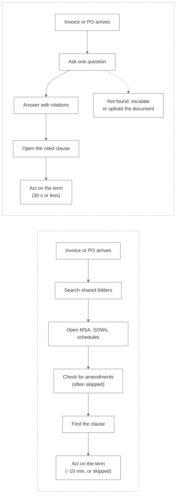
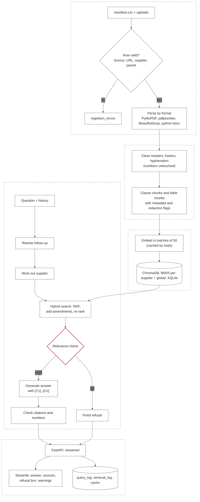

# ClauseCheck: Product Requirement Document

Sprint 2, Simulated Work (AI Application Development with RAG)
Repo: `FirstName_ClauseCheck_Kalvium-Community`
See also: `01-project-overview.md`, `02-project-description.md`, `data-sourcing.md`, `tdd.md`, `rag-architecture-design.md`, `development-plan.md`, `roadmap.md`
Version: 1.0, 2026-10-01
Status: submitted for review (milestone M1). We start building only after this PRD and the RAG architecture design are approved.

This PRD covers what we are building and why: the problem, who it is for, what is in and out of scope, how we will measure success, and what could go wrong. How retrieval and generation work is covered in `rag-architecture-design.md`. If the two documents disagree on scope or success criteria, this one is updated first and the design follows.

| Version | Date | Change | Approved by |
|---|---|---|---|
| 1.0 | 2026-10-01 | First version for M1 review | |

Changes to scope (section 8), KPIs (section 6) or acceptance gates need a new version of this document and a row in the table above.

## Contents

1. [Summary](#1-summary)
2. [Business problem](#2-business-problem)
3. [Stakeholders](#3-stakeholders)
4. [Business impact](#4-business-impact)
5. [Data sources](#5-data-sources)
6. [KPIs and success metrics](#6-kpis-and-success-metrics)
7. [Users, user stories and workflow](#7-users-user-stories-and-workflow)
8. [Scope](#8-scope)
9. [Requirements](#9-requirements)
10. [Data workflow](#10-data-workflow)
11. [UI layout and states](#11-ui-layout-and-states)
12. [Risks](#12-risks)
13. [Assumptions](#13-assumptions)
14. [Dependencies, approvals and timeline](#14-dependencies-approvals-and-timeline)
15. [Validation checklist](#15-validation-checklist)
16. [AI-assisted review](#16-ai-assisted-review)
17. [Decisions, open questions and sign-off](#17-decisions-open-questions-and-sign-off)
18. [Appendix](#18-appendix)

---

## 1. Summary

**Problem.** Procurement buyers can't quickly check negotiated supplier terms (price, payment, penalties, renewal, liability, compliance) because the answers are spread across hundreds of contracts, amendments, price schedules and compliance documents. Looking one up by hand takes several minutes, so buyers often skip it. That leads to overpaid invoices, missed discounts and renewal windows, and expired supplier certificates going unnoticed.

**What we're building.** ClauseCheck, a question-answering assistant for one supplier at a time. It finds the relevant clauses with hybrid search, answers only from those clauses, cites the clause for every term, and says "not found" when the contracts don't contain the answer. It comes with a FastAPI backend, a Streamlit chat UI, document upload, an evaluation suite and a public deployment.

**What we're not building.** Questions across the whole portfolio, comparisons between suppliers, legal advice, drafting, OCR or ERP integration (section 8.2).

**How we'll know it works.** On the held-out evaluation questions at the end of week 5: recall@5 of at least 0.85, at least 85% correct answers, at least 90% correct citations, at least 90% correct refusals, no more than 10% wrong refusals, and a median time to first token under 3 seconds. In a usability session, testers should get to a checked answer in 30 seconds or less (median).

**What we need.** The CUAD dataset, EDGAR amendments, public vendor DPAs and SLAs, our synthetic generator, Gemini and Groq free-tier keys, Hugging Face Spaces and Streamlit Community Cloud, and approval of this PRD (M1) and the RAG design (M2).

**Main risks.** Free-tier rate limits, amendments not being retrieved (so an old term is returned), the refusal threshold overfitting our eval set, and a corpus that is easier than a real company's. All are in section 12, and the assumptions behind them are in section 13.

---

## 2. Business problem

### 2.1 Problem statement

| | |
|---|---|
| Problem | An enterprise procurement team keeps contracts, pricing agreements and compliance documents for 30 to 50 suppliers (about 120 to 200 contracts, 20 to 40 amendments, 30 to 50 price schedules and 30 to 50 compliance documents). To check a term, a buyer has to find the right document, check whether a later amendment changed it, and then find the clause. We estimate this takes about 10 minutes per question (assumption A-3, which we will measure in week 2). Because it's slow, buyers skip it, and mistakes cost money: invoices paid above the agreed price, early-payment discounts missed, renewal notice deadlines missed, and expired certificates relied on. |
| Goal | A buyer asks one question about one supplier and gets the term currently in force, with a link to the clause, in 30 seconds or less (median, including reading the clause). When the contracts don't contain the answer, the buyer gets a fixed refusal message instead of a guess. |
| Primary users | Procurement buyers who raise purchase orders and approve invoices. |
| Secondary users | Category managers and compliance / vendor-risk analysts. |
| Success criteria | All six acceptance gates in section 6.2 met on the held-out split by W5 D4, plus a median time to checked answer of 30 s or less and at least 80% task success in the W5 usability session (KPI-01, KPI-09). |
| Boundary | Questions about one supplier's terms in the indexed documents. Portfolio questions such as "which suppliers auto-renew next quarter?" are not part of v1. |

### 2.2 Why it's hard

| Difficulty | What happens today | What ClauseCheck has to do |
|---|---|---|
| Volume: hundreds of documents, many suppliers | Searching takes too long, so buyers don't | Search only the named supplier's documents |
| Fragmentation: terms split across MSAs, SOWs, amendments and schedules | The first clause found may have been replaced | Link amendments to originals and give the amended term |
| Precision: answers are numbers, dates and conditions | A close answer is still a wrong answer | Match exact text like `Net 45`, `7.2`, `A-114`; copy values as written; check numbers against the cited clause |
| Formats: legal text, pricing tables, certificates | Ordinary search handles tables badly | Split by clause; keep tables together with their header row |
| Trust: buyers act on the answer with money | A wrong answer that looks right is worse than no answer | Cite every term; refuse when the evidence is weak |

### 2.3 The question ClauseCheck answers

What is the negotiated term (price, payment, penalty, renewal or liability) with a given supplier, and where exactly in the contracts does it say so?

The traceability table in section 18.1 links every requirement back to this question.

---

## 3. Stakeholders

### 3.1 Stakeholder map

| Type | Who | Role | What they need | How often |
|---|---|---|---|---|
| Primary users | Procurement buyers (P1) | Check terms before raising POs and approving invoices | Exact price, payment and penalty terms with a clause they can open | Many times a day |
| Secondary users | Category managers (P2) | Prepare renewals and negotiations | Current renewal, notice, termination and liability terms, and what amendments changed | Weekly, and before renewals |
| Secondary users | Compliance / vendor-risk analysts (P3) | Check DPAs, SLAs and certificates | Whether a certificate is valid today; DPA and SLA terms | Weekly and during audits |
| Secondary users | Document maintainer (P4, a team member) | Adds new contracts and amendments | Upload a file and have it answerable after one job | When documents arrive |
| Data owners | The Atticus Project | Publishes CUAD (contracts and clause labels) | Attribution under CC BY 4.0 | Static release |
| Data owners | U.S. SEC (EDGAR) | Hosts public contract filings and amendments | Fair-access rules: declared User-Agent, under 10 requests/s (we use 2) | Static |
| Data owners | Vendors publishing DPAs and SLAs | Own the copyright on their documents | No redistribution; URL shown in citations | Pages change without notice |
| Data owners | Workstream A (team) | Owns the manifest, supplier list, synthetic generator and ingestion | Manifest passes validation; seeds recorded | Ongoing |
| Approvers | Sprint mentor | Business sign-off on the PRD and mock UX (M1) and final submission (M7) | A clear, measurable, bounded PRD | M1, weekly reviews, M7 |
| Approvers | Sprint mentor | Technical sign-off on the RAG design (M2) | A defensible design with acceptance gates | M2 |
| Builders | Workstreams B, C, D (team) | Retrieval; generation and evaluation; app and platform | Clear scope, KPIs and requirements | Daily |

Owners and reviewers for each workstream are named in the team charter. Each PR is reviewed by someone from a different workstream.

### 3.2 Who decides what

R = responsible, A = accountable, C = consulted, I = informed.

| Decision | Users (personas) | A | B | C | D | Mentor |
|---|---|---|---|---|---|---|
| Problem and scope (this PRD) | C | R | C | R | C | A |
| Corpus, manifest, licensing | I | R/A | C | C | I | I |
| Retrieval design and parameters | I | C | R/A | C | I | C |
| Prompts, refusals, eval set | C | C | C | R/A | I | C |
| API, UI, deployment | C | I | I | C | R/A | I |
| Acceptance on the held-out split | I | R | R | R | R | A |

The personas are simulated. We consult them through the mock UX review and the week 5 usability session.

---

## 4. Business impact

ClauseCheck runs on a simulated enterprise repository (assumption A-1), so the numbers below come from a simple model. Each input is listed, and where we can measure an input during the sprint, we will replace our estimate with the measured value.

### 4.1 Operational impact

| Input | Value | Where it comes from |
|---|---|---|
| Buyers on the team | 10 | Our assumption (A-8) |
| Term checks per buyer per day | 12 | Our assumption (A-8) |
| Minutes per manual check | about 10 | Assumption A-3, measured in W2 by timing team members on 20 tuning questions |
| Minutes per check with ClauseCheck | 0.5 or less | KPI-01 target |

Today: 10 × 12 × 10 = 1,200 minutes, or 20 hours of buyer time a day. With ClauseCheck: 10 × 12 × 0.5 = 60 minutes, about 95% less. We will update this once we have the W2 measurement.

The bigger effect is that a 30-second check is quick enough to do every time, so buyers stop skipping it.

### 4.2 Cost impact

| Problem | How money is lost | Example (illustrative only) |
|---|---|---|
| Missed early-payment discounts | Buyer doesn't know a "2% if paid within 10 days" clause exists | $10M yearly spend on 2/10 terms, 10% of eligible invoices paid late, 2% discount: $20,000 a year |
| Overpaid invoices | Invoice price is above the agreed tier and no one checks | Each 1% overcharge on $10M: $100,000 a year |
| Missed renewal notice | An auto-renewing contract renews because notice wasn't sent in time | One unwanted 12-month renewal of a $200k/year contract: $200,000 |
| Expired certificates | A supplier's ISO 27001 or insurance certificate lapsed | Audit finding and contractual exposure (not estimated) |

These are worked examples on made-up inputs, not figures for a real company. They show the scale: a single avoided renewal is worth far more than the cost of building the tool.

### 4.3 User experience impact

| Today | With ClauseCheck |
|---|---|
| Search folders and guess which document applies | Ask one question in plain English |
| No easy way to tell if an amendment changed the term | The amended term is given, along with the term it replaced |
| Answers from memory or colleagues can't be checked | Each term has a `[C#]` citation that opens the clause |
| A wrong answer looks the same as a right one | Weak evidence gives a grey "not found" box instead of an answer |
| Every follow-up starts from scratch | "And their notice period?" stays on the same supplier |

### 4.4 Why now

- This is the problem assigned in the sprint brief, and the corpus plan in `data-sourcing.md` is ready.
- Everything we need (embeddings, hybrid search, a small re-ranker) is available on free tiers, so we can build it in five weeks without paying for licences.
- The roadmap (`roadmap.md`, Part B) builds portfolio questions and renewal/expiry alerts on top of v1, using the same citations.

---

## 5. Data sources

We don't plan any feature around a field we haven't checked. Each field below has an owner, its known quality problems and a status:

- **Confirmed**: confirmed in the source's documentation or our generator spec.
- **To check**: still to be confirmed on our downloaded copy at the W1 D5 manifest validation. Until then it is tracked as risk R-10.
- **Known issue**: a confirmed problem, with a rule for handling it.

### 5.1 Sources

| Source | Owner | What we use | Target | Formats | Licence | Refresh |
|---|---|---|---|---|---|---|
| CUAD v1 | The Atticus Project | Supply, manufacturing, outsourcing, service, maintenance, distributor and hosting contracts, plus expert clause labels | 120–200 contracts | PDF, TXT | CC BY 4.0 | Fixed release; sample chosen with a fixed seed |
| SEC EDGAR EX-10 | U.S. SEC | Amendments paired with their originals; supply contracts with payment terms | 20–40 pairs | HTML, TXT, some PDF | Public filings | Fixed (filings don't change) |
| Vendor DPAs and SLAs | Each vendor | Data processing addenda, service level agreements | 30–50 compliance docs, with certificates | HTML, PDF | Vendor copyright; not redistributed | Re-checked by file hash (`fetch_sources.py --check`) before each weekly review |
| Synthetic documents | Workstream A | Price schedules with volume tiers; ISO-style and insurance certificates | 30–50 schedules and certificates | PDF, DOCX | Ours | Regenerated with `generate_synthetic.py --seed 42` |
| Uploads | Document maintainer | Any new PDF, HTML, TXT or DOCX | No fixed number, 20 MB max each | All four | Supplied by the user | Indexed when uploaded; may be lost when the free host restarts (R-08) |

### 5.2 CUAD v1

| File or field | Used for | Status | Notes |
|---|---|---|---|
| `full_contract_pdf/<type>/*.pdf` | Main input to the PDF loader | Confirmed; to check locally | Known issue: some PDFs may have no text layer. These are dropped (no OCR). |
| `full_contract_txt/*.txt` | About 20% of contracts loaded as TXT to test that loader | Confirmed; to check locally | Known issue: no page numbers, so citations show the clause only (decision D3) |
| File name (`FILER_MM_DD_YYYY-EX-10-TYPE.PDF`) | Tracing back to EDGAR; filtering by contract type | Confirmed | Saved in `data/sources/cuad_index.csv` |
| `master_clauses.csv` label spans | Answers for about 30 eval questions | Confirmed; to check locally | Known issue: there is no payment-terms category, so payment questions use EDGAR and synthetic documents. An empty label doesn't prove a clause is missing, so those are checked by hand before use. |
| `CUAD_v1.json` character offsets | Mapping each answer to one of our `chunk_id`s | Confirmed; to check locally | Known issue: the mapping has to be re-run whenever the chunker changes (R-11) |
| Label categories | Renewal Term, Notice Period to Terminate Renewal, Expiration Date, Cap on Liability, Uncapped Liability, Termination for Convenience, Warranty Duration, Liquidated Damages, Price Restrictions, Most Favored Nation, Minimum Commitment, Volume Restriction, Insurance, Audit Rights, Parties, Effective Date, Governing Law | Confirmed | Known issue: some labels cover a whole clause, so the LLM judge compares meaning, not exact wording |

### 5.3 SEC EDGAR EX-10

| Field | Used for | Status | Notes |
|---|---|---|---|
| Exhibit file (`.htm`, `.txt`, `.pdf`) | Contract and amendment text | To check | Known issue: prices are often redacted (`[***]`). We set `has_redaction`, and redacted values are never used as answers. |
| Amendment recitals ("amends the Supply Agreement dated …") | Linking an amendment to its original (`parent_doc_id`) | To check per pair | A pair is kept only if we find both documents |
| Effective date in the text | `effective_date` | To check | Taken from the document, not the filing date |
| Archive URL | `source_url` | Confirmed | Required; rows without it are rejected |

### 5.4 Vendor DPAs and SLAs

| Field | Used for | Status | Notes |
|---|---|---|---|
| Document text | Compliance answers (breach notification, sub-processors, service credits) | To check | Known issue: these are standard terms, not negotiated ones, so they are labelled that way in the prompt and UI |
| "Last updated" date | `effective_date` | To check | A document is kept only if it shows a date |
| Service-credit tables | Penalty answers with exact numbers | To check | Tables kept together with their header row |
| `retrieved_at`, `sha256`, archive URL | Knowing which version we indexed | Confirmed | Known issue: pages change. A changed hash is reported, never replaced silently. |

### 5.5 Synthetic documents

| Field | Used for | Status | Notes |
|---|---|---|---|
| SKU, unit price, tier bounds, payment terms | About 20 exact-value questions, including tier boundaries | Confirmed (generator spec) | Answers written when the documents are generated |
| Certificate type, issue date, expiry date | Certificate validity questions | Confirmed | Validity is worked out in code against `AS_OF_DATE` (decision D2) |
| `is_synthetic = true` | UI label | Confirmed | Always shown |

### 5.6 Manifest (`data/manifest.csv`)

| Column | Type | Checked at ingestion |
|---|---|---|
| `doc_id` | string, primary key | Unique; `{SUPPLIER}-{TYPE}-{YEAR}`, amendments `{SUPPLIER}-AMD{n}-{YEAR}` |
| `supplier` | string, refers to `suppliers.csv` | Must exist |
| `doc_type` | one of `msa`, `supply`, `service`, `sow`, `amendment`, `price_schedule`, `dpa`, `sla`, `nda`, `certificate` | Must be in the list |
| `effective_date` | ISO date | From the document text |
| `parent_doc_id` | string, refers to `doc_id` | Required for amendments; must exist |
| `source` | `cuad`, `edgar`, `vendor_public`, `synthetic`, `upload` | Must be in the list |
| `source_url` | URL | Required |
| `license` | string | Required |
| `format` | `pdf`, `html`, `txt`, `docx` | Must be in the list |
| `is_synthetic` | bool | `true` only for generated documents |

### 5.7 Chunk metadata

| Field | Example | Used by |
|---|---|---|
| `chunk_id` | `ACME-MSA-2021::7.2::0` | Citations |
| `supplier_id` | `acme-industrial` | Retrieval filter |
| `doc_type`, `clause_no`, `clause_title` | `amendment`, `4.1`, `Payment Terms` | Prompt header, keyword search, citations |
| `page_start`, `page_end` | `14`, `14` (PDF only) | Citations |
| `effective_date`, `expiry_date`, `parent_doc_id` | `2023-04-01`, empty, `ACME-MSA-2021` | Term in force; certificate validity |
| `is_table`, `has_redaction`, `is_synthetic` | `true`, `false`, `false` | Prompt formatting, UI labels |
| `token_count` | `384` | Fitting chunks into the prompt |

Supplier and document names in examples are made up.

### 5.8 Constraints on the data

- Nothing confidential goes into the corpus, because chunks are sent to free-tier APIs (Gemini, Groq).
- Many CUAD and EDGAR contracts are 10 to 20 years old. "Current" means the latest amendment, not "not yet expired".
- Documents from many real companies are treated as one company's repository (A-1). In each contract, the party selling goods or services is the supplier.

---

## 6. KPIs and success metrics

Each KPI has a metric, a measurement method, a target and a date. Eval results go in `eval/results/<date>_<tag>.md` together with the index version, prompt version, threshold and parameters, so every number can be reproduced.

### 6.1 KPIs

| ID | Metric | How it's measured | Target | When |
|---|---|---|---|---|
| KPI-01 | Time to checked answer (ask, then read the cited clause) | Baseline: team members answer 20 tuning questions by hand from the raw documents, timed. Product: at least 5 testers answer the same 20 in ClauseCheck, timed from sending the question to opening the cited clause (`docs/qa.md`). | From about 10 min (A-3) to a median of 30 s or less | Baseline W2 D5; product W5 D4 |
| KPI-02 | Recall@5 | `eval/run_eval.py`: share of answerable questions with a correct chunk in the top 5 after re-ranking (for amendment questions, the amended chunk) | 0.85 or more | Tuning split W3 D5; held-out W5 D4 |
| KPI-03 | Answer correctness | Exact-value questions: normalised value matches and no outdated value is given as current. Prose questions: graded by an LLM judge from a different model family (partly correct counts as 0.5). | 85% or more | Tuning W4 D5; held-out W5 D4 |
| KPI-04 | Citation accuracy | Answered questions where at least one cited chunk is correct and no cited chunk belongs to another supplier | 90% or more | Tuning W4 D5; held-out W5 D4 |
| KPI-05 | Correct refusals | Share of the ~15 unanswerable questions that get a refusal or clarification | 90% or more | Tuning W4 D4; held-out W5 D4 |
| KPI-06 | Wrong refusals | Share of answerable questions that get refused | 10% or less | Tuning W4 D4; held-out W5 D4 |
| KPI-07 | Time to first token | `query_log.ttft_ms` on the deployed app across the full eval run (p50 and p95) | p50 under 3 s | Estimate W4 D5; deployed W5 D4 |
| KPI-08 | Outdated-term answers | Amendment questions (at least 10) where the answer gives only the replaced value | 0 | Tuning W4 D5; held-out W5 D4 |
| KPI-09 | Task success | At least 5 testers do 10 set tasks (lookup, follow-up, recognising a refusal, upload, opening a clause). A task succeeds if they find the right term and clause. | 80% or more | W5 D4 |
| KPI-10 | Unsupported-number warnings (proposed by us as a guardrail) | Share of answers flagged with `unsupported_number` in the eval run | 5% or less | Tuning W4 D5; held-out W5 D4 |
| KPI-11 | Judge agreement | Hand-check 10% of the LLM judge's grades | 85% agreement or more; otherwise we fix the judge prompt before reporting | W4 D5 and W5 D4 |
| KPI-12 | Rebuild from scratch | CI runs `python -m clausecheck.ingest --manifest data/manifest.csv --rebuild` on a clean clone | Passes on every run on `main` | W3 D5 to submission |
| KPI-13 | Cache | Same question asked twice returns `cache_hit: true` with no LLM call | Passes the API test | W5 D2 |
| KPI-14 | Delivery | Public frontend and backend URLs answer a question; `/health` returns `ok` | Live by W5 D3 (M6); submitted W5 D5 (M7) | W5 |

### 6.2 Acceptance gates

The product is done when all six pass on the held-out split.

| Gate | KPI | Target |
|---|---|---|
| Finds the right clause | KPI-02 | Recall@5 ≥ 0.85 |
| Answers correctly | KPI-03 | ≥ 85% |
| Citations are right | KPI-04 | ≥ 90% |
| Doesn't make things up | KPI-05 | ≥ 90% |
| Doesn't refuse things it knows | KPI-06 | ≤ 10% |
| Fast enough | KPI-07 | p50 < 3 s on the deployed app |

KPI-05 and KPI-06 are tuned together, since refusing everything would pass one and answering everything would pass the other.

### 6.3 Evaluation set

| Group | Count | Where the answers come from |
|---|---|---|
| Real-contract questions | ~30 | CUAD labels mapped to our chunk IDs |
| Exact-value questions | ~20 | Synthetic generator, including tier boundaries |
| Amendment questions (within the groups above) | 10 or more | Hand-labelled EDGAR pairs, with the outdated clause recorded |
| Redacted-value questions | 2–3 | Correct answer: "redacted in the filed copy", with the clause cited |
| Follow-up pairs | 5 or more | Written by hand |
| Unanswerable | ~15 | Unknown suppliers and hand-checked missing clauses |

About 60% of the questions are for tuning (choosing thresholds and settings). The other 40% are held out and run once, on W5 D4, for the reported numbers.

---

## 7. Users, user stories and workflow

### 7.1 Personas

| ID | Persona | Situation | Problem today | A good answer |
|---|---|---|---|---|
| P1 | Procurement buyer (primary) | Raises POs and approves invoices, deals with many suppliers a day | Lookups take minutes so they get skipped; can't tell if an amendment changed a term | The exact value and the clause, in seconds |
| P2 | Category manager | Owns supplier relationships, handles renewals and negotiations | Not sure the terms discussed match what was signed | The current term and what it replaced |
| P3 | Compliance / vendor-risk analyst | Checks DPAs, SLAs and certificates for onboarding and audits | Documents are scattered and validity needs date maths | Valid or not as of today, with the document cited |
| P4 | Document maintainer | Team member who adds documents | New documents need a full rebuild to become searchable | Upload, and it's answerable after one job |
| P5 | Sprint reviewer | Mentor and team judging quality | Quality judged by gut feel | One command that produces comparable numbers |

### 7.2 User stories

P0 stories are needed for acceptance. P1 stories are in v1 but are on the cut list (section 8.4).

| ID | Story | Acceptance criteria | Priority | Requirements |
|---|---|---|---|---|
| US-01 | As a procurement buyer, I want to ask "What are the payment terms with Supplier X, and is there an early-payment discount?" so that I approve the invoice for the right due date and take the discount before it expires. | Payment period and discount are given exactly as written; each sentence has a `[C#]` citation pointing to supplier, document, clause and page (for PDFs); median time to first token under 3 s | P0 | FR-5, FR-6, FR-10 |
| US-02 | As a procurement buyer, I want to ask the unit price for a SKU at a given quantity so that I raise the PO at the agreed price and reject invoices above it. | Price copied exactly from the right tier, including boundaries (e.g. exactly 500 when a tier is 500–999); the table is cited | P0 | FR-2, FR-5, FR-6 |
| US-03 | As a procurement buyer, I want to be given the amended term and told which original it replaced, so that I don't act on an outdated term. | Amended value given as current; the original is mentioned only as replaced; no outdated-term answers (KPI-08) | P0 | FR-4, FR-5, FR-6 |
| US-04 | As a procurement buyer, I want a clear "not found" message when the contracts don't contain the answer, so that I don't make a payment decision on a made-up term. | Grey box with fixed text, no generated term; refusal KPIs met | P0 | FR-7 |
| US-05 | As a procurement buyer, I want to ask "And what about their notice period?" without naming the supplier again, so that I can check several terms in one conversation. | Follow-up is rewritten to name the same supplier; all follow-up pairs resolve correctly | P0 | FR-8 |
| US-06 | As a procurement buyer, I want to open the full text of a cited clause, so that I can check it myself before acting. | Each citation expands to the full clause on the same screen | P0 | FR-6, FR-10 |
| US-07 | As a procurement buyer, I want to be told when a value is redacted in the filed contract, so that I ask for the full copy instead of trusting a guess. | Answer says "redacted in the filed copy" and cites the clause; no estimate | P0 | FR-6, FR-7 |
| US-08 | As a category manager, I want to ask whether a contract auto-renews and how much notice is needed to end it, so that I send notice before the deadline. | Two facts, two citations; amended terms take priority | P0 | FR-5, FR-6 |
| US-09 | As a category manager, I want to ask a supplier's liability cap and whether we can terminate for convenience, so that I know what's signed before negotiating. | Cap and conditions given exactly; if there's no such clause, a refusal | P0 | FR-5, FR-6, FR-7 |
| US-10 | As a compliance analyst, I want to ask whether a supplier's ISO 27001 or insurance certificate is valid today, so that I catch lapsed certificates before an audit does. | Valid / not valid worked out in code from `expiry_date` and `AS_OF_DATE`, with the expiry date and certificate cited | P0 | FR-4, FR-6 |
| US-11 | As a compliance analyst, I want to ask about a supplier's DPA or SLA (breach notification time, service credits), so that I can assess vendor risk without reading the whole document. | DPA or SLA clause cited and labelled "standard terms (not negotiated)" | P0 | FR-1, FR-2, FR-6 |
| US-12 | As a procurement buyer, I want to pick a supplier in the sidebar, so that every answer comes from that supplier's documents. | Sidebar choice overrides detection; no citations from other suppliers (KPI-04) | P0 | FR-5 |
| US-13 | As a procurement buyer, I want to be asked which supplier I mean when I name two, so that I don't get an answer that mixes them up. | `clarify_multiple_suppliers` with fixed text; no answer generated | P0 | FR-7 |
| US-14 | As a document maintainer, I want to upload a contract or amendment with its supplier, type and date, so that it becomes answerable without rebuilding the whole index. | `POST /documents` returns 202 and a job ID; job completes; the new document can be cited; a failed file leaves nothing half-indexed | P0 | FR-9 |
| US-15 | As a sprint reviewer, I want one command that runs the eval set and writes a versioned report, so that quality is judged on numbers. | `eval/run_eval.py` writes KPI-02 to KPI-11 with index and prompt versions and parameters | P0 | FR-11, NFR-3 |
| US-16 | As a team member fixing a wrong answer, I want each query's retrieved chunks, scores, outcome and timings logged, so that I can see which step failed. | One `query_log` row per question, one `retrieval_log` row per candidate | P0 | FR-11 |
| US-17 | As a procurement buyer, I want a warning when a number in the answer isn't in the cited clause, so that I double-check before acting. | `unsupported_number` warning shown with the answer; KPI-10 met | P0 | FR-6 |
| US-18 | As a procurement buyer, I want to give an answer a thumbs up or down, so that the team can see which answers people don't trust. | Rating saved against the `query_id` | P1 (cut item 1) | FR-11 |

Features with no story behind them (for example, dark mode or exporting chat history) are not in v1.

### 7.3 Workflow before and after



---

## 8. Scope

### 8.1 In scope for v1

| ID | Feature | Stories | Week |
|---|---|---|---|
| F-01 | Loading PDF, HTML, TXT and DOCX, with table extraction and redaction flags | US-02, US-07, US-11 | W2 |
| F-02 | Splitting documents by clause, with metadata (supplier, type, clause, page, dates, parent document) | US-03, US-06, US-10 | W2 |
| F-03 | Working out the supplier (sidebar, name, fuzzy match, previous turn), including unknown and multiple suppliers | US-04, US-12, US-13 | W3 |
| F-04 | Hybrid search (vector + BM25, merged with RRF), pulling in amendments, and re-ranking | US-01, US-02, US-03, US-08, US-09 | W3 |
| F-05 | Relevance check and fixed refusal messages | US-04, US-07, US-13 | W4 |
| F-06 | Answers built only from retrieved clauses, with `[C#]` citations checked in code and numbers checked against the clause | US-01 to US-11, US-17 | W4 |
| F-07 | Follow-up questions (rewriting, keeping the supplier, sessions) | US-05 | W4 |
| F-08 | Certificate validity worked out in code against `AS_OF_DATE` | US-10 | W4 |
| F-09 | FastAPI backend with streaming answers (`/chat/stream`), `/chunks/{id}`, `/suppliers`, `/health` | US-01, US-06, US-12 | W5 |
| F-10 | Document upload with background indexing and job status | US-14 | W5 |
| F-11 | Streamlit chat UI with streamed answers, sources, refusal box, warnings and labels | US-01, US-04, US-06, US-17 | W5 |
| F-12 | Answer cache, query and retrieval logs, rate limiting | US-16 | W5 |
| F-13 | Evaluation suite (question set, tuning and held-out split, comparisons, LLM judge) | US-15 | W2–W5 |
| F-14 | Public deployment (backend on Hugging Face Spaces, frontend on Streamlit Community Cloud), with the index restored after a restart | All | W5 |
| F-15 | Thumbs up / down feedback | US-18 | W5 (cut item 1) |

### 8.2 Out of scope for v1

Each item has a set behaviour in v1, so nobody has to guess what happens if a user asks for it.

| Not in v1 | Why | What v1 does instead | Later |
|---|---|---|---|
| Portfolio questions ("which suppliers auto-renew next quarter?") | Search only sees 5 chunks, so the list would be incomplete and nobody could tell | Fixed message `out_of_scope_aggregation`, no LLM call | Roadmap H1–H2 |
| Comparing suppliers ("compare Acme and Brightline payment terms") | Doubles the cost and isn't in the eval set | Asks the user to pick one supplier (`clarify_multiple_suppliers`) | Roadmap H4 |
| Legal advice, drafting, redlining | Not what the product is for | Prompt rules out recommendations; UI says "Not legal advice" | Not planned |
| OCR for scanned documents | Our corpus has text layers | Scanned PDFs are listed in the ingestion report and skipped | Roadmap H4 |
| ERP / invoice system integration | Needs systems we don't have | Not available | Roadmap H4 |
| Login, roles, audit trail | Only public and synthetic data | Open demo with a per-IP rate limit | Roadmap H4, needed before any real contracts |
| Confidential contracts, private model | We use free-tier external APIs | Only public and synthetic documents are indexed | Roadmap H4 |
| Renewal and expiry alerts | Depends on portfolio queries | Not available | Roadmap H3 |
| Mobile app, other languages | Not needed for our users in the sprint | English web UI only | Not planned |
| LLM re-ranking, live vendor-page sync | Cost and latency on the free tier | Small cross-encoder; vendor pages re-checked weekly by hash | After the sprint |

### 8.3 Technical constraints

| Area | v1 rule |
|---|---|
| Data refresh | The corpus is a fixed snapshot rebuilt from `manifest.csv`. Uploads are indexed when they arrive. Nothing syncs live. |
| Uploads on free hosting | Uploaded files can be lost when the host restarts, and the UI says so (R-08). |
| Models | Gemini free tier for answers and embeddings, Groq as backup for answers, local MiniLM as backup for embeddings. Model names are set in `.env`. |
| Compute | CPU only. Re-ranker: `cross-encoder/ms-marco-MiniLM-L-6-v2`. |
| Size | Up to about 20k chunks and 50 suppliers on one container. |
| Uploads | `.pdf`, `.html`/`.htm`, `.txt`, `.docx`; 20 MB max; file type checked. |
| Rate limit | 30 requests a minute per IP. |
| Language | English only. |

### 8.4 Cut list

If we fall behind, we drop these in order:

1. Feedback buttons and endpoint (F-15). Logging still works.
2. Pulling in the parent clause from an amendment. Pulling in amendments from the original stays.
3. DOCX upload through the app. Batch ingestion still handles DOCX.
4. The Render backup deployment.
5. The fixed-size vs clause-based chunking comparison.

We don't cut hybrid search, the supplier filter, the relevance check, citations and their validation, the held-out eval, streaming or deployment, because the acceptance gates depend on them.

### 8.5 Handling new requests

- A "can we also add…" request mid-sprint becomes a GitHub issue labelled `v2-backlog` and is checked against section 8.2. It only enters v1 through a new version of this PRD approved by the mentor, and something else has to come out or the timeline has to move.
- Anything not listed in 8.1 or 8.3 is out of scope. If someone finds a case this PRD doesn't cover, they add it to section 17.2 instead of deciding on their own.

---

## 9. Requirements

### 9.1 Functional

| ID | Requirement | Stories | Checked by |
|---|---|---|---|
| FR-1 | Load PDF, HTML, TXT and DOCX into text, keeping track of where each came from | US-11, US-14 | Unit test per format; ingestion report |
| FR-2 | Extract tables from price schedules and SLAs without losing rows or columns | US-02, US-11 | Exact-value eval questions |
| FR-3 | Split documents by clause, with size limits and overlap; split by page when fewer than 3 headings are found | US-06 | Heading tests on 30 real headings; chunk-size histogram |
| FR-4 | Store each chunk with supplier, type, clause number, page, effective and expiry dates, parent document, and table/redaction/synthetic flags | US-03, US-10 | Integration test on every field |
| FR-5 | Answer questions using supplier-filtered hybrid search and re-ranking | US-01, US-02, US-08, US-09, US-12 | KPI-02 and comparisons |
| FR-6 | Give every answer at least one citation to a real document and clause; check markers and numbers | US-01 to US-11, US-17 | KPI-04, KPI-10 |
| FR-7 | Refuse with fixed text when the evidence is weak, the supplier is unknown, no valid citation is left, or the question is out of scope | US-04, US-07, US-13 | KPI-05, KPI-06 |
| FR-8 | Handle follow-up questions in a conversation | US-05 | Follow-up pairs; manual QA |
| FR-9 | Upload and index new documents as background jobs | US-14 | API test; job states |
| FR-10 | Stream answers to a chat UI that shows sources | US-01, US-06 | KPI-07; manual QA |
| FR-11 | Log queries, retrieved chunks, scores, outcomes, timings, token use and feedback | US-15, US-16, US-18 | Log-row test |

### 9.2 Non-functional

| ID | Requirement | How we check it |
|---|---|---|
| NFR-1 | Speed | Time to first token p50 under 3 s on the deployed app (KPI-07) |
| NFR-2 | Secrets | API keys only in `.env` and host secrets; `.env.example` committed; `detect-secrets` passes in CI |
| NFR-3 | Rebuild | Whole index rebuilt from a clean clone with one command (KPI-12); seeds in the README |
| NFR-4 | Rate limits | Retries with backoff; Groq and local fallbacks; unit test with a mocked 429 passes |
| NFR-5 | Caching | A repeated question comes from the cache (KPI-13) |
| NFR-6 | Failing safely | Embedding API down: keyword search only, with a notice. Both LLMs down: error and retry button. Never a silent wrong answer. |
| NFR-7 | Upload safety | Extension and file-type checks, 20 MB limit, generated file names; HTML is parsed, never run |
| NFR-8 | Clear labelling | UI marks synthetic documents, standard terms and redactions; "Not legal advice" always visible |

---

## 10. Data workflow

### 10.1 From documents to answers



### 10.2 What each stage does

| Stage | In and out | Rules | Owner |
|---|---|---|---|
| 1. Ingestion | Manifest row to text and tables | Reject rows with no licence or URL, an unknown supplier or a missing parent; skip files that haven't changed | A |
| 2. Cleaning and chunking | Pages to chunks with metadata | Split on clause headings; 512 tokens max per chunk, long clauses in 400-token windows with 60 overlap and the heading repeated; tables kept whole with header rows; flag `[***]` | A |
| 3. Indexing | Chunks to vector, keyword and SQL indexes | One Chroma collection per embedding model; SQLite holds the master copy; one transaction, undone on failure; index version updated | A, B |
| 4. Answering | Question to checked answer or refusal | Filter by supplier first; relevance check before any answer is generated; citation markers mapped in code; numbers checked against the cited chunks | B, C |
| 5. Delivery | Answer to the UI | Streamed events `meta`, `token`, `citations`, `done` (or `refusal`, `error`); API keys stay on the backend | D |

### 10.3 How we stop made-up answers

| Check | What it catches |
|---|---|
| Unknown supplier | Questions about suppliers we don't have |
| Supplier filter | Answers taken from another supplier's contract |
| Relevance check | Answering when nothing relevant was found (no LLM call is made) |
| Prompt rules and `NOT_FOUND` | The model adding outside knowledge |
| Citation check | Invented `[C#]` markers; answers with no valid citation become refusals |
| Number check | Numbers that aren't in the cited clause (shown as a warning) |
| Visible sources | Anything else: the user can open the clause |

The full design is in `rag-architecture-design.md`, sections 6 to 8 and 11.

---

## 11. UI layout and states

### 11.1 Layout

```text
+------------------------------------------------------------------------------+
|  ClauseCheck                                         Index: 184 docs · OK    |
+-----------------------+------------------------------------------------------+
| Supplier              |  You: What are the payment terms with Acme?          |
| [ All suppliers  v ]  |                                                      |
|                       |  ClauseCheck: Invoices are payable within 45 days    |
| [ New conversation ]  |  of receipt [C1]. This replaced the original 30-day  |
|                       |  term [C1][C3]. A 2% discount applies if paid within |
| Upload a document     |  10 days [C2].                                       |
| [ Choose file ]       |                                                      |
| Supplier  [______]    |  Sources                                             |
| Type      [MSA  v]    |  > C1  Acme Industrial · ACME-AMD1-2023              |
| Effective [______]    |        Amendment · effective 2023-04-01 · §4.1 · p.2 |
| Amends    [______]    |        Amends ACME-MSA-2021        [View clause]     |
| [ Upload ]            |  > C2  Acme Industrial · ACME-MSA-2021               |
| Embedding... 60%      |        MSA · §4.3 Early Payment Discount · p.9       |
|                       |                                                      |
| Uploads may reset on  |  [up] [down]                  1.4 s to first token   |
| restart (free tier).  |                                                      |
| Not legal advice.     |  You: And what about their notice period?            |
| Synthetic documents   |  ClauseCheck: (streaming…)                           |
| are labelled.         +------------------------------------------------------+
|                       |  [ Ask about a supplier's terms…           ] [Send]  |
+-----------------------+------------------------------------------------------+
```

Supplier names and values are made up.

### 11.2 States

| State | When | What the user sees |
|---|---|---|
| Answered | Relevance check passes and at least one citation is valid | Streamed answer with `[C#]` markers and a sources list |
| Answered with a warning | `unsupported_number` | Answer plus a note: "A number in this answer wasn't found in the cited clause. Check it before acting." |
| Amendment | A cited chunk comes from an amendment | Source line shows "Amendment · effective … · Amends …" |
| Labels | Chunk flags | "standard terms (not negotiated)", "synthetic document", "contains redacted values" |
| Not found | `refused_low_score`, `refused_model_not_found`, `refused_no_citation` | Grey box: "I couldn't find this in the contracts for {supplier}. Try rephrasing, or check that the document has been uploaded." |
| Unknown supplier | `refused_unknown_supplier` | Grey box: "{Name} is not in the contract repository." |
| Two suppliers named | `clarify_multiple_suppliers` | "ClauseCheck answers one supplier at a time. Which supplier do you want me to check?" |
| Portfolio question | `out_of_scope_aggregation` | Says that questions across all suppliers aren't supported yet |
| Reduced mode | Embedding API down | "Semantic search unavailable, using keyword search only." |
| Error | Both LLMs down (503) | Error message and a Retry button |
| Upload | Job states | queued, parsing, chunking, embedding, indexing, then completed or failed with the reason |

### 11.3 Streamlit components

| Area | Component | Backend call |
|---|---|---|
| Sidebar: supplier filter | `st.selectbox` | `GET /suppliers` (cached 5 min) |
| Sidebar: new conversation | `st.button` | `POST /sessions` |
| Sidebar: upload | `st.file_uploader` and fields | `POST /documents`, then `GET /documents/jobs/{id}` every 2 s |
| Header: index status | text | `GET /health` |
| Chat: answer | `st.write_stream` | `POST /chat/stream` |
| Chat: sources | one `st.expander` per citation | `GET /chunks/{id}` |
| Chat: refusal | `st.info` | |
| Chat: feedback | buttons | `POST /feedback` (P1) |

---

## 12. Risks

| ID | Risk | Likelihood | Impact | Mitigation | Owner | How we'd notice |
|---|---|---|---|---|---|---|
| R-01 | Free-tier rate limits while embedding the corpus | High | Medium: ingestion slows and W3 slips | Batches of 50, backoff, embedding cache, local MiniLM backup, overnight runs | B | Usage report, 429 counts |
| R-02 | An amendment isn't retrieved, so an old term is returned | Medium | High: buyer acts on an outdated term | Pull in amendments via `parent_doc_id`; prompt rule to give the amended term; outdated-term eval (KPI-08) | B, C | Amendment question results |
| R-03 | The relevance threshold fits our eval set too closely | Medium | Medium: too many or too few refusals in real use | Tuning and held-out split; held-out run only once | C | Gap between tuning and held-out |
| R-04 | The model ignores the rules and makes up a term | Low | High | Relevance check first, `NOT_FOUND` rule, citation and number checks | C | Refusal and warning rates |
| R-05 | Heading pattern misses unusual numbering | Medium | Medium: chunks span clauses and citations are wrong | Page-based fallback; tests on 30 real headings; add patterns from the ingestion report | A | Chunk histogram, flagged documents |
| R-06 | Wrong supplier picked | Low | High: confident answer from the wrong contract | Supplier IDs with aliases, fuzzy threshold 90, supplier shown in the UI, sidebar override | B | Logs, KPI-04 |
| R-07 | Our corpus is easier than a real company's because suppliers are so different | High | Medium: our numbers look better than they would be in practice | Stated as a limitation; report the no-filter comparison as the harder case | C | Comparison table |
| R-08 | Free host wipes its disk on restart | High | Low for the index, medium for uploads | Index zip built in CI and restored at startup; UI warns about uploads | D | `/health` after a restart |
| R-09 | Time to first token over 3 s when deployed | Medium | Medium: KPI-07 missed | In order: lower `RETRIEVE_K` from 20 to 12; skip the rewrite when the supplier is named; send sources first | D | Measurement on W5 D3 |
| R-10 | Fields marked "to check" in section 5 turn out missing or wrong | Medium | High: features planned on data we don't have | Manifest validation on W1 D5; dry-run ingestion in W2 before retrieval work | A | Validation report |
| R-11 | Chunker changes break the eval answer mapping | Medium | Medium: eval numbers quietly wrong | Re-run the mapping on every chunker change; chunker version in every result file | C | Eval script checks every answer chunk exists |
| R-12 | Instructions hidden in an uploaded document | Low | Medium: answer manipulated | Context blocks clearly marked; prompt says to ignore instructions in documents; number check; fixed refusal text | C, D | Injection test in `docs/qa.md` |
| R-13 | Vendor page changes or is taken down | Medium | Low | Hash, fetch date and archive link stored; changes reported, never replaced silently | A | `fetch_sources.py --check` |
| R-14 | RAG design approved after W2 D1 | Medium | High: whole build slips | Start on loaders (already agreed in the TDD) while waiting; ask for review early | Team lead | Review status on W2 D1 |
| R-15 | LLM judge grades badly | Medium | Medium: KPI-03 can't be trusted | Judge from a different model family; hand-check 10%; KPI-11 | C | KPI-11 |

---

## 13. Assumptions

An assumption is something we believe but haven't confirmed. The linked risk is what happens if we're wrong.

| ID | Assumption | Status | How we'll check | By | Linked risk |
|---|---|---|---|---|---|
| A-1 | Public contracts from many companies can stand in for one company's repository | Accepted as a limitation | No-filter comparison shows the harder case | W3 D5 | R-07 |
| A-2 | Free-tier APIs are fine because only public and synthetic data is used | Confirmed by the data-sourcing rules | Review licence and source columns in the manifest | W1 D5 | |
| A-3 | A manual lookup takes about 10 minutes | Not confirmed | Time 20 manual lookups (KPI-01 baseline) | W2 D5 | Section 4 numbers change |
| A-4 | Most questions name exactly one supplier | Not confirmed | Share of eval and usability questions matched to a supplier by name | W4 D5 | R-06 |
| A-5 | Current Gemini and Groq models and limits fit our plan | Not confirmed | Check in AI Studio and the Groq console; record in `.env.example` | W1 D5 | R-01 |
| A-6 | CUAD label categories match our question types | Confirmed in the documentation; to check locally | Build the ~30 CUAD questions from our copy of `master_clauses.csv` | W2 D5 | R-10 |
| A-7 | The free CPU host has enough memory for the re-ranker and Chroma | Not confirmed | Deploy a test build; check `/health` and timing | W5 D3 | R-08, R-09 |
| A-8 | 10 buyers doing 12 checks a day is a reasonable team size | Made-up example | Not checked; only used for section 4 | | Section 4 numbers |
| A-9 | We can find at least 20 amendment pairs on EDGAR | Not confirmed | Pairing log in W1 | W1 D5 | R-02 |
| A-10 | Users read the grey box as "no answer", not as an error | Not confirmed | Refusal task in the usability session (KPI-09) | W5 D4 | R-04 |

---

## 14. Dependencies, approvals and timeline

### 14.1 Dependencies

| What | Needed for | Needed by | Status |
|---|---|---|---|
| Gemini API key (AI Studio) | Embeddings, answers, rewriting | W1 D2 | Pending |
| Groq API key | Backup answers, LLM judge | W1 D2 | Pending |
| Contact email for the EDGAR User-Agent | SEC fair-access rules | W1 D3 | Pending |
| Hugging Face Spaces | Backend hosting | W5 D3 | Pending |
| Streamlit Community Cloud | Frontend hosting | W5 D3 | Pending |
| GitHub Actions | CI, index zip, eval smoke test | W1 D4 | Pending |
| Re-ranker weights (`ms-marco-MiniLM-L-6-v2`) | Re-ranking | W3 D5 | Public, available |

### 14.2 Approvals

| Approval | By | Evidence | Due | Blocks |
|---|---|---|---|---|
| PRD and mock UX | Sprint mentor | Sign-off table in 17.3 | W1 D5 (M1) | Final scope and KPIs |
| RAG architecture design | Sprint mentor | Sign-off in `rag-architecture-design.md` section 0.2 | W2 D1 (M2) | All build work |
| Final acceptance | Sprint mentor | Held-out eval report meeting section 6.2 | W5 D5 (M7) | Submission |

### 14.3 Timeline

| Phase | Week | Outcome | Exit gate | Milestone |
|---|---|---|---|---|
| 1. Foundations and planning | W1 | Team, repo, CI, corpus, manifest, PRD, mock UX | PRD submitted, manifest valid, model names confirmed | M1 (W1 D5) |
| 2. Design and ingestion | W2 | Design approved, all documents chunked, eval set drafted | Full dry run passes, eval set split | M2 (W2 D1), M3 (W2 D5) |
| 3. Embeddings and retrieval | W3 | Hybrid search with re-ranking | Recall@5 ≥ 0.85 on tuning | M4 (W3 D5) |
| 4. Grounded generation | W4 | Cited answers, refusals, follow-ups | KPI-03 to KPI-06 met on tuning | M5 (W4 D5) |
| 5. App and delivery | W5 | API, UI, deployment, final eval | All gates met on held-out; app live | M6 (W5 D3), M7 (W5 D5) |

Day-by-day tasks are in `development-plan.md`.

---

## 15. Validation checklist

Status as of this version.

| # | Question | Status | Where |
|---|---|---|---|
| 1 | Is the business problem specific and quantified with evidence? | Done; baseline measured in W2 | 2.1, 4, A-3 |
| 2 | Does every KPI have a numeric target, method and timeline? | Done | 6.1 |
| 3 | Are all stakeholders named with roles and ownership? | Done | 3.1, 3.2 |
| 4 | Is the primary user clearly defined with a specific use case? | Done | P1; US-01, US-02 |
| 5 | Has the dataset been confirmed with the data team? | Pending: manifest validation on W1 D5 | 5, R-10 |
| 6 | Does every user story follow role + action + business benefit? | Done | 7.2 |
| 7 | Is v1 scope bounded with an out-of-scope list? | Done | 8.1 to 8.5 |
| 8 | Is the data workflow documented end to end? | Done | 10 |
| 9 | Are all assumptions documented as risks? | Done | 13, linked to 12 |
| 10 | Is a wireframe or layout plan included? | Done | 11 |
| 11 | Is the PRD free of vague language ("should", "might", "probably")? | Done | Requirements use measurable criteria; see 18.2 |
| 12 | Has AI-assisted review been done and the gaps fixed? | First pass done; second pass pending | 16 |
| 13 | Are naming and formatting consistent? | Done | 18.2 |
| 14 | Has a stakeholder alignment review been done? | Pending: mentor review at M1 | 17 |
| 15 | Can a non-technical reader understand what this is for? | Done | 1, 2, 4, glossary in 18.3 |

---

## 16. AI-assisted review

### 16.1 Prompts

1. Business problem: "Review this PRD business problem statement. Check: (1) Is the user named specifically? (2) Is the pain quantified with a number? (3) Does the success criterion have a numeric target and timeline? (4) Is the business impact documented? Flag any missing element with a specific suggestion to fix it."
2. KPIs: "Review each KPI in this PRD section. For each KPI, verify it has: (1) a metric name, (2) a measurement method, (3) a numeric target, and (4) a timeline. For any KPI missing one of these, rewrite it with all four elements included."
3. User stories: "Review each user story in this PRD. Each must follow: 'As a [specific role], I want to [specific action], so that [specific business benefit].' Flag any story that is missing the role or the business benefit. Rewrite the flagged stories with all three elements."
4. Risks and assumptions: "Review this PRD for unconfirmed assumptions — statements presented as facts that have not been validated with the data team, engineering team, or business stakeholders. For each assumption found, rewrite it as a documented risk with likelihood, impact, and mitigation plan."
5. Final review: "You are a senior product manager reviewing this PRD for an analytics internship submission. Check: problem statement specificity, KPI completeness, user story format, scope boundary clarity, data source validation status, risk documentation quality, and submission standards. Rate each section 1-5 and list the top 3 improvements needed before this PRD is submission-ready."

### 16.2 First pass

| Prompt | Problem found | What we changed |
|---|---|---|
| 1 | Lookup time and cost figures were written as facts with no source | Turned section 4 into a model with listed inputs; lookup time became assumption A-3, measured in W2 |
| 1 | Success was only measured with system metrics | Added KPI-01 (time to checked answer) and KPI-09 (task success) |
| 2 | Unsupported numbers were tracked with no target | Added KPI-10 with a 5% limit |
| 2 | No number for amendment answers | Added KPI-08 (zero outdated-term answers) |
| 3 | Upload and evaluation had no user story | Added US-14 and US-15 |
| 3 | Feedback had no stated benefit | Wrote US-18 with a benefit and put it first on the cut list |
| 4 | Data fields read as if already checked on our copies | Added a status to every field in section 5 and risk R-10 |
| 4 | We assumed free hosting would be enough without saying so | Added A-7, linked to R-08 and R-09 |
| 5 | Out-of-scope items had no defined behaviour | Added the "what v1 does instead" column in 8.2 |

Still to do before final submission:

1. Replace A-3 with the measured W2 baseline and update section 4.
2. Update the "to check" fields in section 5 after the W1 D5 manifest validation.
3. Hold the mentor review (section 17) and record the decisions.

### 16.3 Second pass

To be done on the version submitted at M1, after manifest validation. Results go here.

---

## 17. Decisions, open questions and sign-off

### 17.1 Decisions from the RAG design

| ID | Question | Proposed answer | Affects |
|---|---|---|---|
| D1 | ChromaDB or Qdrant? | ChromaDB; switch only if filtered search p95 goes over 100 ms (measured in W3) | Nothing in scope |
| D2 | Does code (not the model) work out certificate validity? | Yes, against `AS_OF_DATE` | F-08, US-10 |
| D3 | How do we cite HTML and TXT files with no real pages? | Clause number only, never an estimated page | Citation format |
| D4 | What do we say about redacted values? | "Redacted in the filed copy", with the clause cited, never an estimate | US-07 |
| D5 | Do we support questions about more than one supplier in v1? | No, we ask the user to pick one | US-13, 8.2 |
| D6 | Is a wrong-refusal rate of 10% or less an acceptance gate? | Yes | KPI-06, 6.2 |

### 17.2 Open questions for the M1 review

| ID | Question | Our proposal |
|---|---|---|
| Q1 | Is KPI-10 (unsupported-number rate ≤ 5%) a guardrail or only tracked? | A guardrail, not an acceptance gate |
| Q2 | Is KPI-01 (30 s to a checked answer) the main user-facing KPI? | Yes |
| Q3 | How many usability testers for KPI-01 and KPI-09? | 5: team members from other workstreams plus classmates |

### 17.3 Sign-off

| Role | Name | Decision | Date | Comments |
|---|---|---|---|---|
| Sprint mentor (business) | | ☐ Approved ☐ Approved with changes ☐ Rejected | | |
| Sprint mentor (technical, RAG design) | | ☐ Approved ☐ Approved with changes ☐ Rejected | | |
| Team lead | | ☐ Agreed | | |
| Workstream A owner | | ☐ Agreed | | |
| Workstream B owner | | ☐ Agreed | | |
| Workstream C owner | | ☐ Agreed | | |
| Workstream D owner | | ☐ Agreed | | |

---

## 18. Appendix

### 18.1 Traceability

| Problem (2.2) | Stories | Features | Requirements | KPIs |
|---|---|---|---|---|
| Volume | US-01, US-12 | F-03, F-04 | FR-5 | KPI-01, KPI-02, KPI-07 |
| Fragmentation | US-03, US-08 | F-02, F-04 | FR-4, FR-5 | KPI-08 |
| Precision | US-02, US-07, US-17 | F-01, F-06 | FR-2, FR-6 | KPI-03, KPI-10 |
| Formats | US-02, US-11, US-14 | F-01, F-10 | FR-1, FR-2, FR-9 | KPI-03 |
| Trust | US-04, US-06, US-10, US-13 | F-05, F-06, F-08, F-11 | FR-6, FR-7 | KPI-04, KPI-05, KPI-06, KPI-09 |
| Measuring quality | US-15, US-16 | F-12, F-13 | FR-11, NFR-3 | KPI-11, KPI-12 |

### 18.2 Naming and wording

| Prefix | Meaning | Section |
|---|---|---|
| `P#` | Persona | 7.1 |
| `US-##` | User story | 7.2 |
| `F-##` | Feature | 8.1 |
| `FR-#`, `NFR-#` | Requirement | 9 |
| `KPI-##` | KPI | 6 |
| `R-##` | Risk | 12 |
| `A-#` | Assumption | 13 |
| `D#` | Design decision | 17.1 |
| `Q#` | Open question | 17.2 |
| `M#` | Milestone | 14.3 |
| `W# D#` | Sprint week and day | throughout |

Wording we avoided, and what we wrote instead:

| Avoided | Used |
|---|---|
| "The assistant should be fast" | "Time to first token p50 under 3 s on the deployed app" |
| "Answers should be accurate" | "Answer correctness of 85% or more on the held-out split" |
| "We will use appropriate data" | "CUAD v1, EDGAR EX-10, vendor DPAs/SLAs and synthetic documents (seed 42), with owners and fields in section 5" |
| "The data is probably clean" | "To check at W1 D5; known issues listed" |
| "We might add comparisons" | "Supplier comparison: out of scope, handled by `clarify_multiple_suppliers`, roadmap H4" |

### 18.3 Glossary

| Term | Meaning |
|---|---|
| RAG | Retrieval-Augmented Generation: find relevant text first, then have a language model answer using only that text |
| Chunk | A clause, part of a long clause, or part of a table, stored and searched as one unit |
| Citation `[C#]` | A marker after a sentence pointing to a numbered passage; code maps it to a real document, clause and page |
| Hybrid search | Combining meaning-based (vector) search with exact-word (BM25) search |
| RRF | Reciprocal Rank Fusion: merges two ranked lists using only positions |
| Re-ranker | A small model that reads the question and each passage together to put the best ones first |
| Relevance check | A score check that decides whether the system answers at all |
| Refusal | A fixed "not found" message given instead of an answer |
| Amendment, term in force | A later document that changes an original term; the latest one is the term in force |
| Recall@5 | Share of answerable questions whose correct clause is in the top 5 results |
| Time to first token | How long until the first word of the answer appears |
| Tuning and held-out split | Questions used to choose settings, and questions kept back for the final numbers |
| Synthetic document | A generated price schedule or certificate, labelled as such |

ClauseCheck gives information from contracts. It does not give legal advice.
