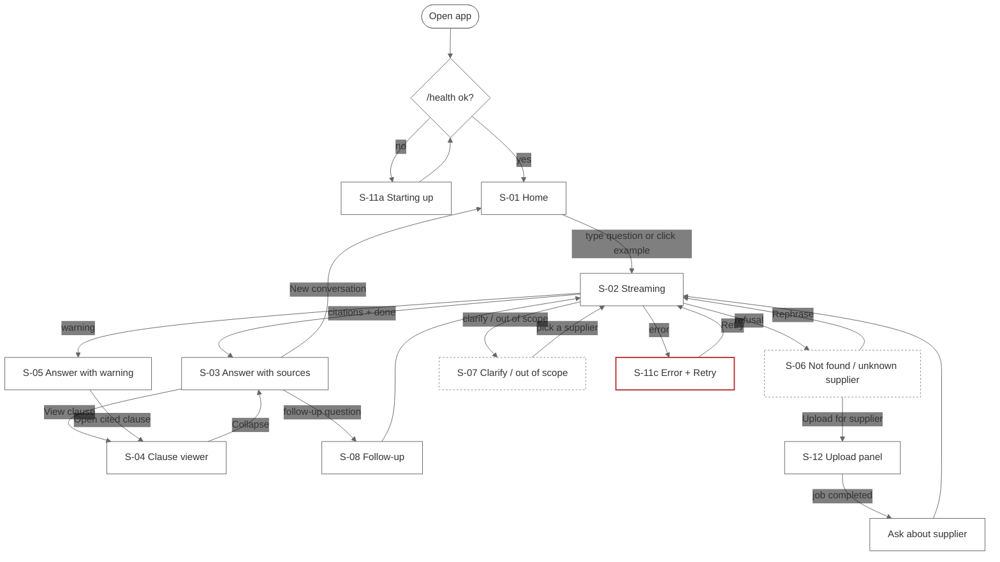
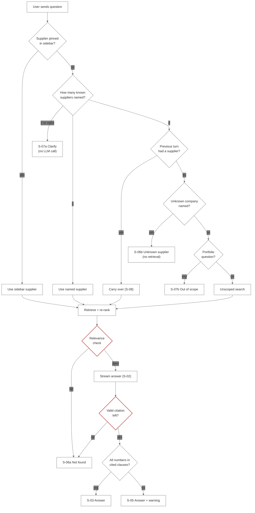
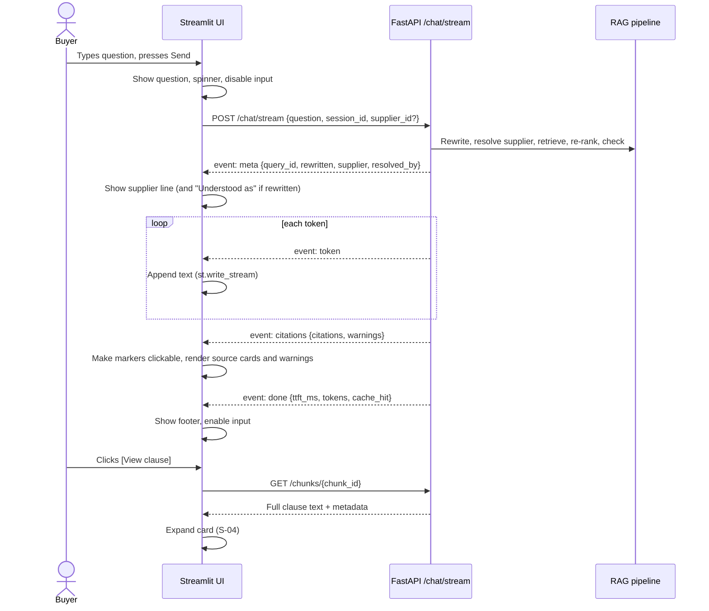
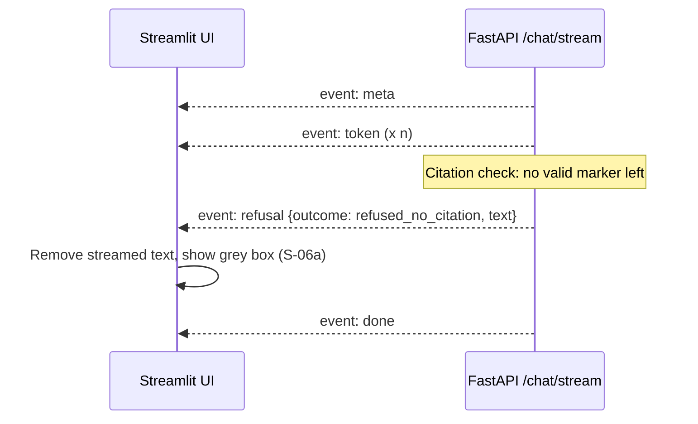
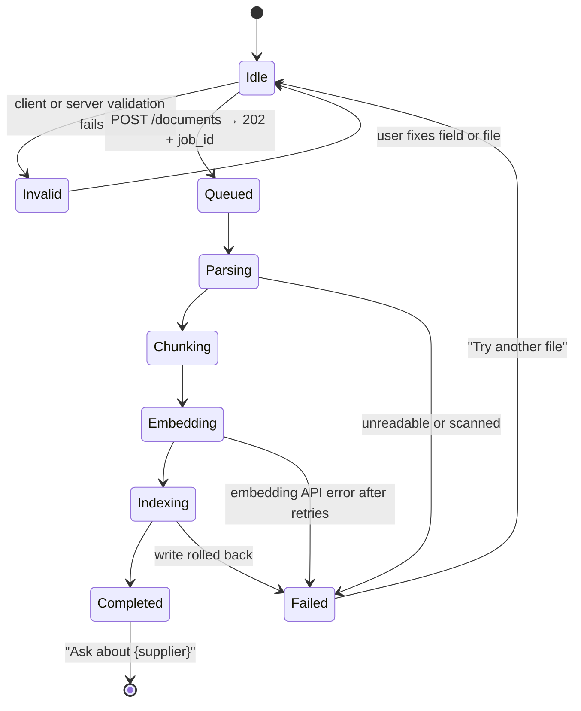
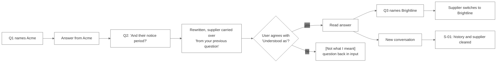

# ClauseCheck: Mock UX

Sprint 2, Simulated Work (AI Application Development with RAG)
Repo: `FirstName_ClauseCheck_Kalvium-Community`
See also: `PRD.md` (sections 7, 8, 11), `functional-requirements.md` (FR-7, FR-9, FR-10), `rag-architecture-design.md`, `development-plan.md` (W1 D4)
Version: 1.0, 2026-10-01
Status: submitted with the PRD for review (milestone M1).

**Required deliverable:** screens + interaction flow.

This document shows **what the user sees and does** in ClauseCheck v1: every screen and state, the copy on it, and how the user moves between them. It turns PRD section 11 (UI layout and states) into a reviewable mock that the W5 UI build (Workstream D) can implement directly, and that the W5 usability session (KPI-01, KPI-09) can test against.

If this document disagrees with `PRD.md` on scope, the PRD wins. If it disagrees with `functional-requirements.md` on behaviour or exact text, that document wins, and this one is updated.

| Version | Date | Change | Approved by |
|---|---|---|---|
| 1.0 | 2026-10-01 | First version for M1 review | |

All supplier names, document IDs, values and dates in the mockups are made up.

---

## Contents

1. [Design principles](#1-design-principles)
2. [Users and their main tasks](#2-users-and-their-main-tasks)
3. [Screen inventory](#3-screen-inventory)
4. [Global layout](#4-global-layout)
5. [Screens](#5-screens)
6. [Interaction flows](#6-interaction-flows)
7. [Streaming events to UI](#7-streaming-events-to-ui)
8. [Usability task walkthroughs](#8-usability-task-walkthroughs)
9. [Copy deck (fixed text)](#9-copy-deck-fixed-text)
10. [Visual and accessibility rules](#10-visual-and-accessibility-rules)
11. [Traceability](#11-traceability)
12. [Mock UX review plan](#12-mock-ux-review-plan)
13. [Open questions and sign-off](#13-open-questions-and-sign-off)

---

## 1. Design principles

Each principle comes from a difficulty in PRD section 2.2 and decides at least one screen below.

| # | Principle | What it means on screen | From PRD 2.2 |
|---|---|---|---|
| UX-1 | **Every term is checkable in one click** | Every sentence carries a `[C#]` marker; every marker has a source card; every card opens the full clause on the same screen | Trust |
| UX-2 | **"Not found" must never look like an answer** | Refusals use a grey box with fixed text, no citations, no streamed prose | Trust |
| UX-3 | **Always show which supplier is being answered** | A supplier line sits above every answer, with how it was chosen (sidebar, named, previous question) | Volume (R-06) |
| UX-4 | **The term in force comes first** | Amendment sources are labelled "Amendment · Amends {doc}"; the replaced term is shown only as replaced | Fragmentation |
| UX-5 | **Values are copied, never paraphrased** | Numbers appear exactly as written; a warning appears if a number is not in the cited clause | Precision |
| UX-6 | **Labels tell the user what kind of evidence it is** | "standard terms (not negotiated)", "synthetic document", "contains redacted values" | Formats |
| UX-7 | **Failures are honest** | An outage shows an error with Retry, never a refusal; reduced mode is announced | Trust (NFR-6) |
| UX-8 | **30 seconds to a checked answer** | Example questions on first load, streamed tokens, sources shown under the answer, no extra navigation | KPI-01 |

---

## 2. Users and their main tasks

| Persona (PRD 7.1) | Main task in the UI | Screens used most |
|---|---|---|
| P1 Procurement buyer (primary) | Ask a payment or price question, open the clause, act | S-01, S-02, S-03, S-04, S-06 |
| P2 Category manager | Check renewal, notice, termination and liability terms; see what an amendment changed | S-03, S-08 |
| P3 Compliance analyst | Check certificate validity, DPA and SLA terms | S-09, S-03 (labels) |
| P4 Document maintainer | Upload a contract or amendment and confirm it is answerable | S-12 |
| P5 Sprint reviewer | Not a UI user (uses `eval/run_eval.py`) | None |

---

## 3. Screen inventory

ClauseCheck is a **single-page app**. "Screens" below are the distinct states of that page that a user can see. Each has an ID used in the flows (section 6) and in the traceability table (section 11).

| ID | Screen / state | Trigger | Stories | Requirements |
|---|---|---|---|---|
| S-01 | Home (empty conversation) | App opens, or "New conversation" | US-01, US-12 | FR-10 |
| S-02 | Answer streaming | Question sent, `meta` received | US-01 | FR-10, AC-10.1, AC-10.2 |
| S-03 | Answer with sources | `citations` + `done` received | US-01, US-02, US-03, US-08, US-09, US-11 | FR-6, AC-10.7, AC-10.8 |
| S-04 | Clause viewer (expanded source) | "View clause" clicked | US-06 | AC-6.9, AC-10.7 |
| S-05 | Answer with unsupported-number warning | `unsupported_number` warning | US-17 | AC-6.11 |
| S-06 | Not found / unknown supplier | Refusal outcomes | US-04 | FR-7, AC-10.6 |
| S-07 | Clarify supplier / out of scope | `clarify_multiple_suppliers`, `out_of_scope_aggregation` | US-13 | FR-7 |
| S-08 | Follow-up question | Second question in a session without a supplier name | US-05 | FR-8 |
| S-09 | Certificate validity answer | Certificate question | US-10 | AC-4.9, AC-6.14 |
| S-10 | Redacted value answer | Cited chunk has `has_redaction` | US-07 | AC-6.13 |
| S-11 | System states (reduced mode, error, rate limit, starting up) | Backend conditions | n/a | NFR-6, AC-10.11 |
| S-12 | Upload panel (idle, validating, in progress, completed, failed) | Sidebar upload | US-14 | FR-9, AC-9.10 |

---

## 4. Global layout

### 4.1 Layout regions

```text
+--------------------------------------------------------------------------------+
| [H] HEADER   ClauseCheck                    Index: 184 docs · 41 suppliers · OK |
+------------------------+-------------------------------------------------------+
| [SB] SIDEBAR           | [CP] CHAT PANEL                                       |
|                        |                                                       |
|  SB-1 Supplier filter  |   conversation (questions, answers, sources, boxes)   |
|  SB-2 New conversation |                                                       |
|  SB-3 Upload panel     |                                                       |
|  SB-4 Notices          |                                                       |
|                        +-------------------------------------------------------+
|                        | [IN] INPUT   [ Ask about a supplier's terms…  ] [Send] |
+------------------------+-------------------------------------------------------+
```

| Region | Contents | Always visible? | Streamlit component | Backend call |
|---|---|---|---|---|
| H | App name; index status (document count, supplier count, `ok` / `degraded` / `down`) | Yes | `st.markdown` | `GET /health` on load |
| SB-1 | Supplier selector, default "All suppliers (detect from question)" | Yes | `st.selectbox` | `GET /suppliers` (cached 5 min) |
| SB-2 | "New conversation" button | Yes | `st.button` | `POST /sessions` |
| SB-3 | Upload form and job status | Yes (collapsible) | `st.expander` + `st.file_uploader` | `POST /documents`, `GET /documents/jobs/{id}` |
| SB-4 | "Not legal advice." · "Synthetic documents are labelled." · "Uploads may reset on restart (free tier)." | Yes | `st.caption` | None |
| CP | Messages, answers, source cards, refusal boxes, warnings | Yes | `st.chat_message`, `st.write_stream`, `st.expander`, `st.info`, `st.warning` | `POST /chat/stream`, `GET /chunks/{id}` |
| IN | Question box and Send | Yes; disabled while a reply streams | `st.chat_input` | `POST /chat/stream` |

### 4.2 Anatomy of one answer

Every answered message has the same five parts, in this order, so users learn where to look.

```text
 ┌────────────────────────────────────────────────────────────────────┐
 │ (1) SUPPLIER LINE  Answering from: Acme Industrial · named in question │
 │ (2) ANSWER         Invoices are payable within 45 days of receipt [C1]. │
 │ (3) WARNINGS       (only if any)                                        │
 │ (4) SOURCES        > C1 ...   > C2 ...                                  │
 │ (5) FOOTER         1.4 s to first token · [👍] [👎] (P1)               │
 └────────────────────────────────────────────────────────────────────┘
```

| Part | Shows | Source of data |
|---|---|---|
| 1 Supplier line | Resolved supplier and `resolved_by` in plain words (see 9.4) | `meta` event |
| 2 Answer | Streamed text with `[C#]` markers | `token` events |
| 3 Warnings | `unsupported_number`, `semantic_search_unavailable` | `citations` event |
| 4 Sources | One collapsed card per valid citation | `citations` event |
| 5 Footer | Time to first token; feedback buttons (cut item 1); "from cache" tag when `cache_hit` | `done` event |

---

## 5. Screens

### S-01 Home (empty conversation)

**Purpose:** get a first-time buyer to a useful question in one click (UX-8).

```text
+--------------------------------------------------------------------------------+
|  ClauseCheck                                   Index: 184 docs · 41 suppliers · OK |
+------------------------+-------------------------------------------------------+
| Supplier               |                                                       |
| [ All suppliers     v ]|        Ask about one supplier's negotiated terms.     |
|  (detect from question)|        Every answer cites the clause it comes from.   |
|                        |                                                       |
| [ New conversation ]   |        Try:                                           |
|                        |        [ What are the payment terms with Acme?      ] |
| > Upload a document    |        [ Unit price for SKU A-114 at 500 units?     ] |
|                        |        [ Does the Brightline contract auto-renew?   ] |
|                        |        [ Is Northline's ISO 27001 certificate valid?] |
| Not legal advice.      |                                                       |
| Synthetic documents    |        Answers one supplier at a time. Questions      |
| are labelled.          |        across all suppliers aren't supported yet.     |
| Uploads may reset on   |                                                       |
| restart (free tier).   +-------------------------------------------------------+
|                        |  [ Ask about a supplier's terms…            ] [Send]  |
+------------------------+-------------------------------------------------------+
```

| Element | Behaviour |
|---|---|
| Example question chips | Click sends the question immediately (same as typing it and pressing Send). Chips use real suppliers from `GET /suppliers` so they always answer. |
| Scope note | Sets expectations before the first refusal (supports A-10: refusals are read as "no answer", not as an error). |
| Supplier selector | "All suppliers" = detect from the question. Choosing a supplier pins it for every question until changed (US-12). |
| Header status | Grey "Starting…" until `/health` responds; see S-11 if it fails. |

**Exit:** user sends a question → S-02.

---

### S-02 Answer streaming

**Purpose:** show progress within 3 s (KPI-07) and show the supplier before any term appears (UX-3).

```text
|  You: What are the payment terms with Acme, and is there an early-payment     |
|       discount?                                                               |
|                                                                               |
|  ClauseCheck                                                                  |
|  Answering from: Acme Industrial · named in your question                    |
|  Invoices are payable within 45 days of receipt [C1]. This replaced the▌      |
|                                                                               |
|  ○ Checking citations…                                                        |
+-------------------------------------------------------------------------------+
|  [ Ask about a supplier's terms…                       ] [Send] (disabled)    |
```

| Moment | What the user sees |
|---|---|
| 0 s, question sent | Question appears; a spinner "Finding clauses…" in the reply bubble; input disabled |
| `meta` arrives | Spinner replaced by the supplier line |
| First `token` | Text streams in with a cursor `▌` |
| Last `token` | "Checking citations…" while the backend validates markers and numbers |
| `citations` arrives | → S-03 (or S-05 with a warning) |
| `refusal` arrives at any point | Streamed text is **removed** and replaced by the grey box → S-06 (AC-10.6) |
| `error` arrives | → S-11 error state |

**Note on markers while streaming:** `[C#]` markers are shown as plain text while streaming and become clickable only after `citations` arrives, because the backend may drop invalid markers (AC-6.6). A dropped marker disappears from the final text.

---

### S-03 Answer with sources

**Purpose:** the main success screen. The user reads the term, sees where it comes from, and can open the clause (US-01, US-03, US-06).

```text
|  You: What are the payment terms with Acme, and is there an early-payment     |
|       discount?                                                               |
|                                                                               |
|  ClauseCheck                                                                  |
|  Answering from: Acme Industrial · named in your question                    |
|                                                                               |
|  Invoices are payable within 45 days of receipt [C1]. This replaced the       |
|  original 30-day term [C1][C3]. A 2% discount applies if paid within 10 days  |
|  [C2].                                                                        |
|                                                                               |
|  Sources                                                                      |
|  > [C1] Acme Industrial · ACME-AMD1-2023                    ★ Term in force  |
|         Amendment · effective 2023-04-01 · §4.1 Payment Terms · p.2           |
|         Amends ACME-MSA-2021                               [View clause]     |
|  > [C2] Acme Industrial · ACME-MSA-2021                                       |
|         MSA · effective 2021-06-15 · §4.3 Early Payment Discount · p.9       |
|                                                            [View clause]     |
|  > [C3] Acme Industrial · ACME-MSA-2021                     Replaced         |
|         MSA · effective 2021-06-15 · §4.1 Payment Terms · p.8                 |
|                                                            [View clause]     |
|                                                                               |
|  1.4 s to first token                                         [👍] [👎]       |
```

**Source card fields (AC-10.7):**

| Field | Rule |
|---|---|
| Marker | `[C#]`, matching the marker in the text. Clicking a marker in the text scrolls to and highlights its card. |
| Supplier · doc_id | Always shown |
| Doc type · effective date | Always shown |
| §clause_no clause_title | Shown when the chunk has a clause number; "page-split document" when the document used page fallback |
| Page | PDF only; never shown for HTML or TXT (decision D3) |
| "Amends {doc_id}" | Amendment chunks only |
| "★ Term in force" / "Replaced" badge | When the answer cites both an amendment and the clause it replaced (UX-4) |
| Labels | "standard terms (not negotiated)" for DPA/SLA; "synthetic document"; "contains redacted values" |
| [View clause] | Opens S-04 inside the card |

**Variants of S-03 (same layout, different content):**

| Variant | Example question | What changes |
|---|---|---|
| Price table (US-02) | "Unit price for SKU A-114 at 500 units?" | Source card shows "Price schedule · table" and "synthetic document"; View clause renders the table with the header row and the matching tier row highlighted |
| Renewal / notice (US-08) | "Does Brightline auto-renew, and how much notice to end it?" | Two facts, two citations |
| Liability / termination (US-09) | "What's the liability cap with Northline?" | One citation; if no such clause exists → S-06 instead |
| DPA / SLA (US-11) | "What's the breach-notification time in Cloudnest's DPA?" | Card shows "standard terms (not negotiated)" |
| From cache | Same question asked twice | Footer shows "from cache" instead of a time to first token (AC-10.4) |

---

### S-04 Clause viewer

**Purpose:** let the buyer read the exact clause without leaving the conversation (US-06, KPI-01 stops the clock here).

```text
|  v [C1] Acme Industrial · ACME-AMD1-2023                    ★ Term in force   |
|         Amendment · effective 2023-04-01 · §4.1 Payment Terms · p.2            |
|         Amends ACME-MSA-2021                                                   |
|  ┌──────────────────────────────────────────────────────────────────────────┐ |
|  │ 4.1 Payment Terms. Section 4.1 of the Agreement is deleted and replaced  │ |
|  │ with the following: "Buyer shall pay each undisputed invoice within      │ |
|  │ forty-five (45) days of receipt of the invoice."                         │ |
|  └──────────────────────────────────────────────────────────────────────────┘ |
|   Source: SEC EDGAR · [Open original filing ↗]          [Collapse]             |
```

| Element | Behaviour |
|---|---|
| Clause text | Full stored chunk from `GET /chunks/{id}`, loaded on first open and kept for the session. Values that appear in the answer are highlighted. |
| Tables | Rendered as a table, header row kept, matching row highlighted |
| Redactions | `[***]` shown in a grey pill with the tooltip "Redacted in the filed copy" |
| Source link | `source_url` (EDGAR archive, vendor page, CUAD). Synthetic documents show "Generated document (seed 42)" instead of a link |
| Loading | "Loading clause…" skeleton; on `404` shows "This clause is no longer in the index. Ask the question again." |
| Collapse | Returns to the card in S-03; scroll position kept |

---

### S-05 Answer with unsupported-number warning

**Purpose:** flag a number the backend could not find in the cited clauses without hiding the answer (US-17, AC-6.11).

```text
|  Answering from: Acme Industrial · named in your question                     |
|                                                                               |
|  Late deliveries incur a penalty of 1.5% of the order value per week [C1].    |
|                                                                               |
|  ┌ ⚠ ─────────────────────────────────────────────────────────────────────┐  |
|  │ A number in this answer wasn't found in the cited clause. Check it      │  |
|  │ before acting.                                   [Open cited clause]    │  |
|  └─────────────────────────────────────────────────────────────────────────┘  |
|                                                                               |
|  Sources                                                                      |
|  > [C1] Acme Industrial · ACME-SUPPLY-2020 · §7.2 Late Delivery · p.11        |
```

| Rule | Detail |
|---|---|
| Position | Between the answer and the sources, so it is read before acting |
| Colour | Amber (`st.warning`); never red, since the answer may still be right |
| Answer text | Not edited or hidden (AC-6.11) |
| Shortcut | "Open cited clause" expands the first source card (S-04) |

---

### S-06 Not found / unknown supplier

**Purpose:** a refusal must be instantly distinguishable from an answer (UX-2, US-04).

**S-06a Not found** (`refused_low_score`, `refused_model_not_found`, `refused_no_citation`)

```text
|  You: Is there a most-favoured-nation clause with Acme?                       |
|                                                                               |
|  ClauseCheck                                                                  |
|  Answering from: Acme Industrial · named in your question                    |
|  ┌──────────────────────────────────────────────────────────────────────────┐|
|  │ ⓘ I couldn't find this in the contracts for Acme Industrial. Try         │|
|  │   rephrasing, or check that the document has been uploaded.              │|
|  └──────────────────────────────────────────────────────────────────────────┘|
|   [ Rephrase ]   [ Upload a document for Acme Industrial ]                    |
```

**S-06b Unknown supplier** (`refused_unknown_supplier`)

```text
|  You: What are our terms with Quartzline?                                     |
|                                                                               |
|  ClauseCheck                                                                  |
|  ┌──────────────────────────────────────────────────────────────────────────┐|
|  │ ⓘ Quartzline is not in the contract repository.                          │|
|  └──────────────────────────────────────────────────────────────────────────┘|
|   Did you mean: [ Quartz Logistics ]   ·   [ See all suppliers ]              |
```

| Rule | Detail |
|---|---|
| Container | Grey `st.info` box with an ⓘ icon. No sources section, no feedback buttons, no time to first token |
| Text | Fixed text from `rag/refusals.py` (section 9.1), never generated (AC-7.1) |
| After streamed text | If text had already streamed (`refused_no_citation`), it is removed and replaced by the box |
| "Rephrase" | Puts the original question back in the input box for editing |
| "Upload a document for {supplier}" | Opens the upload panel (S-12) with the supplier pre-filled |
| "Did you mean" | Shown only when a supplier scores between 70 and 89 on fuzzy match (below the 90 threshold). Clicking it re-sends the question with that supplier selected. **Proposal, see Q-UX-2.** |
| "See all suppliers" | Opens the sidebar selector |

---

### S-07 Clarify supplier / out of scope

**S-07a Two suppliers named** (`clarify_multiple_suppliers`, US-13)

```text
|  You: Compare payment terms for Acme and Brightline                           |
|                                                                               |
|  ClauseCheck                                                                  |
|  ┌──────────────────────────────────────────────────────────────────────────┐|
|  │ ⓘ ClauseCheck answers one supplier at a time. Which supplier do you      │|
|  │   want me to check?                                                      │|
|  └──────────────────────────────────────────────────────────────────────────┘|
|   [ Acme Industrial ]   [ Brightline Packaging ]                              |
```

Clicking a supplier button re-sends the **same question** with that supplier set in `supplier_id`. The sidebar selector is not changed, so the next question goes back to detection.

**S-07b Portfolio question** (`out_of_scope_aggregation`)

```text
|  You: Which suppliers auto-renew next quarter?                                |
|  ┌──────────────────────────────────────────────────────────────────────────┐|
|  │ ⓘ Questions across all suppliers aren't supported yet. Ask about one     │|
|  │   supplier, for example "Does the Acme contract auto-renew?"             │|
|  └──────────────────────────────────────────────────────────────────────────┘|
```

No buttons: there is nothing the user can pick that would make the question answerable in v1 (PRD 8.2).

---

### S-08 Follow-up question

**Purpose:** let the user check several terms with one supplier without repeating the name (US-05).

```text
|  You: What are the payment terms with Acme?                                   |
|  ClauseCheck  (answer with sources, collapsed to one line after the next      |
|               question is sent: "Answered · 3 sources ▸")                    |
|                                                                               |
|  You: And what about their notice period?                                     |
|                                                                               |
|  ClauseCheck                                                                  |
|  Answering from: Acme Industrial · from your previous question               |
|  Understood as: "What is the notice period to terminate or prevent renewal   |
|  of the Acme Industrial contract?"                          [Not what I meant]|
|                                                                               |
|  Either party may prevent automatic renewal by giving written notice at least |
|  ninety (90) days before the end of the then-current term [C1].              |
+-------------------------------------------------------------------------------+
|  [ Ask about Acme Industrial…                          ] [Send]               |
```

| Element | Behaviour |
|---|---|
| "from your previous question" | Shown when `resolved_by = carry_over` (AC-8.5) |
| "Understood as:" | The rewritten question from `meta`, in grey italic, only when a rewrite happened (AC-8.8). Lets the user catch a wrong rewrite. |
| [Not what I meant] | Puts the original follow-up back in the input box and clears the carried-over supplier for the next send |
| Input placeholder | Changes to "Ask about {supplier}…" while a supplier is being carried over |
| Switching supplier | Naming a different known supplier switches to it (AC-8.6); the supplier line updates to "named in your question" |
| Sidebar override | If a supplier is pinned in the sidebar, it wins over carry-over (AC-8.7); supplier line says "selected in sidebar" |
| New conversation | Clears history and carried-over supplier (AC-8.1) and returns to S-01 |

---

### S-09 Certificate validity answer

**Purpose:** a compliance analyst gets a clear yes/no that was worked out in code, not by the model (US-10, decision D2).

```text
|  You: Is Northline's ISO 27001 certificate still valid?                       |
|                                                                               |
|  ClauseCheck                                                                  |
|  Answering from: Northline Metals · named in your question                   |
|                                                                               |
|  ┌──────────────────────────────┐                                            |
|  │ ✔ VALID as of 2026-10-01     │   Expires 2027-02-28                       |
|  └──────────────────────────────┘                                            |
|  Northline Metals holds an ISO/IEC 27001 certificate issued 2024-03-01 and    |
|  expiring 2027-02-28 [C1].                                                    |
|                                                                               |
|  Sources                                                                      |
|  > [C1] Northline Metals · NORTHLINE-CERT-2024 · synthetic document           |
|         Certificate · issued 2024-03-01 · expires 2027-02-28                  |
```

| Rule | Detail |
|---|---|
| Badge | Green "✔ VALID as of {AS_OF_DATE}" or red "✖ EXPIRED on {expiry_date}", from the code-computed validity line, not from the answer text (AC-6.14) |
| Boundary | Valid on the expiry date itself, if Q-1 in `functional-requirements.md` is approved |
| Date shown | Always `AS_OF_DATE`, so the user knows what "today" meant |

---

### S-10 Redacted value answer

**Purpose:** never estimate a value that was blacked out in the public filing (US-07, decision D4).

```text
|  Answering from: Helix Components · named in your question                    |
|                                                                               |
|  The unit price for Product B is redacted in the filed copy [C1]. Request the |
|  unredacted contract from the contract owner before relying on a price.       |
|                                                                               |
|  Sources                                                                      |
|  > [C1] Helix Components · HELIX-SUPPLY-2014 · contains redacted values       |
|         Supply · §3.1 Pricing · p.4                         [View clause]     |
```

In the clause viewer, each `[***]` appears as a grey "redacted" pill (S-04).

---

### S-11 System states

| State | Trigger | What the user sees | Can the user still ask? |
|---|---|---|---|
| S-11a Starting up | `/health` not yet responding (free host waking up) | Header: "Starting… this can take up to a minute on the free tier." Input disabled; retried every 5 s | No, until `ok` |
| S-11b Reduced mode | Embedding API down; `semantic_search_unavailable` | Amber bar above the answer: "Semantic search unavailable, using keyword search only." Header status "degraded" | Yes |
| S-11c Error | Both LLMs down (HTTP 503) or `error` event | Red box in the reply: "ClauseCheck couldn't generate an answer right now. This is a system error, not a 'not found'." **[Retry]** resends the same question (AC-10.11) | Yes, via Retry |
| S-11d Rate limited | HTTP 429 (30 requests/min per IP) | "Too many questions in the last minute. Try again in {Retry-After} s." Send disabled with a countdown | After countdown |
| S-11e Backend unreachable | Network error from the frontend | "Can't reach the ClauseCheck server." **[Retry]** | Via Retry |

```text
|  ClauseCheck                                                                  |
|  ┌ ✖ ──────────────────────────────────────────────────────────────────────┐|
|  │ ClauseCheck couldn't generate an answer right now. This is a system      │|
|  │ error, not a "not found".                                     [ Retry ]  │|
|  └──────────────────────────────────────────────────────────────────────────┘|
```

Errors are red and refusals are grey, so a failure is never read as "the contract doesn't say" (UX-7, AC-7.7).

---

### S-12 Upload panel

**Purpose:** a document maintainer adds a document and can confirm it is answerable after one job (US-14).

**S-12a Idle form**

```text
| v Upload a document            |
|   File   [ Choose file ]       |
|          .pdf .html .txt .docx |
|          max 20 MB             |
|   Supplier [ Acme Industrial v]|   ← existing suppliers, or type a new name
|   Type     [ Amendment       v]|   msa · supply · service · sow · amendment ·
|                                |   price_schedule · dpa · sla · nda · certificate
|   Effective date [ 2026-09-15 ]|
|   Amends   [ ACME-MSA-2021   v]|   ← only when Type = amendment; required
|   Expiry date [            ]   |   ← only when Type = certificate; required
|   [ Upload ]                   |
|                                |
|   Uploads may reset on restart |
|   (free tier).                 |
```

| Field | Rule |
|---|---|
| File | Extension and file type checked in the browser first, then on the server (AC-9.2) |
| Supplier | Select from `GET /suppliers` or type a new name. A new name shows "New supplier will be created" under the field (AC-9.4) |
| Type | Required; values from the manifest `doc_type` list |
| Amends | Appears only for amendments; lists that supplier's documents; required (AC-9.3) |
| Expiry date | Appears only for certificates; required so validity can be computed |
| Upload button | Disabled until required fields are filled |

**S-12b Validation errors** (shown under the field, no job created)

| Problem | Message | Server code (Q-2 proposal) |
|---|---|---|
| Wrong extension or file type | "Only PDF, HTML, TXT and DOCX files are supported." | 415 |
| Over 20 MB | "This file is {n} MB. The limit is 20 MB." | 413 |
| Amendment without "Amends" | "Choose the document this amendment changes." | 422 |
| "Amends" not found | "{doc_id} isn't in the repository. Upload the original first." | 422 |

**S-12c In progress** (polls `GET /documents/jobs/{id}` every 2 s)

```text
|   ACME-AMD2-2026.pdf             |
|   ✔ Queued                       |
|   ✔ Parsing                      |
|   ✔ Chunking                     |
|   ◐ Embedding…  60%              |
|   ○ Indexing                     |
|   You can keep asking questions  |
|   while this runs.               |
```

**S-12d Completed**

```text
|   ✔ ACME-AMD2-2026.pdf is ready  |
|     14 clauses indexed           |
|   [ Ask about Acme Industrial ]  |
```

"Ask about Acme Industrial" selects that supplier in the sidebar and focuses the input. The header document count increases by one.

**S-12e Failed**

```text
|   ✖ ACME-AMD2-2026.pdf failed    |
|     Unreadable or scanned PDF    |
|     (no text layer). Nothing was |
|     added to the index.          |
|   [ Try another file ]           |
```

Failure reasons come from the job (`unreadable or scanned`, `embedding API error after retries`). The message always says nothing was half-indexed (AC-9.6).

---

## 6. Interaction flows

### 6.1 Overall navigation



### 6.2 Asking a question (main flow)



The supplier order matches AC-5.1: sidebar → named → carry-over → unscoped.

### 6.3 Streaming sequence



### 6.4 Refusal after streaming



### 6.5 Upload job states



### 6.6 Follow-up and conversation reset



---

## 7. Streaming events to UI

| Event (`/chat/stream`) | Payload used | UI action | Screen |
|---|---|---|---|
| (request sent) | | Show question, spinner "Finding clauses…", disable input | S-02 |
| `meta` | `query_id`, `rewritten_question`, `supplier`, `resolved_by` | Supplier line; "Understood as" if rewritten | S-02, S-08 |
| `token` | text delta | Append to answer | S-02 |
| `citations` | citations, warnings | Validate display markers, render source cards, labels, warnings | S-03, S-05, S-09, S-10, S-11b |
| `refusal` | `outcome`, fixed text | Replace any streamed text with grey box and its buttons | S-06, S-07 |
| `error` | code, message | Red box with Retry | S-11c |
| `done` | `ttft_ms`, tokens, `cache_hit` | Footer, enable input | All |
| HTTP 429 before stream | `Retry-After` | Countdown | S-11d |

`done` is always last (AC-10.1), so the input is re-enabled only on `done` or on a network failure.

---

## 8. Usability task walkthroughs

These are the 10 tasks for the W5 usability session (KPI-09, at least 5 testers). Each lists the expected path through the screens and the success check. KPI-01 timing runs from **Send** to **opening the cited clause**.

| # | Task given to tester | Expected path | Success when | Target |
|---|---|---|---|---|
| T-01 | "Find Acme's payment terms and the clause that says so." | S-01 → S-02 → S-03 → S-04 | Correct term read out and clause opened | ≤ 30 s |
| T-02 | "What's the unit price for SKU A-114 at exactly 500 units?" | S-01 → S-03 (table) → S-04 | Price from the 500–999 tier | ≤ 30 s |
| T-03 | "Has Acme's payment term changed since the original contract?" | S-03 with "Term in force" / "Replaced" badges | Names the amended term as current | ≤ 45 s |
| T-04 | "Now find Acme's notice period, without typing 'Acme'." | S-03 → S-08 | Correct notice period; tester notices "from your previous question" | ≤ 30 s |
| T-05 | "Does Acme have a most-favoured-nation clause?" (it doesn't) | S-06a | Tester says "not in the contracts", not "the app broke" (A-10) | ≤ 20 s |
| T-06 | "What are our terms with Quartzline?" (not a supplier) | S-06b | Tester says the supplier isn't in the repository | ≤ 20 s |
| T-07 | "Compare Acme and Brightline payment terms." | S-07a → pick one → S-03 | Gets one supplier's answer after picking | ≤ 40 s |
| T-08 | "Is Northline's ISO 27001 certificate valid today?" | S-09 | Reads the VALID/EXPIRED badge and expiry date | ≤ 30 s |
| T-09 | "Upload this amendment for Acme and ask about the changed term." | S-12a → S-12c → S-12d → S-03 | New document cited in the answer | ≤ 3 min |
| T-10 | "Here's an answer with a warning. What would you do?" | S-05 → S-04 | Tester opens the clause to check before acting | ≤ 30 s |

Observers record time, path taken, misclicks, and anything the tester says that shows confusion (for example, reading a grey box as an error). Results go to `docs/usability.md`.

---

## 9. Copy deck (fixed text)

One place for every fixed string, so the UI, `rag/refusals.py` and the QA checklist use the same words.

### 9.1 Refusals and clarifications (must match `rag/refusals.py`, AC-7.1)

| Outcome | Text |
|---|---|
| `refused_low_score`, `refused_model_not_found`, `refused_no_citation` | I couldn't find this in the contracts for {supplier}. Try rephrasing, or check that the document has been uploaded. |
| `refused_unknown_supplier` | {Name} is not in the contract repository. |
| `clarify_multiple_suppliers` | ClauseCheck answers one supplier at a time. Which supplier do you want me to check? |
| `out_of_scope_aggregation` | Questions across all suppliers aren't supported yet. Ask about one supplier, for example "Does the Acme contract auto-renew?" *(wording proposed, see Q-UX-1)* |

### 9.2 Warnings and notices

| Key | Text |
|---|---|
| `unsupported_number` | A number in this answer wasn't found in the cited clause. Check it before acting. |
| `semantic_search_unavailable` | Semantic search unavailable, using keyword search only. |
| Error (503) | ClauseCheck couldn't generate an answer right now. This is a system error, not a "not found". |
| Rate limit (429) | Too many questions in the last minute. Try again in {n} s. |
| Starting up | Starting… this can take up to a minute on the free tier. |
| Uploads | Uploads may reset on restart (free tier). |
| Legal | Not legal advice. |

### 9.3 Labels on sources

| Condition | Label |
|---|---|
| `doc_type` is `dpa` or `sla` | standard terms (not negotiated) |
| `is_synthetic` | synthetic document |
| `has_redaction` | contains redacted values |
| Amendment chunk | Amendment · Amends {parent_doc_id} |
| Cited amendment and its replaced clause | ★ Term in force / Replaced |

### 9.4 Supplier line (`resolved_by` in plain words)

| `resolved_by` | Supplier line |
|---|---|
| `filter` | Answering from: {supplier} · selected in sidebar |
| `alias`, `fuzzy` | Answering from: {supplier} · named in your question |
| `carry_over` | Answering from: {supplier} · from your previous question |
| `unscoped` | Answering from: all suppliers (no supplier detected) |

---

## 10. Visual and accessibility rules

| Rule | Detail |
|---|---|
| Colour meaning | Grey = no answer (refusal), amber = check this (warning), red = system error, green/red badge = certificate validity only |
| Never colour alone | Every coloured box also has an icon (ⓘ, ⚠, ✖, ✔) and text |
| Exact values | Numbers in answers and clauses use a tabular/monospace style so `45` vs `4.5` is unambiguous |
| Keyboard | Enter sends; Tab moves through markers and source cards; Space/Enter expands a card |
| Focus | After `done`, focus returns to the input box |
| Contrast | Streamlit default theme, light mode only in v1 (dark mode has no user story, PRD 7.2) |
| Width | Usable down to 1024 px wide; the sidebar collapses below that (mobile is out of scope, PRD 8.2) |
| Language | English only |
| Streamlit limits | Inline clickable markers and the "Not what I meant" link may need a small custom component or `st.button` placed under the answer; if that slips, markers stay as text and cards are numbered to match (fallback, no change to behaviour) |

---

## 11. Traceability

| Screen | Stories | Requirements / criteria | KPIs | Usability task |
|---|---|---|---|---|
| S-01 Home | US-01, US-12 | FR-10, AC-10.9, AC-10.10 | KPI-01 | T-01 |
| S-02 Streaming | US-01 | AC-10.1, AC-10.2, AC-10.6 | KPI-07 | T-01 |
| S-03 Answer with sources | US-01, US-02, US-03, US-08, US-09, US-11, US-12 | FR-6, AC-6.5, AC-6.8, AC-10.7, AC-10.8 | KPI-03, KPI-04, KPI-08 | T-01, T-02, T-03 |
| S-04 Clause viewer | US-06 | AC-6.9, AC-10.7 | KPI-01 | T-01, T-10 |
| S-05 Warning | US-17 | AC-6.11, AC-10.8 | KPI-10 | T-10 |
| S-06 Not found / unknown | US-04 | FR-7, AC-7.1, AC-7.2, AC-10.6 | KPI-05, KPI-06 | T-05, T-06 |
| S-07 Clarify / out of scope | US-13 | AC-7.1, AC-7.3 | KPI-05 | T-07 |
| S-08 Follow-up | US-05 | FR-8, AC-8.1, AC-8.5–8.8 | KPI-09 | T-04 |
| S-09 Certificate | US-10 | AC-4.9, AC-6.14 | KPI-03 | T-08 |
| S-10 Redacted | US-07 | AC-6.13 | KPI-03 | n/a |
| S-11 System states | n/a | NFR-6, AC-5.11, AC-7.7, AC-10.11 | KPI-14 | n/a |
| S-12 Upload | US-14 | FR-9, AC-9.1–9.6, AC-9.10 | KPI-09 | T-09 |
| Feedback buttons (S-03 footer) | US-18 | AC-11.7 **[cut-1]** | n/a | n/a |

Every P0 user story in PRD 7.2 maps to at least one screen. US-15 and US-16 (eval and logging) have no UI by design.

---

## 12. Mock UX review plan

The personas are simulated (PRD 3.2), so the mock is reviewed in two rounds.

| Round | When | Who | Method | Output |
|---|---|---|---|---|
| R1 Mock review | W1 D5 (M1) | Sprint mentor + one member from each workstream acting as P1–P4 | Walk through T-01 to T-10 on the wireframes in this document; each reviewer says what they would click and what they expect next | Issues filed with label `mock-ux`; changes recorded as v1.1 |
| R2 Usability session | W5 D4 | At least 5 testers (Q3 in PRD) | Tasks T-01 to T-10 on the deployed app, timed | KPI-01 and KPI-09 results in `docs/usability.md` |

**Questions the R1 review must answer:**

1. Can a reviewer tell an answer from a refusal from an error at a glance (S-03 vs S-06 vs S-11c)?
2. Is the supplier line noticed before the answer is read?
3. Is "Term in force / Replaced" understood without explanation?
4. Is the "Understood as" line helpful, or noise?
5. Does the upload form ask for anything the maintainer wouldn't know?

---

## 13. Open questions and sign-off

### 13.1 Open questions

| ID | Question | Affects | Proposal |
|---|---|---|---|
| Q-UX-1 | The exact `out_of_scope_aggregation` text isn't fixed in the PRD or FR doc. | S-07b, 9.1, AC-7.1 | Use the wording in 9.1 and add it to `rag/refusals.py` |
| Q-UX-2 | Should an unknown supplier show "Did you mean…" suggestions (fuzzy score 70–89)? | S-06b, `rag/supplier_resolver.py` | Yes, max 2 suggestions, never auto-selected; needs the resolver to return near-misses in the refusal payload |
| Q-UX-3 | Should "Understood as" show on every rewritten follow-up, or only when the supplier was carried over? | S-08 | Every rewrite, since it costs one line and catches bad rewrites |
| Q-UX-4 | `api-design.md` uses `/api/v1/ask`, bearer-key auth, numeric `[1]` markers, a `sources`-before-tokens event, and OCR on upload. The PRD, FR doc and this mock use `/chat/stream`, open demo with rate limit, `[C#]` markers, `citations` after tokens, and no OCR. | API contract, S-02, S-12 | Align `api-design.md` to the PRD (PRD wins on scope). Sending sources before tokens is worth considering: it is the third latency fix in R-09 and would let S-02 show source cards early. |
| Q-UX-5 | Thumbs up/down is cut item 1. | S-03 footer | Keep it in the mock; hide it in the build if cut |

### 13.2 Sign-off

| Role | Name | Decision | Date | Comments |
|---|---|---|---|---|
| Sprint mentor (business) | | ☐ Approved ☐ Approved with changes ☐ Rejected | | |
| Workstream D owner (UI) | | ☐ Agreed | | |
| Workstream C owner (refusal text, citations) | | ☐ Agreed | | |
| Team lead | | ☐ Agreed | | |

---

ClauseCheck gives information from contracts. It does not give legal advice.
