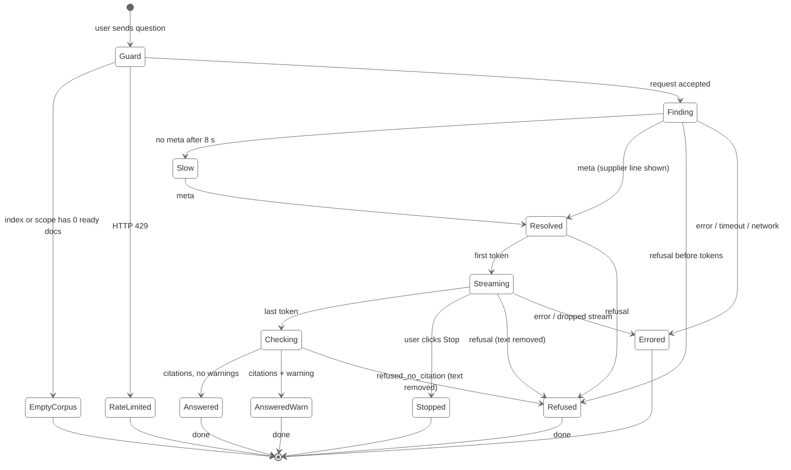

# ClauseCheck: UI States

Sprint 2, Simulated Work (AI Application Development with RAG)
See also: [mock-ux.md](mock-ux.md) (S-02, S-06, S-07, S-11, S-12, section 7 and 9), [PRD.md](../requirements/PRD.md) (section 11), [functional-requirements.md](../requirements/functional-requirements.md) (FR-7, FR-10), [non-functional-requirements.md](../requirements/non-functional-requirements.md) (NFR-6), [api-design.md](../architecture/api-design.md), [user-flows.md](user-flows.md)
Version: 1.0, 2026-10-01
Status: draft for M1 review, alongside the Mock UX.

This document specifies the **five non-happy-path state families** of the ClauseCheck chat page in enough detail to build and test them:

1. **Loading**: the app or a reply is waiting and nothing can be shown yet
2. **Streaming**: an answer is arriving token by token
3. **Refusal**: the system worked correctly and decided not to answer
4. **Error**: the system failed and could not produce an answer
5. **Empty corpus**: there is nothing in the index (or in the selected scope) to answer from

[mock-ux.md](mock-ux.md) defines the screens; this document defines **when each state is entered, what it shows, what the user can do, and how it is left**. If the two disagree on copy or layout, [mock-ux.md](mock-ux.md) wins and this file is updated. If either disagrees with [functional-requirements.md](../requirements/functional-requirements.md) on behaviour, the FR document wins.

All supplier names, document IDs and values below are made up.

| Version | Date | Change | Approved by |
|---|---|---|---|
| 1.0 | 2026-10-01 | First version | |

---

## Contents

1. [Why these five states matter](#1-why-these-five-states-matter)
2. [State model for one reply](#2-state-model-for-one-reply)
3. [Shared rules for every state](#3-shared-rules-for-every-state)
4. [Loading states](#4-loading-states)
5. [Streaming states](#5-streaming-states)
6. [Refusal states](#6-refusal-states)
7. [Error states](#7-error-states)
8. [Empty corpus states](#8-empty-corpus-states)
9. [Precedence when conditions overlap](#9-precedence-when-conditions-overlap)
10. [Backend signal to UI state mapping](#10-backend-signal-to-ui-state-mapping)
11. [Copy deck additions](#11-copy-deck-additions)
12. [Accessibility](#12-accessibility)
13. [How to trigger each state for testing](#13-how-to-trigger-each-state-for-testing)
14. [Open questions](#14-open-questions)

---

## 1. Why these five states matter

ClauseCheck's value is **trust**: a buyer must be able to act on an answer. The happy path (S-03) is the easy part. Trust is lost in the other states, when the user cannot tell:

| Confusion | Consequence | State family that prevents it |
|---|---|---|
| "Is it still working, or stuck?" | User re-sends, doubles cost, or gives up | Loading |
| "Is this text final and checked?" | User acts on a half-written or unvalidated sentence | Streaming |
| "Does 'not found' mean the contract is silent, or the app broke?" | User wrongly concludes a term doesn't exist (the worst failure) | Refusal vs Error |
| "Why does every question fail?" | User blames the model when nothing has been uploaded | Empty corpus |

The single most important rule in this document:

> **A refusal, an error and an empty corpus must never look alike.** Each says a different true thing: "the contracts don't support an answer", "the system failed", "there are no contracts to search". They differ in colour, icon, wording and available actions (UX-2, UX-7).

---

## 2. State model for one reply

Every question produces exactly one reply bubble, which moves through these states and ends in exactly one terminal state.



| Reply state | Type | Screen in [mock-ux.md](mock-ux.md) | Section here |
|---|---|---|---|
| Guard | transient, client-side | n/a | 8, 7.4 |
| Finding, Slow | loading | S-02 (spinner) | 4.2 |
| Resolved, Streaming, Checking | streaming | S-02 | 5 |
| Answered, AnsweredWarn | terminal success | S-03, S-05 | (out of scope here) |
| Refused | terminal refusal | S-06, S-07 | 6 |
| Errored, RateLimited | terminal error | S-11c/d/e | 7 |
| Stopped | terminal, user action | new | 5.5 |
| EmptyCorpus | terminal, setup | new | 8 |

**Invariant:** the input box is disabled from Guard until a terminal state is reached (AC-10.1: `done` is always last). It is re-enabled on `done`, on a terminal error, on Stop, or on network failure, never earlier.

---

## 3. Shared rules for every state

### 3.1 Visual language

| Meaning | Colour | Icon | Container | Used by |
|---|---|---|---|---|
| Working, wait | Neutral grey text | spinner / `○` | Inline in reply bubble | Loading, Checking |
| No answer, by design | Grey box | ⓘ | `st.info` | Refusal |
| Check before acting | Amber box | ⚠ | `st.warning` | Warnings, reduced mode, Stopped |
| System failed | Red box | ✖ | `st.error` | Error |
| Nothing to search yet | Neutral panel, no box | 📄 (outline) | Centre panel, replaces S-01 content | Empty corpus |

Colour is never the only signal; every state has an icon **and** a sentence (section 12).

### 3.2 What each terminal state shows

| Part of reply | Answered | Refused | Errored | Stopped | Empty corpus |
|---|---|---|---|---|---|
| Supplier line | ✔ | ✔ if resolved | only if `meta` arrived | ✔ | ✖ |
| Answer text | ✔ | ✖ (removed) | ✖ (removed) | ✖ (discarded, see 5.5) | ✖ |
| Sources | ✔ | ✖ | ✖ | ✖ | ✖ |
| Feedback buttons | ✔ | ✖ | ✖ | ✖ | ✖ |
| Time to first token | ✔ | ✖ | ✖ | ✖ | ✖ |
| Primary action | View clause | Rephrase / Upload | **Retry** | Ask again | **Upload a document** |

### 3.3 Timing thresholds

From NFR targets (first progress within 3 s, KPI-07; total request timeout 40 s, [api-design.md](../architecture/api-design.md) 5):

| Threshold | Value | Effect |
|---|---|---|
| Spinner appears | immediately (< 100 ms) | Never a blank bubble |
| "Still working" hint | 8 s with no `meta` | Loading → Slow (4.2) |
| Token stall | 15 s with no new token after streaming began | Treated as dropped stream (7.5) |
| Hard timeout | 40 s from send | Error E-2 |
| Clause load hint | 3 s | "Still loading clause…" |

---

## 4. Loading states

Loading = the UI is waiting for the backend and has nothing new to show. The goal is to **prove the app is alive** without implying any result.

### 4.1 L-1 App starting (cold start)

Maps to S-11a. The free-tier host sleeps; the first `/health` call wakes it.

```text
+--------------------------------------------------------------------------------+
|  ClauseCheck                                         ◐ Starting…               |
+------------------------+-------------------------------------------------------+
| Supplier               |                                                       |
| [ Loading…         v ] |     ◐  Starting ClauseCheck…                          |
|                        |        This can take up to a minute on the free tier. |
| [ New conversation ]   |                                                       |
|   (disabled)           |                                                       |
+------------------------+-------------------------------------------------------+
|  [ Ask about a supplier's terms…                   ] [Send] (disabled)         |
```

| Rule | Detail |
|---|---|
| Entered | App opens and `GET /health` has not returned `ok`/`degraded` |
| Behaviour | Retry `/health` every 5 s; show elapsed seconds after 20 s ("Starting… 25 s") |
| Example chips | Hidden: they would send a question that cannot be answered yet |
| Leaves to | `ok`/`degraded` with docs → S-01; `ok` with 0 docs → EC-1 (8.1); still down after 90 s → E-4 |
| Never | Show a refusal or "not found" while starting |

### 4.2 L-2 Finding clauses (question sent, before `meta`)

```text
|  You: What are the payment terms with Acme?                                    |
|                                                                               |
|  ClauseCheck                                                                  |
|  ◐ Finding clauses…                                                           |
|                                                         [ Stop ]              |
```

After 8 s with no `meta` (state **Slow**):

```text
|  ClauseCheck                                                                  |
|  ◐ Finding clauses… still working (the server may be waking up).              |
|                                                         [ Stop ]              |
```

| Rule | Detail |
|---|---|
| Entered | Request accepted (no 4xx before stream) |
| Shows | Spinner + "Finding clauses…"; question already in the conversation |
| Input | Disabled; Stop visible |
| Does not show | Supplier guess, example citations, skeleton answer text (a skeleton looks like an answer is coming, which may not be true if a refusal follows) |
| Leaves to | `meta` → 5.1; `refusal` → 6; `error`/timeout/network → 7 |

### 4.3 L-3 Checking citations (after last token, before `citations`)

The answer text is complete but **not yet validated**: markers may be dropped and numbers not yet checked (AC-6.6, AC-6.11).

```text
|  Invoices are payable within 45 days of receipt [C1]. A 2% discount applies   |
|  if paid within 10 days [C2].                                                 |
|                                                                               |
|  ○ Checking citations…                                                        |
```

| Rule | Detail |
|---|---|
| Text style | Normal colour, markers as plain text (not clickable) |
| Sources area | Not rendered yet (no empty "Sources" header) |
| Leaves to | `citations` → S-03/S-05; `refusal` (`refused_no_citation`) → R-5; `error` → 7.5 |

### 4.4 L-4 Side-panel and lookup loading

| Element | Loading display | Failure display |
|---|---|---|
| Header index status | "◐ Checking index…" | see E-4 |
| Supplier selector | Disabled, placeholder "Loading suppliers…" | "Couldn't load suppliers. Type the name in your question instead." Selector stays at "All suppliers" |
| Clause viewer (S-04) | Skeleton lines "Loading clause…"; after 3 s "Still loading clause…" | 404 → "This clause is no longer in the index. Ask the question again." Other → E-6 |
| Upload job | Step list (S-12c) | S-12e |

---

## 5. Streaming states

Streaming = text is arriving. The rule is that **streamed text is provisional until `citations` arrives**: it may be removed (refusal) or edited (dropped markers).

### 5.1 ST-1 Supplier resolved (`meta` received, no tokens yet)

```text
|  ClauseCheck                                                                  |
|  Answering from: Acme Industrial · named in your question                    |
|  ◐ Writing answer…                                                            |
```

The supplier line is shown **before** any term (UX-3), so the user can catch the wrong supplier and Stop early. For follow-ups the "Understood as: …" line also appears here (S-08).

### 5.2 ST-2 Tokens arriving

```text
|  Answering from: Acme Industrial · named in your question                    |
|  Invoices are payable within 45 days of receipt [C1]. This replaced the▌      |
|                                                         [ Stop ]              |
```

| Rule | Detail |
|---|---|
| Rendering | `st.write_stream`; cursor `▌` at the end |
| Markers | `[C#]` as plain text, not links (they may be dropped) |
| Numbers | Rendered in monospace as they stream (UX-5), so the user isn't later surprised by a reflow |
| Scrolling | Auto-scroll to keep the cursor visible **unless** the user has scrolled up; then show "↓ New text" pill |
| Feedback buttons | Not shown |
| Copy | Disabled until `done` (prevents copying unvalidated text into a PO or email) |

### 5.3 ST-3 Streaming in reduced mode

If `semantic_search_unavailable` is known before streaming (from `/health` = `degraded`), the amber bar is shown **above** the supplier line from the first moment, not appended after the answer:

```text
|  ⚠ Semantic search unavailable, using keyword search only.                   |
|  Answering from: Acme Industrial · named in your question                    |
|  Invoices are payable within▌                                                 |
```

### 5.4 ST-4 Marker reconciliation (on `citations`)

| Case | UI action |
|---|---|
| Marker valid | Becomes a link; card rendered |
| Marker dropped by backend | Removed from the text without animation; no message to the user (logged server-side) |
| All markers dropped | Backend sends `refused_no_citation` → R-5 (never an answer with zero sources) |
| Unsupported number | Text kept unchanged; amber S-05 box inserted between text and sources |

### 5.5 ST-5 Stopped by user (new state)

[user-flows.md](user-flows.md) requires a Stop button. Because validation runs **after** the last token, a stopped answer has never been checked. Showing it as if it were an answer would break UX-1 and UX-5.

```text
|  ClauseCheck                                                                  |
|  Answering from: Acme Industrial · named in your question                    |
|  ┌ ⚠ ─────────────────────────────────────────────────────────────────────┐  |
|  │ Stopped. The partial answer was discarded because its citations         │  |
|  │ weren't checked.                                       [ Ask again ]    │  |
|  └─────────────────────────────────────────────────────────────────────────┘  |
```

| Rule | Detail |
|---|---|
| Client | Aborts the request (closes the stream) |
| Server | Cancels generation on disconnect ([api-design.md](../architecture/api-design.md) 4.2); logs `outcome = stopped` |
| Text | Removed, replaced by the amber box |
| "Ask again" | Re-sends the same question with the same supplier |
| Conversation history | The stopped turn is **not** used for follow-up carry-over (no validated supplier answer) |

This differs from [user-flows.md](user-flows.md) ("keep what was generated and only show citations for that text"). See Q-ST-1.

---

## 6. Refusal states

Refusal = the pipeline worked and correctly decided **not to answer**. It is a valid, trustworthy result (A-10). Copy is fixed text from `rag/refusals.py`, never generated (AC-7.1).

### 6.1 Common rules

| Rule | Detail |
|---|---|
| Container | Grey `st.info`, ⓘ icon |
| Never present | Sources, feedback buttons, time-to-first-token, red colour, the word "error" |
| Streamed text | If any text had streamed, it is **removed** and replaced (AC-10.6) |
| Supplier line | Kept when the supplier was resolved (tells the user *which* contracts were searched) |
| History | A refused turn still sets carry-over supplier when one was resolved (the user is probably still asking about that supplier) |
| Speed | Pre-retrieval refusals (R-2, R-3, R-4) make **no LLM call** and should appear in < 1 s |

### 6.2 Refusal catalogue

| ID | Outcome code(s) | When | Text (from [mock-ux.md](mock-ux.md) 9.1) | Actions |
|---|---|---|---|---|
| R-1 | `refused_low_score`, `refused_model_not_found` | Nothing relevant retrieved, or model says the clauses don't cover it | I couldn't find this in the contracts for {supplier}. Try rephrasing, or check that the document has been uploaded. | Rephrase · Upload a document for {supplier} |
| R-2 | `refused_unknown_supplier` | Named company is not in the repository | {Name} is not in the contract repository. | Did you mean: {≤2 suggestions} · See all suppliers |
| R-3 | `clarify_multiple_suppliers` | Two or more known suppliers named | ClauseCheck answers one supplier at a time. Which supplier do you want me to check? | One button per supplier |
| R-4 | `out_of_scope_aggregation` | Portfolio / cross-supplier question | Questions across all suppliers aren't supported yet. Ask about one supplier, for example "Does the Acme contract auto-renew?" | None |
| R-5 | `refused_no_citation` | Answer streamed but no valid citation survived | Same as R-1 | Same as R-1 |

### 6.3 R-1 Not found (example)

```text
|  You: Is there a most-favoured-nation clause with Acme?                       |
|                                                                               |
|  ClauseCheck                                                                  |
|  Answering from: Acme Industrial · named in your question                    |
|  ┌──────────────────────────────────────────────────────────────────────────┐|
|  │ ⓘ I couldn't find this in the contracts for Acme Industrial. Try         │|
|  │   rephrasing, or check that the document has been uploaded.              │|
|  └──────────────────────────────────────────────────────────────────────────┘|
|   [ Rephrase ]   [ Upload a document for Acme Industrial ]                    |
```

When no supplier was resolved (`unscoped`), `{supplier}` becomes "your contracts".

### 6.4 R-5 Refusal after streaming (transition)

```text
 t=0   ◐ Finding clauses…
 t=1s  Answering from: Acme Industrial · named in your question
 t=2s  The agreement includes a most-favoured-nation clause that▌
 t=3s  ○ Checking citations…
 t=3.4 [streamed text removed] → grey R-1 box
```

| Rule | Detail |
|---|---|
| Transition | Replace in one render (no fade that leaves the old text readable) |
| Announcement | Screen reader hears the refusal text, not the removed text (section 12) |
| Why it matters | This is the case where the model wrote something unsupported. Leaving it visible, even struck through, invites the user to read it |

### 6.5 Refusal vs empty corpus vs error

| User sees | Means | Next step for the user |
|---|---|---|
| Grey ⓘ "couldn't find this in the contracts for X" | X's contracts were searched; the term isn't supported | Rephrase, or upload a missing document for X |
| Neutral panel "No contracts indexed yet" | Nothing to search at all | Upload |
| Red ✖ "system error, not a 'not found'" | Nothing was concluded | Retry |

R-1 must **never** be returned when the corpus or the scope is empty; that is EC-1/EC-2 (section 8).

---

## 7. Error states

Error = something failed; **no conclusion about the contracts was reached**. Errors always offer Retry (or a countdown) and always say they are not a "not found" (UX-7, AC-7.7, AC-10.11).

### 7.1 Common rules

| Rule | Detail |
|---|---|
| Container | Red `st.error`, ✖ icon |
| Streamed text | Removed (unvalidated) |
| Retry | Re-sends the identical request (question, `session_id`, `supplier_id`); does not add a duplicate user message |
| Retry limit | After 3 failed retries for the same question, Retry stays but the text adds "If this keeps happening, try again in a few minutes." |
| History | Errored turns are excluded from follow-up rewriting and carry-over |
| Request ID | Shown in small grey text ("Ref: req_7c11aa") so a report can be traced to logs ([api-design.md](../architecture/api-design.md) 2.4) |

### 7.2 Error catalogue

| ID | Trigger | When detected | Text | Action |
|---|---|---|---|---|
| E-1 | LLM(s) down: HTTP 502/503 or `error` event `LLM_UPSTREAM_ERROR` / `SERVICE_UNAVAILABLE` | Before or during stream | ClauseCheck couldn't generate an answer right now. This is a system error, not a "not found". | Retry |
| E-2 | Timeout: HTTP 504, or 40 s client timeout | Any time | ClauseCheck took too long to answer. This is a system error, not a "not found". | Retry |
| E-3 | Rate limit: HTTP 429 | Before stream | Too many questions in the last minute. Try again in {n} s. | Countdown, then Send re-enabled |
| E-4 | Backend unreachable (network error, DNS, CORS, `/health` down > 90 s) | Any time | Can't reach the ClauseCheck server. | Retry |
| E-5 | Stream dropped or stalled mid-answer | During stream | The answer was interrupted before it could be checked. This is a system error, not a "not found". | Retry |
| E-6 | Clause viewer load failure (non-404) | On View clause | Couldn't load this clause. | Retry (inside the card only) |
| E-7 | Invalid question (empty, < 3 or > 1000 chars) | Client-side, before send | Questions need 3–1,000 characters. | Edit (message shown under the input, no reply bubble) |
| E-8 | Unhandled 500 `INTERNAL_ERROR` | Any time | Something went wrong on our side. This is a system error, not a "not found". | Retry |

### 7.3 E-1 example

```text
|  ClauseCheck                                                                  |
|  ┌ ✖ ──────────────────────────────────────────────────────────────────────┐|
|  │ ClauseCheck couldn't generate an answer right now. This is a system      │|
|  │ error, not a "not found".                                     [ Retry ]  │|
|  │ Ref: req_7c11aa                                                          │|
|  └──────────────────────────────────────────────────────────────────────────┘|
```

### 7.4 E-3 Rate limited

```text
|  ┌ ✖ ──────────────────────────────────────────────────────────────────────┐|
|  │ Too many questions in the last minute. Try again in 24 s.                │|
|  └──────────────────────────────────────────────────────────────────────────┘|
+-------------------------------------------------------------------------------+
|  [ Ask about a supplier's terms…                   ] [Send 24 s] (disabled)   |
```

The countdown uses `Retry-After`; the typed question stays in the input so the user can send it when the countdown ends.

### 7.5 E-5 Stream dropped (mid-answer)

```text
|  Answering from: Acme Industrial · named in your question                    |
|  ┌ ✖ ──────────────────────────────────────────────────────────────────────┐|
|  │ The answer was interrupted before it could be checked. This is a system  │|
|  │ error, not a "not found".                                     [ Retry ]  │|
|  └──────────────────────────────────────────────────────────────────────────┘|
```

[user-flows.md](user-flows.md) proposes keeping the partial answer marked "incomplete". For the same reason as Stop (5.5), the partial text is **unvalidated**, so it is discarded. See Q-ST-1.

### 7.6 Degraded is not an error

Reduced mode (S-11b, embedding API down) still produces validated, cited answers. It is shown as an amber notice (5.3), header status "degraded", and **never** as a red box. Refusals in reduced mode use the normal grey R-1 box; the amber bar above it tells the user the search was keyword-only, which may explain the miss.

---

## 8. Empty corpus states

Empty corpus = **there is nothing to retrieve from**, either globally or within the chosen scope. This is a setup state, not a refusal: telling a user "I couldn't find this in the contracts" when there are no contracts is false and teaches them that refusals are meaningless.

[mock-ux.md](mock-ux.md) does not cover this yet; these are new states (EC-1 to EC-4). [api-design.md](../architecture/api-design.md) already defines the backend guard (`422 NO_DOCUMENTS_INDEXED`), and [user-flows.md](user-flows.md) says "block the question and link to upload".

### 8.1 EC-1 Empty index (0 ready documents)

Detected on load from `/health` (`documents_indexed = 0`). Replaces S-01's centre content.

```text
+--------------------------------------------------------------------------------+
|  ClauseCheck                                   Index: 0 docs · 0 suppliers · OK |
+------------------------+-------------------------------------------------------+
| Supplier               |                                                       |
| [ No suppliers yet  v ]|                    📄                                 |
|   (disabled)           |        No contracts are indexed yet.                  |
|                        |                                                       |
| [ New conversation ]   |        ClauseCheck only answers from documents in     |
|                        |        its repository. Upload a contract, amendment,  |
| v Upload a document    |        price schedule or certificate to start.        |
|   (expanded)           |                                                       |
|                        |              [ Upload a document ]                    |
|                        |                                                       |
|                        +-------------------------------------------------------+
|                        |  [ Upload a document to start asking…  ] [Send] (off) |
+------------------------+-------------------------------------------------------+
```

| Rule | Detail |
|---|---|
| Example chips | Hidden (they reference suppliers that don't exist) |
| Input | Disabled, placeholder "Upload a document to start asking…" |
| Upload panel | Auto-expanded in the sidebar |
| Primary button | Scrolls to / focuses the upload panel |
| Leaves to | First upload reaches Completed → S-01 with chips from `GET /suppliers` |
| Backend guard | If a request still arrives (stale UI, direct API call), `/chat/stream` returns **HTTP 422 `NO_DOCUMENTS_INDEXED`** before opening the stream and makes no retrieval or LLM call. The UI renders EC-1 copy in a neutral reply, not a grey refusal box |

### 8.2 EC-2 Empty scope (supplier pinned but no ready documents)

Possible when a supplier was just created by an upload that is still processing or failed, or when all of a supplier's documents were deleted.

```text
|  ClauseCheck                                                                  |
|  Answering from: Kestrel Foods · selected in sidebar                         |
|  📄 Kestrel Foods has no indexed documents yet.                               |
|     [ Upload a document for Kestrel Foods ]   [ Ask about all suppliers ]    |
```

| Rule | Detail |
|---|---|
| Detected | Backend: supplier filter matches 0 ready chunks → 422 `NO_DOCUMENTS_INDEXED` with `details.scope = "supplier"` |
| Supplier selector | Suppliers with 0 ready docs appear greyed with "(no documents)" so this is rare |
| Not | R-1. The difference matters: R-1 says "searched and not found"; EC-2 says "nothing to search" |
| "Ask about all suppliers" | Clears the sidebar pin and re-sends the question (supplier then detected from text) |

### 8.3 EC-3 Indexing in progress (0 ready, ≥ 1 processing)

```text
|                    ◐                                                          |
|        Your first document is being indexed.                                 |
|        ACME-MSA-2021.pdf · Embedding… 60%                                    |
|        You can ask questions as soon as it's ready.                           |
```

Input stays disabled until the first job reaches Completed, then the page moves to S-01 automatically (no reload). If the job fails, the page returns to EC-1 with the S-12e failure message in the sidebar.

### 8.4 EC-4 Index reset after restart (free tier)

Uploads may be lost when the free host restarts (SB-4 notice). If the index count drops between sessions:

```text
|  ⚠ The index was reset when the server restarted. Uploaded documents need    |
|    to be uploaded again. The seed corpus (184 docs) is still available.       |
```

| Rule | Detail |
|---|---|
| Detected | `/health` returns a lower `documents_indexed` than the session's last known value, or an `index_reset_at` later than session start (needs backend support, Q-EC-2) |
| If seed corpus remains | Amber notice once per session; normal S-01 |
| If nothing remains | EC-1 with the notice above it |
| Open conversation | Earlier answers stay visible, but their [View clause] may return 404 (S-04 message) |

### 8.5 Empty corpus vs refusal (decision table)

| Ready docs in index | Ready docs in scope | Retrieval result | State |
|---|---|---|---|
| 0 | n/a | not run | EC-1 (or EC-3 if a job is running) |
| > 0 | 0 (supplier pinned) | not run | EC-2 |
| > 0 | > 0 | below threshold | R-1 |
| > 0 | > 0 | relevant | Answer |

---

## 9. Precedence when conditions overlap

When several conditions are true at once, show only the highest-priority state (one bubble, one message).

| Priority | Condition | State shown |
|---|---|---|
| 1 | Backend unreachable / starting | L-1 or E-4 |
| 2 | Empty index | EC-1 / EC-3 |
| 3 | Invalid input | E-7 (under input) |
| 4 | Rate limited | E-3 |
| 5 | Supplier ambiguity (2+ named) | R-3 |
| 6 | Unknown supplier | R-2 |
| 7 | Out of scope | R-4 |
| 8 | Empty scope | EC-2 |
| 9 | Error during pipeline | E-1, E-2, E-5, E-8 |
| 10 | Not found / no citation | R-1, R-5 |
| 11 | Answer (with warnings / reduced-mode notice) | S-03, S-05 |

Reduced mode (5.3) is a **modifier**, not a state: it is shown on top of whichever of 5–11 applies.

---

## 10. Backend signal to UI state mapping

| Signal | Source | UI state |
|---|---|---|
| `/health` pending / 503 | `GET /health` | L-1, then E-4 after 90 s |
| `/health` `documents_indexed = 0` | `GET /health` | EC-1 / EC-3 |
| HTTP 400 | `/chat/stream` | E-7 (should be caught client-side first) |
| HTTP 422 `NO_DOCUMENTS_INDEXED` | `/chat/stream` | EC-1 or EC-2 (by `details.scope`) |
| HTTP 429 | `/chat/stream` | E-3 |
| HTTP 500 / 502 / 503 / 504 before stream | `/chat/stream` | E-8 / E-1 / E-1 / E-2 |
| (request accepted) | client | L-2 |
| `meta` | stream | ST-1 |
| `token` | stream | ST-2 |
| no token for 15 s | client timer | E-5 |
| `citations` | stream | ST-4 → S-03 / S-05 |
| `refusal` | stream | R-1 … R-5 |
| `error` | stream | E-1 / E-2 / E-8 by code |
| `done` | stream | terminal; enable input |
| connection closed without `done` | client | E-5 |
| user clicks Stop | client | ST-5 |

### 10.1 Contract alignment needed

[api-design.md](../architecture/api-design.md) and [mock-ux.md](mock-ux.md) disagree in ways that affect these states (already logged as Q-UX-4). For the states in this document, the required behaviour is:

| Topic | [api-design.md](../architecture/api-design.md) today | Required for these states |
|---|---|---|
| Not-found signal | Fallback text sent as `token`s, then `done.answerable = false` | Dedicated `refusal` event with `outcome` code, sent instead of tokens (or after, for R-5). The UI must never stream refusal text as if it were an answer |
| Sources timing | `sources` before tokens | `citations` after validation; if early sources are adopted, they render as "Retrieved (not yet checked)" and are replaced on `citations` |
| Empty corpus | `422 NO_DOCUMENTS_INDEXED` | Keep, and add `details.scope: "index" | "supplier"` |
| Errors mid-stream | `error` event, terminal | Keep; add `request_id` to every `error` event |
| Keep-alive | `ping` every 15 s | Keep; the 15 s stall timer in E-5 resets on `ping` **only before the first token** (a ping during generation doesn't prove tokens are still coming) |

---

## 11. Copy deck additions

New fixed strings introduced here (to add to [mock-ux.md](mock-ux.md) section 9 after review).

| Key | Text |
|---|---|
| `loading.finding` | Finding clauses… |
| `loading.slow` | Finding clauses… still working (the server may be waking up). |
| `loading.writing` | Writing answer… |
| `loading.checking` | Checking citations… |
| `loading.clause_slow` | Still loading clause… |
| `stream.stopped` | Stopped. The partial answer was discarded because its citations weren't checked. |
| `error.timeout` | ClauseCheck took too long to answer. This is a system error, not a "not found". |
| `error.interrupted` | The answer was interrupted before it could be checked. This is a system error, not a "not found". |
| `error.internal` | Something went wrong on our side. This is a system error, not a "not found". |
| `error.repeated` | If this keeps happening, try again in a few minutes. |
| `error.clause` | Couldn't load this clause. |
| `error.input_length` | Questions need 3–1,000 characters. |
| `error.suppliers` | Couldn't load suppliers. Type the name in your question instead. |
| `empty.index.title` | No contracts are indexed yet. |
| `empty.index.body` | ClauseCheck only answers from documents in its repository. Upload a contract, amendment, price schedule or certificate to start. |
| `empty.index.placeholder` | Upload a document to start asking… |
| `empty.scope` | {supplier} has no indexed documents yet. |
| `empty.indexing` | Your first document is being indexed. You can ask questions as soon as it's ready. |
| `empty.reset` | The index was reset when the server restarted. Uploaded documents need to be uploaded again. |

Writing rules: errors always contain "system error, not a 'not found'"; refusals never contain "error", "failed" or "sorry"; empty-corpus copy never contains "couldn't find".

---

## 12. Accessibility

| Rule | Detail |
|---|---|
| Live region | The reply bubble is `aria-live="polite"`. Tokens are **not** announced one by one; the full answer is announced once on `done` |
| Refusals and errors | Announced with `aria-live="assertive"` because they replace content |
| Replaced text | Removed text (R-5, E-5, ST-5) is removed from the DOM, so a screen reader cannot read the unvalidated version |
| Busy state | Reply bubble has `aria-busy="true"` from send until a terminal state |
| Focus | After a terminal state, focus returns to the input; for errors, focus moves to Retry; for EC-1, to "Upload a document" |
| Stop | Reachable by keyboard (Esc also stops) |
| Spinners | Respect `prefers-reduced-motion` (static ◐ with text) |
| Icons | Every coloured box has an icon and text (no colour-only meaning) |

---

## 13. How to trigger each state for testing

The backend reads fault-injection flags only when `CLAUSECHECK_ENV=test`.

| State | How to trigger | Pass when |
|---|---|---|
| L-1 | Stop the backend, open the UI, start it 20 s later | Spinner + elapsed time; moves to S-01 without reload |
| L-2 Slow | `FAULT_DELAY_META_S=10` | "still working" hint at 8 s |
| ST-2 | Any answerable question | Markers not clickable until `citations` |
| ST-5 | Click Stop after the first token | Amber box; text gone; server log shows `stopped` and no further tokens billed |
| R-1 | "Does Acme have a most-favoured-nation clause?" | Grey box, no sources, < 4 s |
| R-2 | "What are our terms with Quartzline?" | Grey box, no LLM call in logs |
| R-3 | "Compare Acme and Brightline payment terms" | Two supplier buttons |
| R-4 | "Which suppliers auto-renew next quarter?" | Grey box, no buttons |
| R-5 | `FAULT_STRIP_CITATIONS=1` | Streamed text replaced by grey box |
| E-1 | `FAULT_LLM=down` | Red box, Retry works once flag removed |
| E-2 | `FAULT_LLM_DELAY_S=45` | Timeout error at 40 s |
| E-3 | Send 31 questions in 60 s | Countdown, input text kept |
| E-4 | Block backend port in browser devtools | "Can't reach…" + Retry |
| E-5 | `FAULT_DROP_STREAM_AFTER_TOKENS=5` | Partial text removed, red box |
| E-7 | Send "ok" | Message under input, no request sent |
| EC-1 | Start with `INDEX_PATH` pointing to an empty store | Upload panel open, input disabled, chips hidden |
| EC-2 | Upload a doc for a new supplier, pin it, send before indexing finishes | Neutral empty-scope message, not R-1 |
| EC-3 | Empty index, upload one file | Progress shown; S-01 appears on Completed |
| EC-4 | Restart backend after a user upload | Amber reset notice once |

These are added to the W5 QA checklist and, where automatable, to `tests/ui/test_states.py`.

---

## 14. Open questions

| ID | Question | Affects | Proposal |
|---|---|---|---|
| Q-ST-1 | On Stop or a dropped stream, keep the partial answer ([user-flows.md](user-flows.md)) or discard it? | ST-5, E-5 | **Discard.** Citations are validated only after the last token, so partial text is unchecked; keeping it contradicts UX-1 and UX-5. Revisit if validation becomes per-sentence |
| Q-ST-2 | Should Stop exist at all in v1, given answers are short (~2 s)? | ST-5 | Keep: it also covers the wrong-supplier case (user sees the supplier line and stops) |
| Q-EC-1 | Should EC-1 offer a "Load demo corpus" button for reviewers? | EC-1 | Yes in `test`/demo builds only, hidden in normal mode |
| Q-EC-2 | How does the UI detect an index reset (EC-4)? | `/health` | Add `index_reset_at` (or `index_generation`) to `/health` |
| Q-ER-1 | Show the request ID to users? | Section 7 | Yes, small and grey; it costs nothing and speeds up bug reports |
| Q-RF-1 | Should refusal buttons include "Search all suppliers" when a supplier was carried over? | R-1 | Yes when `resolved_by = carry_over`, since the carry-over may be wrong |

---

ClauseCheck gives information from contracts. It does not give legal advice.
