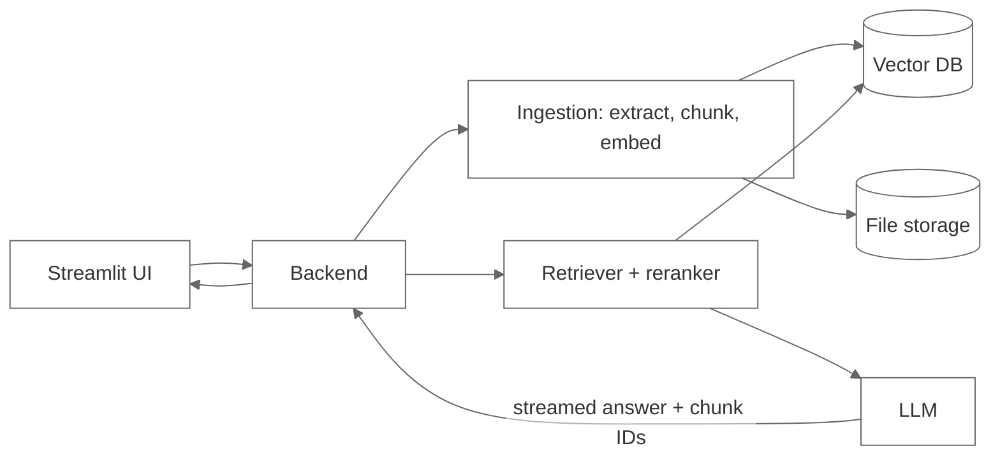
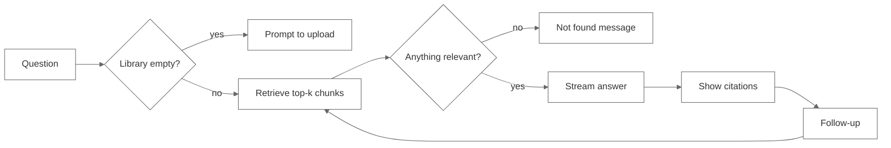
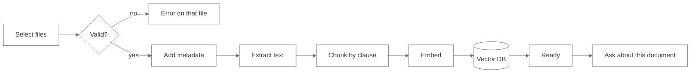
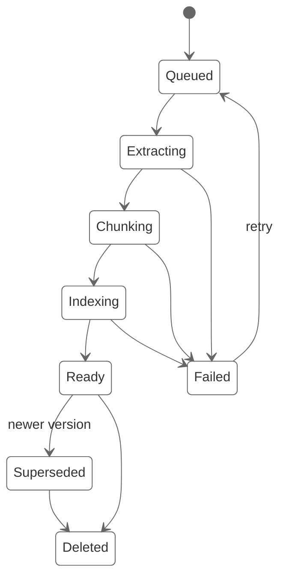

# ClauseCheck – User Flows

ClauseCheck lets procurement buyers ask questions about negotiated terms and get answers that point back to the exact clause in the contract. This doc covers the two flows we're building in Sprint 2:

1. Ask → stream → cite → follow-up
2. Upload → index

There are two kinds of users. Buyers ask questions before raising a PO or replying to a supplier. Contract admins upload and maintain the documents. In the demo build anyone can upload.

## Architecture

Upload goes through ingestion and ends up in the vector DB. Questions go through the retriever, which pulls chunks from the same store, and the LLM only sees those chunks.

## Flow 1: Ask → stream → cite → follow-up

### Steps

1. The buyer types a question, for example "What are the payment terms with Acme Supplies?" If a supplier name is recognised, we add it as a filter chip that the user can remove.
2. On submit, the question is embedded and we run a vector search (k around 6), filtered by supplier if one is set, then rerank.
3. If nothing clears the similarity threshold, we skip the LLM call and show "Couldn't find this in your contracts" with a couple of closely matching clause titles.
4. Otherwise we send the chunks to the LLM with instructions to answer only from them and cite each claim by chunk ID.
5. The answer streams in. A Stop button stays visible while it's generating.
6. Citation markers like [1] become clickable once the stream finishes. Clicking one opens a side panel with the document name, supplier, page, section heading and the clause text, with the matched part highlighted.
7. Follow-ups such as "Is there a late payment penalty?" get rewritten into a standalone query using the last few turns ("late payment penalty, Acme Supplies contract"). Retrieval then runs again with the same supplier filter.
8. Thumbs up/down is optional. We log the question, answer, cited chunk IDs and rating so we can use them for evaluation later.

### What a good answer looks like

The actual term comes in the first sentence ("Net 45 from invoice date"). Any number, date or percentage has a citation next to it. If two documents disagree, for example an MSA saying Net 30 and a later amendment saying Net 45, the answer shows both and says which one is more recent. If the context doesn't cover the question, the answer says so instead of guessing.

### Things that can go wrong

- **Empty library:** we block the question and link to upload.
- **Two suppliers with similar names:** we ask which one the user meant before searching.
- **Stream drops or times out:** we keep the partial answer, mark it as incomplete, and offer Retry.
- **User hits Stop:** we keep what was generated and only show citations for that text.
- **Model cites a chunk ID we never retrieved:** we drop the marker and log it.
- **Cited document has been replaced by a newer version:** the citation panel shows a "superseded" note.
- **Follow-up is about something unrelated:** we treat it as a new question and clear the supplier filter.

### Done when

- First token shows up in about 2 seconds on the demo data
- Every number or date in an answer has a citation
- Clicking a citation shows the right clause and page
- Questions the contracts don't cover get the not-found message, not a made-up answer
- Follow-ups with "it" or "that supplier" resolve correctly in at least 4 of 5 test cases
- Stop and Retry both work mid-stream

## Flow 2: Upload → index

### Steps

1. The admin opens Library → Upload. We accept PDF, DOCX and TXT, up to 20 MB per file and 10 files per batch.
2. For each file we check the type and size and hash it to catch duplicates.
3. Metadata: supplier, document type (MSA, SOW, pricing agreement, amendment, compliance doc) and effective date. We try to pull these from the first page, but the user can edit them. Supplier and type are required.
4. On "Upload & index", each file becomes its own job, so one bad file doesn't block the rest.
5. We extract text page by page and fall back to OCR for scanned PDFs.
6. Chunking splits on clause headings like "7. Payment Terms". When a document has no clear headings, we fall back to roughly 500-token windows with some overlap. Each chunk keeps doc_id, supplier, doc_type, page, section and effective_date.
7. Chunks are embedded in batches and upserted into the vector DB.
8. The document is marked Ready with a clause count, and an "Ask about this document" link opens Flow 1 with the filter already set.

### Document states

### Things that can go wrong

- **Wrong file type or too big:** we reject just that file and give the reason.
- **Exact duplicate:** we skip it and link to the copy that's already in the library.
- **Same supplier and doc type with a newer effective date:** we ask whether to replace the old one or keep both. The old one becomes Superseded. It can still be cited, but it's flagged.
- **Scanned PDF with poor OCR:** we index what we can and warn that answers from this file may be incomplete.
- **Password-protected PDF:** we mark it Failed with that reason.
- **Embedding or DB error halfway through:** we remove any chunks already written for that doc, mark it Failed and show Retry.
- **User closes the tab:** the job keeps running and the status is there when they come back.
- **Delete:** removes the file and all of its vectors, after a confirmation.

### Done when

- A 20-page text PDF reaches Ready in under a minute
- Every chunk has doc_id, supplier, doc_type, page and section
- Duplicates aren't indexed twice
- A failed upload leaves no partial vectors behind
- A document is searchable as soon as it's Ready
- Deleted documents stop showing up in answers

## How the two flows connect

After indexing, "Ask about this document" takes you into Flow 1. From Flow 1, the empty-library and not-found states point back to upload. The metadata saved during indexing is what drives the citation panel and the supplier filter, so if chunking or metadata goes wrong, citations will too.

## Still to decide

- Upload access: admins only, or anyone in the demo?
- When clauses conflict, do we always show both, or lead with the newest?
- How many past turns to use when rewriting follow-ups (3 or 5)?
- The not-found threshold, which we'll tune once the eval set is ready
